# Minimal production target architecture

Status: design with a working first paper slice. The implementation boundary and remaining blockers are explicit in `production_architecture_audit.md`.

One native C++20 trading process owns the decision-to-accounting lifecycle. Strategy plugins share one ingestion/state owner, one portfolio authority and one OMS. Separate control, reconciliation and telemetry services may be isolated by process when needed, but do not own duplicate trading state. No Kubernetes, Kafka or new distributed infrastructure is required.

```mermaid
flowchart LR
    Feed[Venue feed adapters / recorded feed] --> Decode[Existing Decode normalizers]
    Decode --> State[MarketStateStore + venue-qualified adapters]
    State --> Supervisor[Trading runtime / strategy supervisor]
    Artifacts[Frozen approved rules and config] --> Supervisor
    Supervisor --> Plugins[MM / combinatorial / cross-venue plugins]
    Plugins --> Decision[Existing decision interfaces]
    Decision --> Risk[Global portfolio risk authority]
    Ledger[Existing account ledgers] --> Risk
    Risk --> OMS[Existing ExecutionGateway + maker lifecycle extensions]
    OMS --> Adapter[Paper adapter; future exchange adapter gated off]
    Adapter --> Reports[Authoritative order / fill events]
    Reports --> OMS
    Reports --> Ledger
    Journal[Durable append-only journal] --- Supervisor
    Journal --- OMS
    Journal --- Ledger
    Reconcile[Independent private-account reconciliation] --> Reports
    State --> Read[Bounded read models]
    OMS --> Read
    Risk --> Read
    Ledger --> Read
    Read --> Backend[Existing read-only paper backend]
    Backend --> UI[Existing dashboard operations view]
```

## Ownership and interfaces

1. **Trading runtime and supervisor:** single writer for event ordering, plugin startup/stop, configuration epoch, logical input sequence and recovery barriers. Plugin callbacks are synchronous; borrowed book/evidence views never escape the callback. Persist intent and submit authorization before an adapter side effect. Supervisor stop blocks new exposure. Stopping is not proof that an external order is canceled.
2. **Market data/state:** retain `RawPacket`, Decode provenance, `MarketStateStore` and `MarketDepthView`. Adapt the existing cross-venue sequence-aware store behind the same venue-qualified read interface, rather than merge away its SID/sequence/as-of safeguards. One owner per `(venue, market, asset)`; other views derive from that owner. Disconnect/schema failure clears admission; new snapshots, sequence integrity, freshness and tradability must pass before strategies regain admission.
3. **Plugins:** retain MM `QuoteIntent`/`CancelQuoteIntent`, combinatorial `OpportunityIntent` + `OrderDecision`, and cross-venue approved pair/payoff proof. Target a discriminated request envelope referencing those existing payloads, strategy ID, rule/config epoch and native idempotency ID. Strategy owns its decision model; it cannot reserve funds, mutate accounting or call adapters. The implemented `StrategyPlugin` currently exposes combinatorial intents only. Maker and pair request variants are a migration gate, not falsely available plugins.
4. **Global Portfolio Risk Authority:** extend existing `RiskEngine`, quote evaluator and reservation ledgers behind one admission owner. Maintain venue/account/settlement-asset wallets; include filled positions, pending fills, open orders, unknown outcomes, fees and collateral haircut. Reserve all legs atomically before OMS handoff. Sell inventory, quote replacements and cancel-pending quantities stay encumbered until authoritative events. The new slice uses existing guards with its canonical paper ledger and permits only one atomic in-flight plan.
5. **OMS/EMS:** retain `ExecutionGateway`, planner, child/client IDs, state machines, fill tracker and adapters. Add typed maker/pair handling here; move tool-local quote lifecycle under it. A pair coordinator coordinates OMS children and cannot become another order store. States must distinguish Prepared, SubmitPending, AckUnknown, acknowledged/Open, Partial, CancelPending and authoritative terminal outcomes. Venue receipt and local timeout are separate events. Existing gateway's pre-ack preparation and local-only `poll` are specifically not the final target.
6. **Accounting and reconciliation:** retain `PaperLedger`/`PositionLedger` and separate mark/PnL projections. One journaled delta per unique own fill ID; cash postings and fees are independently verifiable. Extend multi-account composition already present in `TwoAccountPaperLedger`. Separate private-account reconciliation reads authoritative order, fill, position, balance, collateral and settlement snapshots, checks source/as-of identity, journals discrepancies and can freeze risk. It must never directly invent a fill, cancellation or settlement. Chain hints supplement that service but do not replace it.
7. **Journals:** one ordered append-only event/order stream is sufficient initially. Version records, freeze configuration/rule/input/code hashes, persist before submit and before acknowledging accounting. Handle torn writes and disk failure by stopping admission. Recovery replays a verified prefix, restores durable own receipts, and reconciles unknown tails without resend. Implemented POSIX journal uses a lock, SHA-256 chain and `fsync`; it detects corruption, not a malicious writer recomputing the entire chain. External head anchoring, compaction and recovery across software upgrades are future requirements.
8. **Operations/telemetry:** existing `DashboardSnapshot` is the read boundary. Atomic snapshots feed the existing file-backed backend and read-only dashboard. Include source freshness, book integrity, plugin lifecycle, order state, encumbrance, positions/balances, valuation/settlement distinctions, latency and incident source IDs. Telemetry cannot grant approvals or release reservations. Add a bounded asynchronous projection before pursuing low-latency operation; current synchronous durable publication deliberately exposes its cost.

## Modes and safety

| Mode | Current feed | Strategy/decision/risk | Execution and ledger |
|---|---|---|---|
| REPLAY | Frozen bounded JSONL or existing binary raw log | Same combinatorial plugin and risk entry | Existing PaperAtomic adapter and existing ledger; deterministic logical clock |
| PAPER | Frozen bounded recorded feed in this slice | Same interfaces | Same paper lifecycle; no exchange/private account side effects |
| SHADOW | Frozen bounded recorded feed in this slice | Same interfaces and reservation admission | Journal would-submit; release paper-only reservation; no adapter call or fill |
| LIVE | Unsupported and rejected | No startup | No reachable live transport in runtime binary |

PAPER is not yet a network market-data daemon. Network feed capture and private account reconciliation are explicit later milestones. Financial outputs from synthetic fixtures verify contracts, not strategy profitability. Existing estimated/terminal paper PnL is never labeled exchange-realized cash. `verified_live_realized_pnl` remains null.

## Recovery authority

Committed inputs are re-executed only inside the deterministic paper sandbox, without appending another set of fills or sending an external request. Both the recorded transaction trace digest and final account digest are verified. A committed stop remains latched. For incomplete input transactions, durable plan/report records restore known paper receipts; unresolved reservation cost remains an explicit recovery encumbrance and all admissions freeze. The tail is not automatically truncated, retried, expired or certified reconciled. The original journal and inputs remain the repair evidence.
