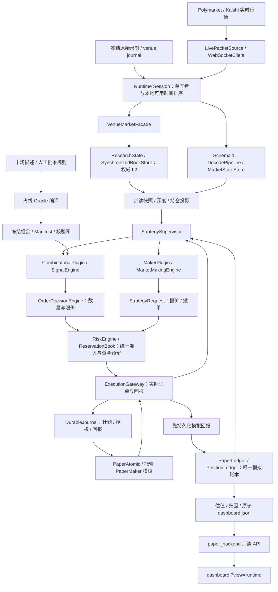

# Polytope 当前完整框架与逐文件职责

整理日期：2026-11-07（America/Chicago）。范围为当前工作区实际文件，包含未提交及未跟踪源码；不是仅按 Git 提交生成。通过源码、构建目标与现有文档交叉核对，未在本次启动采集、交易或重跑完整测试。

清理状态：同日已删除无效空测试和可重建 PMXT 事件，见[清理记录](cleanup_2026-11-07.zh-CN.md)。运行目录一节描述产物类型，不代表所有派生大文件仍保留；再次回放 PMXT 数据需先重建规范化事件。

后续清理：按用户要求，`runs/` 现在只保留 `cross_venue/` 和 `cross_venue_v0_20261101/`。本文其他 runs 目录说明作为历史架构索引；对应数据、报告和冻结发布均已删除，`research/runs/` 保留。

最终清理状态：顶层 `runs/` 已按用户最新要求全部清空，cross 系列也已删除。本文所述该目录中的产物均为历史说明；`research/runs/` 保留。

## 阅读约定

- 同目录同名 `.h` 与 `.cpp` 成对列出：前者声明类型/接口，后者提供实现；只有头文件时可能为内联实现、模板或接口。
- 测试、样本、运行 JSON/CSV/日志、构建产物、缓存与第三方库按目录/同类用途合并。第一方业务源码逐文件列出。
- `public` 放模块间契约，`core` 放流程组织，`tools` 放验证/运行器；这些是当前代码惯例，不代表严格隔离已经全部完成。
- 旧报告与新实现有差异时，以当前源码和 CMake 实际组装为准。特别是旧报告“runtime 还是骨架”和 V0.2.0“Maker 尚未接入”的表述已被后续 Schema 3 实现更新。

## 1. 系统定位和整体架构

这是以 Polymarket 为主要交易对象、同时研究 Kalshi 跨场所关系的 C++20 交易与 Python 研究系统。三条业务线共享基础设施：组合套利、通用做市、跨场所结算关系研究。前两者已在多策略 PAPER/SHADOW/REPLAY runtime 中衔接；跨场所 Pair 插件仍未集成。



图中展示职责关系；不是各节点各一个进程。`trading_engine` 与 `trading_runtime` 调用同一个 `runtime::run`。后端与 Vite 前端独立启动。Schema 1、Schema 2/3 的状态输入路径是按配置选择的，不在实时路径上同时维护两个盘口权威。

### 1.1 单次输入如何流过系统

1. Session 接收带原始来源/接收时间的包，分配本地 availability/decision 顺序；计时输入也能触发陈旧检查。
2. 解码和状态组件验证原生 snapshot/delta、序列、连接 epoch、时间、价格和数据质量；重连后重新建立可用盘口。
3. Supervisor 向策略提供不可变值投影，按配置优先级和实例 ID 调度。组合策略输出机会，再决定数量；Maker 输出期望报价/撤单。
4. 风控按实际数量、价格和费用检查共享现金、可卖库存、各层敞口、每策略预算及未完成订单承诺。
5. OMS 拥有实际订单，先记录授权/计划，再调用 paper 模拟。Maker 的期望状态不会直接删除实际订单。
6. 模拟回报持久化后，按唯一 receipt 入账；预留只按已确认的模拟生命周期释放。
7. 从账本和行情派生 PnL、策略归因、延迟与运维快照，后端和浏览器只读展示。

### 1.2 关键数据与权威边界

| 对象 | 所有者/生产者 | 主要消费者 |
|---|---|---|
| 原始包及来源 | Feed / LivePacketSource / 原始录制 | 解码、回放、审计 |
| 实时 L2 | ResearchState 中的 SynchronizedBookStore，经 VenueMarketFacade 读取 | 策略与风控 |
| Schema 1 标准市场状态 | MarketStateStore | 原有组合策略与回归 |
| 冻结结算约束与组合 | Oracle 离线编译 | Signal / OrderDecision |
| 期望报价 | MakerPlugin 内的 MarketMakingEngine | Supervisor |
| 实际订单和稳定 ID | ExecutionGateway | 风控、模拟、账本、恢复、运维 |
| 现金/库存预留 | RiskEngine / ReservationBook | 所有策略及 OMS |
| 模拟现金与持仓 | PaperLedger / PositionLedger | 风控只读投影、PnL、归因 |
| 持久化经济事件 | DurableJournal | 恢复与独立审计 |
| dashboard.json / UI 状态 | 派生读模型 | 只读 API 与前端 |

### 1.3 当前模式与边界

- Schema 1：保留录制输入的组合套利实验/回归语义。
- Schema 2：有界实时 PAPER/SHADOW 及 venue journal REPLAY，组合插件路径。
- Schema 3：多策略运行，组合套利与通用 Maker 共享风险、OMS、模拟账本和预算。
- PAPER：真实或录制行情+模拟执行。SHADOW：记录风控/拟提交计划，不调用成交适配。REPLAY：冻结输入上复现对应政策。
- LIVE 在统一 runtime 配置校验中被拒绝。仓库中已有 Live adapter/签名/传输研究代码，不等于统一入口已开放真实资金交易。
- `FuturePairRequest` 尚不受支持。跨场所市场相似不构成结算等价批准。
- 专用 UpDown5m/LeadLag 模型和独立运行器保留，但不能将其全部视为通用 MakerPlugin 已验证能力。
- 私有账户对账目前只有接口边界，没有认证场所实现。模拟收益与奖励估计不等于交易所已实现现金。

## 2. 顶层目录

| 路径 | 职责 |
|---|---|
| `engine/` | 行情、市场状态、策略、风险、OMS、模拟账本与 runtime |
| `oracle/` | 离线规则提取/批准、约束、可行状态、payoff、组合与产物 |
| `replay/` | LeadLag、跨场所 L2 回放及采集审计 |
| `research/` | Python 研究、数据采集、规则版本比较、历史回测 |
| `tools/` | 实际运行器、验证、性能探测与审计/冻结工具 |
| `apps/paper_backend/` | C++ 只读 HTTP/SSE 服务 |
| `frontend/dashboard/` | TypeScript/Vite 研究监控和运维 UI |
| `config/` | YAML 草案、不同 JSON schema 与策略实验配置 |
| `scripts/` | 特定 SOL/宏观实验启动与复分析脚本 |
| `tests/` | 模块测试、集成、回放、fuzz、性能及固定输入 |
| `docs/` | 设计、协议、报告与验证证据索引 |
| `runs/`、`research/runs/` | 分实验配置、冻结输入、日志、结果和报告 |
| `logs/` | 可读行情 JSONL 与二进制 raw 录制 |
| `build/` | CMake 构建缓存、目标、测试结果及本地验证产物 |
| `secp256k1/` | 第三方椭圆曲线密码库及其自带工具/测试/构建 |
| `.local/` | 本地 Python 环境与 secp256k1 辅助安装 |
| `.git/` | Git 元数据 |

### 根目录文件

| 文件 | 职责 |
|---|---|
| `CMakeLists.txt` | C++20 顶层构建：Boost/OpenSSL/Threads、各业务库、可执行入口和大量 CTest 注册；LTO/native arch 是显式开关 |
| `README.md` | 概览、构建方法与专题文档导航；pipeline 为简图，完整运行以本文及当前代码为准 |
| `.gitignore` | 本地文件与生成物的版本控制排除 |
| `.env.live` | 本地真实接口凭证/环境配置；本文不读取或记录其值 |
| `paper_backend.out` | 本地后端标准输出文件 |
| `paper_backend.pid` | 某次后端启动记录的 PID，不代表该进程目前仍存在 |

## 3. 第一方源码、配置与工具逐文件说明

以下每个小节对应一个实际目录。同名头/源合并列出；空实现、兼容层和占位文件单独标明。

### `engine/`

| 文件 | 功能 |
|---|---|
| [main.cpp](../engine/main.cpp) | trading_engine 命令行入口：解析 --config 与 --recover，调用统一 runtime::run。 |

### `engine/chain_confirm/`

链上成交确认与公开成交线索匹配。

| 文件 | 功能 |
|---|---|
| [CMakeLists.txt](../engine/chain_confirm/CMakeLists.txt) | 注册本目录业务库、依赖、工具和/或测试目标。 |
| [ChainConfirmConfig.cpp](../engine/chain_confirm/ChainConfirmConfig.cpp)、[ChainConfirmConfig.h](../engine/chain_confirm/ChainConfirmConfig.h) | 链上订阅、补拉与对账配置。 |
| [ChainConfirmMetrics.h](../engine/chain_confirm/ChainConfirmMetrics.h) | 链上确认与对账指标。 |
| [ClassifiedFillRecord.cpp](../engine/chain_confirm/ClassifiedFillRecord.cpp)、[ClassifiedFillRecord.h](../engine/chain_confirm/ClassifiedFillRecord.h) | 分类后的成交及匹配信息。 |
| [ConfirmedFill.cpp](../engine/chain_confirm/ConfirmedFill.cpp)、[ConfirmedFill.h](../engine/chain_confirm/ConfirmedFill.h) | 已确认链上成交记录。 |
| [ConfirmedFillStore.cpp](../engine/chain_confirm/ConfirmedFillStore.cpp)、[ConfirmedFillStore.h](../engine/chain_confirm/ConfirmedFillStore.h) | 确认成交存储及查询。 |
| [DirectionLabel.cpp](../engine/chain_confirm/DirectionLabel.cpp)、[DirectionLabel.h](../engine/chain_confirm/DirectionLabel.h) | 成交方向标签与映射。 |
| [EthLog.h](../engine/chain_confirm/EthLog.h) | Ethereum 日志及来源字段。 |
| [EthLogDecoder.cpp](../engine/chain_confirm/EthLogDecoder.cpp)、[EthLogDecoder.h](../engine/chain_confirm/EthLogDecoder.h) | 通用链上日志解码。 |
| [EthLogSubscription.h](../engine/chain_confirm/EthLogSubscription.h) | 链上日志订阅请求与过滤条件。 |
| [FillReconciler.cpp](../engine/chain_confirm/FillReconciler.cpp)、[FillReconciler.h](../engine/chain_confirm/FillReconciler.h) | 将公开成交线索与链上确认成交关联。 |
| [OrderFilledDecoder.cpp](../engine/chain_confirm/OrderFilledDecoder.cpp)、[OrderFilledDecoder.h](../engine/chain_confirm/OrderFilledDecoder.h) | 解析合约成交日志字段。 |
| [OrderFilledEvent.h](../engine/chain_confirm/OrderFilledEvent.h) | OrderFilled 原始事件契约。 |
| [PendingTradeHint.h](../engine/chain_confirm/PendingTradeHint.h) | 待链上确认的公开成交线索。 |
| [PendingTradeHintRing.cpp](../engine/chain_confirm/PendingTradeHintRing.cpp)、[PendingTradeHintRing.h](../engine/chain_confirm/PendingTradeHintRing.h) | 有界保存待匹配线索。 |
| [PolygonHttpBackfillClient.cpp](../engine/chain_confirm/PolygonHttpBackfillClient.cpp)、[PolygonHttpBackfillClient.h](../engine/chain_confirm/PolygonHttpBackfillClient.h) | 断流/缺块后的 HTTP 日志补拉。 |
| [PolygonWsLogClient.cpp](../engine/chain_confirm/PolygonWsLogClient.cpp)、[PolygonWsLogClient.h](../engine/chain_confirm/PolygonWsLogClient.h) | Polygon WebSocket 日志订阅。 |
| [ReconciliationResult.cpp](../engine/chain_confirm/ReconciliationResult.cpp)、[ReconciliationResult.h](../engine/chain_confirm/ReconciliationResult.h) | 成交匹配/对账的结果。 |

### `engine/common/`

模块之间的共同契约与数学工具。

| 文件 | 功能 |
|---|---|
| [Constants.h](../engine/common/Constants.h) | 公共常量。 |
| [ErrorCode.h](../engine/common/ErrorCode.h) | 公共错误码。 |
| [StrategyRequest.h](../engine/common/StrategyRequest.h) | 统一策略请求 variant，携带实例、模型、配置 epoch、输入版本与幂等身份；Pair 请求暂预留。 |
| [Time.h](../engine/common/Time.h) | 公共时间表示与时间工具。 |
| [Types.h](../engine/common/Types.h) | 所在模块的公共标识、枚举、数值或消息类型。 |

### `engine/common/math/`

| 文件 | 功能 |
|---|---|
| [BitmaskMath.h](../engine/common/math/BitmaskMath.h) | 状态与条件位掩码运算。 |
| [EdgeMath.h](../engine/common/math/EdgeMath.h) | 单位、总额和基点优势计算。 |
| [FixedPointMath.h](../engine/common/math/FixedPointMath.h) | 固定点价格、数量和金额运算。 |
| [FractionalVwap.h](../engine/common/math/FractionalVwap.h) | 微单位/分数量深度上的 VWAP 与成本计算。 |
| [RiskMath.h](../engine/common/math/RiskMath.h) | 风控共用限额/数值计算。 |
| [VwapMath.h](../engine/common/math/VwapMath.h) | 线性或前缀深度上的成交均价和可执行量计算。 |

### `engine/decision_fastpath/`

固定形状组合快速决策与通用路径对照。

| 文件 | 功能 |
|---|---|
| [CMakeLists.txt](../engine/decision_fastpath/CMakeLists.txt) | 注册本目录业务库、依赖、工具和/或测试目标。 |

### `engine/decision_fastpath/core/`

| 文件 | 功能 |
|---|---|
| [DifferentialVerifier.cpp](../engine/decision_fastpath/core/DifferentialVerifier.cpp)、[DifferentialVerifier.h](../engine/decision_fastpath/core/DifferentialVerifier.h) | 比较通用路径与快速路径的结果差异。 |
| [EventLocalDecisionPipeline.cpp](../engine/decision_fastpath/core/EventLocalDecisionPipeline.cpp)、[EventLocalDecisionPipeline.h](../engine/decision_fastpath/core/EventLocalDecisionPipeline.h) | 在局部事件上串联快速信号/决策/风控/执行计划。 |
| [FastPathGate.cpp](../engine/decision_fastpath/core/FastPathGate.cpp)、[FastPathGate.h](../engine/decision_fastpath/core/FastPathGate.h) | 决定快路径是否可启用及何时回退。 |

### `engine/decision_fastpath/kernel/`

| 文件 | 功能 |
|---|---|
| [FixedBuyBundleKernelScalar.cpp](../engine/decision_fastpath/kernel/FixedBuyBundleKernelScalar.cpp)、[FixedBuyBundleKernelScalar.h](../engine/decision_fastpath/kernel/FixedBuyBundleKernelScalar.h) | 固定全买组合的标量快速决策内核。 |
| [FixedShapeKernelSpec.cpp](../engine/decision_fastpath/kernel/FixedShapeKernelSpec.cpp)、[FixedShapeKernelSpec.h](../engine/decision_fastpath/kernel/FixedShapeKernelSpec.h) | 固定形状内核定义、哈希与注册表。 |

### `engine/decode/`

协议解码及统一事件；Kalshi 和 CLOB 的连续 L2 路径还有专用 normalizer。

| 文件 | 功能 |
|---|---|
| [CMakeLists.txt](../engine/decode/CMakeLists.txt) | 注册本目录业务库、依赖、工具和/或测试目标。 |
| [README.md](../engine/decode/README.md) | 本模块用法、设计边界与资料索引。 |

### `engine/decode/codecs/`

| 文件 | 功能 |
|---|---|
| [CodecRegistry.cpp](../engine/decode/codecs/CodecRegistry.cpp)、[CodecRegistry.h](../engine/decode/codecs/CodecRegistry.h) | 按 codec 类型查找解压实现。 |
| [GzipCodec.cpp](../engine/decode/codecs/GzipCodec.cpp)、[GzipCodec.h](../engine/decode/codecs/GzipCodec.h) | Gzip codec 声明；当前对应 cpp 为空，不能视为完整压缩支持。 |
| [Lz4Codec.cpp](../engine/decode/codecs/Lz4Codec.cpp)、[Lz4Codec.h](../engine/decode/codecs/Lz4Codec.h) | LZ4 codec 声明；当前对应 cpp 为空。 |
| [NoneCodec.cpp](../engine/decode/codecs/NoneCodec.cpp)、[NoneCodec.h](../engine/decode/codecs/NoneCodec.h) | 无压缩输入处理。 |
| [ZstdCodec.cpp](../engine/decode/codecs/ZstdCodec.cpp)、[ZstdCodec.h](../engine/decode/codecs/ZstdCodec.h) | Zstd codec 声明；当前对应 cpp 为空。 |

### `engine/decode/core/`

| 文件 | 功能 |
|---|---|
| [DecodeConfig.h](../engine/decode/core/DecodeConfig.h) | 解码容量、行为、来源等配置。 |
| [DecodeContext.h](../engine/decode/core/DecodeContext.h) | 单次解码所需上下文。 |
| [DecodePipeline.cpp](../engine/decode/core/DecodePipeline.cpp)、[DecodePipeline.h](../engine/decode/core/DecodePipeline.h) | codec、JSON、场所 parser、normalizer 和事件发布的主流水线。 |
| [DecodePipelineResult.h](../engine/decode/core/DecodePipelineResult.h) | 解码流水线的结果、事件计数和诊断。 |
| [DecodeWorker.cpp](../engine/decode/core/DecodeWorker.cpp)、[DecodeWorker.h](../engine/decode/core/DecodeWorker.h) | 单个解码工作单元及批量处理接口。 |

### `engine/decode/internal/`

| 文件 | 功能 |
|---|---|
| [DecodeAssert.h](../engine/decode/internal/DecodeAssert.h) | 内部不变量断言。 |
| [DecodeLimits.h](../engine/decode/internal/DecodeLimits.h) | 包、事件、盘口层数等容量上限。 |
| [DecodeScratchBuffer.h](../engine/decode/internal/DecodeScratchBuffer.h) | 复用解码临时缓冲，限制热路径分配。 |

### `engine/decode/json/`

| 文件 | 功能 |
|---|---|
| [JsonDecodeResult.h](../engine/decode/json/JsonDecodeResult.h) | JSON 解析状态及错误结果。 |
| [JsonDecoder.cpp](../engine/decode/json/JsonDecoder.cpp)、[JsonDecoder.h](../engine/decode/json/JsonDecoder.h) | JSON 解码及结构识别。 |
| [JsonFieldReader.h](../engine/decode/json/JsonFieldReader.h) | 按契约读取/校验 JSON 字段。 |
| [JsonView.h](../engine/decode/json/JsonView.h) | JSON 数据的只读视图。 |

### `engine/decode/metrics/`

| 文件 | 功能 |
|---|---|
| [DecodeCounters.h](../engine/decode/metrics/DecodeCounters.h) | 解码分类计数。 |
| [DecodeLatency.h](../engine/decode/metrics/DecodeLatency.h) | 解码耗时记录。 |
| [DecodeMetrics.cpp](../engine/decode/metrics/DecodeMetrics.cpp)、[DecodeMetrics.h](../engine/decode/metrics/DecodeMetrics.h) | 解码指标汇总。 |

### `engine/decode/normalize/`

| 文件 | 功能 |
|---|---|
| [EventNormalizer.cpp](../engine/decode/normalize/EventNormalizer.cpp)、[EventNormalizer.h](../engine/decode/normalize/EventNormalizer.h) | 事件级字段、类型与统一表示转换。 |
| [Normalizer.cpp](../engine/decode/normalize/Normalizer.cpp)、[Normalizer.h](../engine/decode/normalize/Normalizer.h) | 解析消息到统一事件的规范化接口/实现。 |
| [PriceScale.h](../engine/decode/normalize/PriceScale.h) | 价格刻度转换。 |
| [SideMapper.h](../engine/decode/normalize/SideMapper.h) | 买卖方向映射。 |
| [SizeScale.h](../engine/decode/normalize/SizeScale.h) | 数量刻度转换。 |
| [TimestampNormalizer.h](../engine/decode/normalize/TimestampNormalizer.h) | 时间单位与时间戳统一。 |

### `engine/decode/parser/`

| 文件 | 功能 |
|---|---|
| [ParsedVenueMessage.h](../engine/decode/parser/ParsedVenueMessage.h) | 尚未统一为标准事件的场所消息。 |
| [ParsedVenueMessageBatch.h](../engine/decode/parser/ParsedVenueMessageBatch.h) | 场所消息批容器。 |
| [ParserRegistry.cpp](../engine/decode/parser/ParserRegistry.cpp)、[ParserRegistry.h](../engine/decode/parser/ParserRegistry.h) | 注册和选择场所协议解析器。 |

### `engine/decode/parser/kalshi/`

| 文件 | 功能 |
|---|---|
| [KalshiBookNormalizer.cpp](../engine/decode/parser/kalshi/KalshiBookNormalizer.cpp)、[KalshiBookNormalizer.h](../engine/decode/parser/kalshi/KalshiBookNormalizer.h) | Kalshi snapshot/delta、序列及盘口方向规范化。 |

### `engine/decode/parser/polymarket/`

| 文件 | 功能 |
|---|---|
| [CrossVenueClobNormalizer.cpp](../engine/decode/parser/polymarket/CrossVenueClobNormalizer.cpp)、[CrossVenueClobNormalizer.h](../engine/decode/parser/polymarket/CrossVenueClobNormalizer.h) | 供跨场所连续 L2 重建使用的 Polymarket CLOB 消息规范化。 |
| [PolymarketBookParser.h](../engine/decode/parser/polymarket/PolymarketBookParser.h) | 解析完整盘口快照。 |
| [PolymarketLifecycleParser.h](../engine/decode/parser/polymarket/PolymarketLifecycleParser.h) | 解析市场生命周期事件。 |
| [PolymarketParser.cpp](../engine/decode/parser/polymarket/PolymarketParser.cpp)、[PolymarketParser.h](../engine/decode/parser/polymarket/PolymarketParser.h) | Polymarket 消息类型分派和解析入口。 |
| [PolymarketPriceChangeParser.h](../engine/decode/parser/polymarket/PolymarketPriceChangeParser.h) | 解析逐资产价格/数量变化。 |
| [PolymarketStatusParser.h](../engine/decode/parser/polymarket/PolymarketStatusParser.h) | 解析状态/控制消息。 |
| [PolymarketTradeParser.h](../engine/decode/parser/polymarket/PolymarketTradeParser.h) | 解析公开成交消息。 |

### `engine/decode/public/`

| 文件 | 功能 |
|---|---|
| [DecodeError.h](../engine/decode/public/DecodeError.h) | 错误分类与诊断。 |
| [DecodeInputView.h](../engine/decode/public/DecodeInputView.h) | 借用原始负载与来源信息的输入视图。 |
| [DecodeResult.h](../engine/decode/public/DecodeResult.h) | 公开解码结果。 |
| [DecodeTypes.h](../engine/decode/public/DecodeTypes.h) | 解码共享枚举和类型。 |
| [ICodec.h](../engine/decode/public/ICodec.h) | 解压/无压缩处理接口。 |
| [IDecodePipeline.h](../engine/decode/public/IDecodePipeline.h) | 解码流水线接口。 |
| [IEventPublisher.h](../engine/decode/public/IEventPublisher.h) | 标准事件发布接口。 |
| [IExchangeParser.h](../engine/decode/public/IExchangeParser.h) | 场所解析接口。 |
| [INormalizer.h](../engine/decode/public/INormalizer.h) | 规范化接口。 |
| [NormalizedEvent.h](../engine/decode/public/NormalizedEvent.h) | 统一盘口、成交、控制与生命周期事件契约。 |
| [NormalizedEventBatch.h](../engine/decode/public/NormalizedEventBatch.h) | 标准事件批容器。 |

### `engine/decode/publish/`

| 文件 | 功能 |
|---|---|
| [EventPublisher.cpp](../engine/decode/publish/EventPublisher.cpp)、[EventPublisher.h](../engine/decode/publish/EventPublisher.h) | 标准事件发布实现。 |
| [EventRingPublisher.h](../engine/decode/publish/EventRingPublisher.h) | 向环形缓冲发布事件。 |
| [NullEventPublisher.h](../engine/decode/publish/NullEventPublisher.h) | 丢弃事件的空发布器。 |

### `engine/decode/replay/`

| 文件 | 功能 |
|---|---|
| [DecodeHash.h](../engine/decode/replay/DecodeHash.h) | 规范化事件的确定性哈希。 |
| [DecodeReplayRunner.cpp](../engine/decode/replay/DecodeReplayRunner.cpp)、[DecodeReplayRunner.h](../engine/decode/replay/DecodeReplayRunner.h) | 固定输入重放与解码确定性检查。 |
| [DecodeTraceWriter.h](../engine/decode/replay/DecodeTraceWriter.h) | 写出解码追踪证据。 |

### `engine/execution/`

实际订单/计划状态、提交适配、回报与撤换。

| 文件 | 功能 |
|---|---|
| [CMakeLists.txt](../engine/execution/CMakeLists.txt) | 注册本目录业务库、依赖、工具和/或测试目标。 |
| [FillTracker.cpp](../engine/execution/FillTracker.cpp) | 早期骨架/空命名空间；当前业务实现位于该模块 core/ 或其他实际源文件。 |
| [IExecutionAdapter.h](../engine/execution/IExecutionAdapter.h) | 订单提交/撤销/结果等执行适配接口。 |
| [LiveExecution.cpp](../engine/execution/LiveExecution.cpp) | 早期骨架/空命名空间；当前业务实现位于该模块 core/ 或其他实际源文件。 |
| [OrderStateMachine.cpp](../engine/execution/OrderStateMachine.cpp) | 早期骨架/空命名空间；当前业务实现位于该模块 core/ 或其他实际源文件。 |
| [PaperExecution.cpp](../engine/execution/PaperExecution.cpp) | 早期骨架/空命名空间；当前业务实现位于该模块 core/ 或其他实际源文件。 |
| [SandboxExecution.cpp](../engine/execution/SandboxExecution.cpp) | 早期骨架/空命名空间；当前业务实现位于该模块 core/ 或其他实际源文件。 |

### `engine/execution/adapter/`

| 文件 | 功能 |
|---|---|
| [CrossVenueShadowAdapter.h](../engine/execution/adapter/CrossVenueShadowAdapter.h) | 跨场所只记录计划而不真实下单的研究适配。 |
| [IExecutionAdapter.h](../engine/execution/adapter/IExecutionAdapter.h) | 订单提交/撤销/结果等执行适配接口。 |
| [LiveExecutionAdapter.cpp](../engine/execution/adapter/LiveExecutionAdapter.cpp)、[LiveExecutionAdapter.h](../engine/execution/adapter/LiveExecutionAdapter.h) | 已有真实订单执行适配器；统一 runtime 不开放 LIVE。 |
| [LiveMakerExecutionAdapter.cpp](../engine/execution/adapter/LiveMakerExecutionAdapter.cpp)、[LiveMakerExecutionAdapter.h](../engine/execution/adapter/LiveMakerExecutionAdapter.h) | 已有真实 Maker 报价执行适配；与当前 paper runtime 分离。 |
| [LiveOrderBridge.h](../engine/execution/adapter/LiveOrderBridge.h) | 签名器、传输与真实订单请求/响应桥接契约。 |
| [PaperExecutionAdapter.cpp](../engine/execution/adapter/PaperExecutionAdapter.cpp)、[PaperExecutionAdapter.h](../engine/execution/adapter/PaperExecutionAdapter.h) | 模拟组合订单执行，支持原子/顺序策略。 |
| [PaperMakerExecutionAdapter.cpp](../engine/execution/adapter/PaperMakerExecutionAdapter.cpp)、[PaperMakerExecutionAdapter.h](../engine/execution/adapter/PaperMakerExecutionAdapter.h) | 传统报价模拟适配及统一 OMS 使用的托管模拟接口；统一路径不另建真实订单所有者。 |
| [PaperMakerFillModel.cpp](../engine/execution/adapter/PaperMakerFillModel.cpp)、[PaperMakerFillModel.h](../engine/execution/adapter/PaperMakerFillModel.h) | 根据成交穿价/盘口等证据模拟 Maker 成交。 |
| [PolymarketLiveOrderTransport.cpp](../engine/execution/adapter/PolymarketLiveOrderTransport.cpp) | Polymarket 真实订单的 HTTP/TLS 传输实现。 |
| [SandboxExecutionAdapter.cpp](../engine/execution/adapter/SandboxExecutionAdapter.cpp)、[SandboxExecutionAdapter.h](../engine/execution/adapter/SandboxExecutionAdapter.h) | 沙箱执行适配。 |

### `engine/execution/cancel/`

| 文件 | 功能 |
|---|---|
| [CancelManager.cpp](../engine/execution/cancel/CancelManager.cpp)、[CancelManager.h](../engine/execution/cancel/CancelManager.h) | 根据订单状态组织撤单。 |

### `engine/execution/core/`

| 文件 | 功能 |
|---|---|
| [ExecutionContext.h](../engine/execution/core/ExecutionContext.h) | 执行上下文。 |
| [ExecutionGateway.cpp](../engine/execution/core/ExecutionGateway.cpp)、[ExecutionGateway.h](../engine/execution/core/ExecutionGateway.h) | 统一实际订单与执行计划所有者；组织 prepare、提交、回报、Maker 生命周期及资源处置。 |
| [ExecutionPlanStore.h](../engine/execution/core/ExecutionPlanStore.h) | 执行计划登记与查询。 |
| [ExecutionScratch.h](../engine/execution/core/ExecutionScratch.h) | 执行临时空间。 |
| [ExecutionWorkflow.cpp](../engine/execution/core/ExecutionWorkflow.cpp)、[ExecutionWorkflow.h](../engine/execution/core/ExecutionWorkflow.h) | 执行验证工作流。 |
| [MakerLifecycle.cpp](../engine/execution/core/MakerLifecycle.cpp) | ExecutionGateway 的托管 Maker 订单实现：状态、回报、撤换、幂等和恢复。 |

### `engine/execution/metrics/`

| 文件 | 功能 |
|---|---|
| [ExecutionMetrics.cpp](../engine/execution/metrics/ExecutionMetrics.cpp)、[ExecutionMetrics.h](../engine/execution/metrics/ExecutionMetrics.h) | 执行计数和延迟统计。 |

### `engine/execution/plan/`

| 文件 | 功能 |
|---|---|
| [ExecutionPlanner.cpp](../engine/execution/plan/ExecutionPlanner.cpp)、[ExecutionPlanner.h](../engine/execution/plan/ExecutionPlanner.h) | 从获批意图/决策生成订单执行计划。 |
| [OrderBuilder.cpp](../engine/execution/plan/OrderBuilder.cpp)、[OrderBuilder.h](../engine/execution/plan/OrderBuilder.h) | 构造子订单和稳定的客户端订单 ID。 |
| [PlanValidator.cpp](../engine/execution/plan/PlanValidator.cpp)、[PlanValidator.h](../engine/execution/plan/PlanValidator.h) | 验证计划、限价、有效期和风险批准关系。 |

### `engine/execution/public/`

| 文件 | 功能 |
|---|---|
| [ChildOrder.h](../engine/execution/public/ChildOrder.h) | 执行计划中的单腿订单。 |
| [ExecutionConfig.h](../engine/execution/public/ExecutionConfig.h) | 执行模式、时效和部分成交等配置。 |
| [ExecutionReport.h](../engine/execution/public/ExecutionReport.h) | 成交及生命周期回报。 |
| [ExecutionResult.h](../engine/execution/public/ExecutionResult.h) | 提交/执行结果。 |
| [ExecutionTypes.cpp](../engine/execution/public/ExecutionTypes.cpp)、[ExecutionTypes.h](../engine/execution/public/ExecutionTypes.h) | 订单、执行模式和状态等公共类型。 |
| [MakerExecutionTypes.cpp](../engine/execution/public/MakerExecutionTypes.cpp)、[MakerExecutionTypes.h](../engine/execution/public/MakerExecutionTypes.h) | 传统 Maker 执行请求/回报及模拟相关公共类型。 |
| [MakerOrder.h](../engine/execution/public/MakerOrder.h) | 统一 OMS Maker 订单、模拟回报、撤换政策与序列化契约。 |
| [OrderPlan.h](../engine/execution/public/OrderPlan.h) | 多腿执行计划及状态。 |
| [ReservationDisposition.h](../engine/execution/public/ReservationDisposition.h) | 执行后消耗/释放预留资源的指令。 |

### `engine/execution/publish/`

| 文件 | 功能 |
|---|---|
| [CapturingExecutionPublisher.h](../engine/execution/publish/CapturingExecutionPublisher.h) | 内存捕获执行回报。 |
| [ExecutionReportPublisher.h](../engine/execution/publish/ExecutionReportPublisher.h) | 执行回报发布接口。 |
| [HashOnlyExecutionPublisher.cpp](../engine/execution/publish/HashOnlyExecutionPublisher.cpp)、[HashOnlyExecutionPublisher.h](../engine/execution/publish/HashOnlyExecutionPublisher.h) | 执行结果低开销哈希输出。 |
| [JsonlExecutionReportWriter.h](../engine/execution/publish/JsonlExecutionReportWriter.h) | 执行回报 JSONL 输出。 |
| [ReservationDispositionPublisher.h](../engine/execution/publish/ReservationDispositionPublisher.h) | 预留消耗/释放事件发布。 |

### `engine/execution/state/`

| 文件 | 功能 |
|---|---|
| [ActivePaperQuoteBook.cpp](../engine/execution/state/ActivePaperQuoteBook.cpp)、[ActivePaperQuoteBook.h](../engine/execution/state/ActivePaperQuoteBook.h) | 旧 Maker 模拟路径的活跃报价簿；统一托管路径不以其作为第二个订单账本。 |
| [FillTracker.cpp](../engine/execution/state/FillTracker.cpp)、[FillTracker.h](../engine/execution/state/FillTracker.h) | 跟踪去重后的成交、累计数量与均价。 |
| [OrderStateMachine.cpp](../engine/execution/state/OrderStateMachine.cpp)、[OrderStateMachine.h](../engine/execution/state/OrderStateMachine.h) | 单订单合法状态迁移。 |
| [PairExecutionStateMachine.cpp](../engine/execution/state/PairExecutionStateMachine.cpp)、[PairExecutionStateMachine.h](../engine/execution/state/PairExecutionStateMachine.h) | 跨场所双腿执行的状态/未对冲风险建模，尚非统一 Pair 插件。 |
| [PartialFillPolicy.cpp](../engine/execution/state/PartialFillPolicy.cpp)、[PartialFillPolicy.h](../engine/execution/state/PartialFillPolicy.h) | 部分成交后继续、撤销或需对冲的处理政策。 |
| [PlanStateMachine.cpp](../engine/execution/state/PlanStateMachine.cpp)、[PlanStateMachine.h](../engine/execution/state/PlanStateMachine.h) | 多腿计划的状态迁移。 |

### `engine/execution/synthetic/`

| 文件 | 功能 |
|---|---|
| [SyntheticCompleteSetExecutor.cpp](../engine/execution/synthetic/SyntheticCompleteSetExecutor.cpp)、[SyntheticCompleteSetExecutor.h](../engine/execution/synthetic/SyntheticCompleteSetExecutor.h) | 完整套 YES/NO 合成组合的执行支持。 |

### `engine/execution/tools/`

| 文件 | 功能 |
|---|---|
| [verify_execution_workflow.cpp](../engine/execution/tools/verify_execution_workflow.cpp) | Execution 模块工作流验证入口。 |

### `engine/feed/`

原始行情、传输、完整性、录制与兼容入口。

| 文件 | 功能 |
|---|---|
| [README.md](../engine/feed/README.md) | 本模块用法、设计边界与资料索引。 |
| [RealtimeFeedEngine.cpp](../engine/feed/RealtimeFeedEngine.cpp)、[RealtimeFeedEngine.h](../engine/feed/RealtimeFeedEngine.h) | 组织原始行情接收、录制、解码适配、完整性检查和健康发布。 |

### `engine/feed/decode/`

| 文件 | 功能 |
|---|---|
| [DecodeInputAdapter.h](../engine/feed/decode/DecodeInputAdapter.h) | RawPacket 到独立 Decode 输入接口的适配。 |
| [EventNormalizer.cpp](../engine/feed/decode/EventNormalizer.cpp)、[EventNormalizer.h](../engine/feed/decode/EventNormalizer.h) | 旧 Feed 路径兼容头/编译单元；真正实现转至独立 engine/decode 对应模块。 |
| [JsonDecoder.cpp](../engine/feed/decode/JsonDecoder.cpp)、[JsonDecoder.h](../engine/feed/decode/JsonDecoder.h) | 旧 Feed 路径兼容头/编译单元；真正实现转至独立 engine/decode 对应模块。 |
| [NormalizedEvent.h](../engine/feed/decode/NormalizedEvent.h) | 旧 Feed 路径兼容头/编译单元；真正实现转至独立 engine/decode 对应模块。 |

### `engine/feed/integrity/`

| 文件 | 功能 |
|---|---|
| [ConsistencyChecker.cpp](../engine/feed/integrity/ConsistencyChecker.cpp)、[ConsistencyChecker.h](../engine/feed/integrity/ConsistencyChecker.h) | 检查来源/序列及状态一致性。 |
| [RecoveryController.cpp](../engine/feed/integrity/RecoveryController.cpp)、[RecoveryController.h](../engine/feed/integrity/RecoveryController.h) | 根据异常组织恢复和重新同步。 |
| [StaleDetector.cpp](../engine/feed/integrity/StaleDetector.cpp)、[StaleDetector.h](../engine/feed/integrity/StaleDetector.h) | 检测输入/状态是否超时陈旧。 |

### `engine/feed/output/`

| 文件 | 功能 |
|---|---|
| [EventBus.cpp](../engine/feed/output/EventBus.cpp)、[EventBus.h](../engine/feed/output/EventBus.h) | 行情事件分发。 |
| [HealthPublisher.cpp](../engine/feed/output/HealthPublisher.cpp)、[HealthPublisher.h](../engine/feed/output/HealthPublisher.h) | 发布行情健康状态。 |
| [ReplayRunner.cpp](../engine/feed/output/ReplayRunner.cpp)、[ReplayRunner.h](../engine/feed/output/ReplayRunner.h) | 按原始录制顺序驱动离线回放。 |

### `engine/feed/raw_ingest/`

| 文件 | 功能 |
|---|---|
| [RawLogReader.cpp](../engine/feed/raw_ingest/RawLogReader.cpp)、[RawLogReader.h](../engine/feed/raw_ingest/RawLogReader.h) | 读取二进制原始日志并检查格式/长度/完整性。 |
| [RawLogWriter.cpp](../engine/feed/raw_ingest/RawLogWriter.cpp)、[RawLogWriter.h](../engine/feed/raw_ingest/RawLogWriter.h) | 写入可供确定性回放的二进制原始日志。 |
| [RawPacket.cpp](../engine/feed/raw_ingest/RawPacket.cpp)、[RawPacket.h](../engine/feed/raw_ingest/RawPacket.h) | 原始包及来源、连接、收包时间、压缩/安全标记等元数据契约。 |

### `engine/feed/source_runtime/`

| 文件 | 功能 |
|---|---|
| [CrossVenueLiveCapture.cpp](../engine/feed/source_runtime/CrossVenueLiveCapture.cpp) | 跨场所实时采集编排、订阅及原始证据记录。 |
| [CrossVenuePublicData.cpp](../engine/feed/source_runtime/CrossVenuePublicData.cpp) | 研究采集使用的公共 HTTP 访问、原始记录与相关数据工具。 |
| [HeartbeatController.cpp](../engine/feed/source_runtime/HeartbeatController.cpp)、[HeartbeatController.h](../engine/feed/source_runtime/HeartbeatController.h) | 心跳与连接活性判定。 |
| [ReconnectController.cpp](../engine/feed/source_runtime/ReconnectController.cpp)、[ReconnectController.h](../engine/feed/source_runtime/ReconnectController.h) | 重连状态及退避策略。 |
| [WebSocketClient.cpp](../engine/feed/source_runtime/WebSocketClient.cpp)、[WebSocketClient.h](../engine/feed/source_runtime/WebSocketClient.h) | WebSocket/TLS 连接、收包、订阅、断连与传输生命周期。 |

### `engine/feed/state/`

| 文件 | 功能 |
|---|---|
| [EntityStateStore.cpp](../engine/feed/state/EntityStateStore.cpp)、[EntityStateStore.h](../engine/feed/state/EntityStateStore.h) | 早期 Feed 状态兼容接口/编译单元，引用独立 State 组件。 |
| [StateHasher.cpp](../engine/feed/state/StateHasher.cpp)、[StateHasher.h](../engine/feed/state/StateHasher.h) | 早期 Feed 状态兼容接口/编译单元，引用独立 State 组件。 |

### `engine/memory/`

有界缓冲与对象池等基础组件。

| 文件 | 功能 |
|---|---|
| [Alignment.h](../engine/memory/Alignment.h) | 内存对齐工具。 |
| [FixedPool.h](../engine/memory/FixedPool.h) | 固定容量对象池。 |
| [RingBuffer.h](../engine/memory/RingBuffer.h) | 有界环形缓冲组件。 |
| [SlabAllocator.cpp](../engine/memory/SlabAllocator.cpp) | 早期骨架/空命名空间；当前业务实现位于该模块 core/ 或其他实际源文件。 |

### `engine/metrics/`

早期全局指标占位；当前实际指标分散于业务模块和 runtime。

| 文件 | 功能 |
|---|---|
| [EventCounter.cpp](../engine/metrics/EventCounter.cpp) | 早期骨架/空命名空间；当前业务实现位于该模块 core/ 或其他实际源文件。 |
| [LatencyHistogram.cpp](../engine/metrics/LatencyHistogram.cpp) | 早期骨架/空命名空间；当前业务实现位于该模块 core/ 或其他实际源文件。 |
| [Metrics.cpp](../engine/metrics/Metrics.cpp) | 早期骨架/空命名空间；当前业务实现位于该模块 core/ 或其他实际源文件。 |

### `engine/order_decision/`

将机会变为实际数量、深度成本和限价决策。

| 文件 | 功能 |
|---|---|
| [CMakeLists.txt](../engine/order_decision/CMakeLists.txt) | 注册本目录业务库、依赖、工具和/或测试目标。 |

### `engine/order_decision/core/`

| 文件 | 功能 |
|---|---|
| [FastFixedShapeOrderDecisionImpl.cpp](../engine/order_decision/core/FastFixedShapeOrderDecisionImpl.cpp)、[FastFixedShapeOrderDecisionImpl.h](../engine/order_decision/core/FastFixedShapeOrderDecisionImpl.h) | 固定形状组合的优化决策实现。 |
| [GenericOrderDecisionImpl.cpp](../engine/order_decision/core/GenericOrderDecisionImpl.cpp)、[GenericOrderDecisionImpl.h](../engine/order_decision/core/GenericOrderDecisionImpl.h) | 通用组合规模与价格决策实现。 |
| [OrderDecisionCache.cpp](../engine/order_decision/core/OrderDecisionCache.cpp)、[OrderDecisionCache.h](../engine/order_decision/core/OrderDecisionCache.h) | 缓存可复用的订单决策中间结果。 |
| [OrderDecisionEngine.cpp](../engine/order_decision/core/OrderDecisionEngine.cpp)、[OrderDecisionEngine.h](../engine/order_decision/core/OrderDecisionEngine.h) | 将机会和深度转成实际组合数量、各腿限价与决策结果。 |
| [OrderDecisionWorkflow.h](../engine/order_decision/core/OrderDecisionWorkflow.h) | 订单决策验证工作流结果契约。 |

### `engine/order_decision/limits/`

| 文件 | 功能 |
|---|---|
| [LimitPriceBuilder.cpp](../engine/order_decision/limits/LimitPriceBuilder.cpp)、[LimitPriceBuilder.h](../engine/order_decision/limits/LimitPriceBuilder.h) | 从成交成本和价格保护构造各腿限价。 |
| [PriceProtection.h](../engine/order_decision/limits/PriceProtection.h) | 价格保护约束。 |

### `engine/order_decision/math/`

| 文件 | 功能 |
|---|---|
| [CostCurve.cpp](../engine/order_decision/math/CostCurve.cpp)、[CostCurve.h](../engine/order_decision/math/CostCurve.h) | 数量到累计成本的曲线。 |
| [DiscreteOptimizer.h](../engine/order_decision/math/DiscreteOptimizer.h) | 在离散候选数量上选择可行最优解。 |
| [EdgeCurve.h](../engine/order_decision/math/EdgeCurve.h) | 数量到净优势的曲线。 |
| [OrderDecisionMath.h](../engine/order_decision/math/OrderDecisionMath.h) | 决策共用数学辅助。 |
| [PrefixVwap.cpp](../engine/order_decision/math/PrefixVwap.cpp)、[PrefixVwap.h](../engine/order_decision/math/PrefixVwap.h) | 前缀深度上的均价/成本查询。 |

### `engine/order_decision/public/`

| 文件 | 功能 |
|---|---|
| [ApprovedOrderDecisionEnvelope.h](../engine/order_decision/public/ApprovedOrderDecisionEnvelope.h) | 携带风控批准身份的决策封装。 |
| [OrderDecision.cpp](../engine/order_decision/public/OrderDecision.cpp)、[OrderDecision.h](../engine/order_decision/public/OrderDecision.h) | 具体组合规模、各腿数量和价格保护的决策。 |
| [OrderDecisionConfig.h](../engine/order_decision/public/OrderDecisionConfig.h) | 规模、边际优势和限价等决策参数。 |
| [OrderDecisionEvalStats.h](../engine/order_decision/public/OrderDecisionEvalStats.h) | 数量评估和优化统计。 |
| [OrderDecisionResult.h](../engine/order_decision/public/OrderDecisionResult.h) | 决策成功/拒绝及结果。 |
| [OrderDecisionStageTimings.h](../engine/order_decision/public/OrderDecisionStageTimings.h) | 分阶段耗时。 |
| [OrderDecisionTypes.h](../engine/order_decision/public/OrderDecisionTypes.h) | 订单决策共享类型。 |

### `engine/order_decision/sizing/`

| 文件 | 功能 |
|---|---|
| [BundleSizeOptimizer.cpp](../engine/order_decision/sizing/BundleSizeOptimizer.cpp)、[BundleSizeOptimizer.h](../engine/order_decision/sizing/BundleSizeOptimizer.h) | 在净优势和限制下选择组合数量。 |
| [CostCurveBuilder.cpp](../engine/order_decision/sizing/CostCurveBuilder.cpp)、[CostCurveBuilder.h](../engine/order_decision/sizing/CostCurveBuilder.h) | 从多腿深度建立成本曲线。 |
| [SizeCandidateEnumerator.cpp](../engine/order_decision/sizing/SizeCandidateEnumerator.cpp)、[SizeCandidateEnumerator.h](../engine/order_decision/sizing/SizeCandidateEnumerator.h) | 枚举盘口/限制决定的候选数量。 |

### `engine/order_decision/tools/`

| 文件 | 功能 |
|---|---|
| [OrderDecisionTools.cpp](../engine/order_decision/tools/OrderDecisionTools.cpp) | 订单决策验证工具的样本装载和结果输出。 |
| [verify_order_decision_workflow.cpp](../engine/order_decision/tools/verify_order_decision_workflow.cpp) | Order Decision 模块工作流验证入口。 |

### `engine/paper/`

模拟账户经济事实与持仓账本，以及派生估值/绩效/只读模型。

| 文件 | 功能 |
|---|---|
| [CMakeLists.txt](../engine/paper/CMakeLists.txt) | 注册本目录业务库、依赖、工具和/或测试目标。 |

### `engine/paper/core/`

| 文件 | 功能 |
|---|---|
| [PaperTradingEngine.cpp](../engine/paper/core/PaperTradingEngine.cpp)、[PaperTradingEngine.h](../engine/paper/core/PaperTradingEngine.h) | 接收执行事件并协调唯一模拟现金/持仓账本、估值和绩效。 |
| [PaperTradingWorkflow.cpp](../engine/paper/core/PaperTradingWorkflow.cpp)、[PaperTradingWorkflow.h](../engine/paper/core/PaperTradingWorkflow.h) | 模拟交易验证工作流。 |

### `engine/paper/ledger/`

| 文件 | 功能 |
|---|---|
| [CashLedger.h](../engine/paper/ledger/CashLedger.h) | 现金余额/变动相关类型或计算。 |
| [FillApplication.cpp](../engine/paper/ledger/FillApplication.cpp)、[FillApplication.h](../engine/paper/ledger/FillApplication.h) | 将普通成交准确应用到账本。 |
| [MakerFillApplication.cpp](../engine/paper/ledger/MakerFillApplication.cpp)、[MakerFillApplication.h](../engine/paper/ledger/MakerFillApplication.h) | 将 Maker 成交和费用应用到账本。 |
| [PaperEventAdapter.cpp](../engine/paper/ledger/PaperEventAdapter.cpp)、[PaperEventAdapter.h](../engine/paper/ledger/PaperEventAdapter.h) | 执行回报到模拟账户事件转换。 |
| [PaperLedger.cpp](../engine/paper/ledger/PaperLedger.cpp)、[PaperLedger.h](../engine/paper/ledger/PaperLedger.h) | 权威模拟现金、费用、成交幂等与持仓入账。 |
| [PositionLedger.cpp](../engine/paper/ledger/PositionLedger.cpp)、[PositionLedger.h](../engine/paper/ledger/PositionLedger.h) | 逐资产持仓、成本及实现收益核算。 |
| [TwoAccountPaperLedger.cpp](../engine/paper/ledger/TwoAccountPaperLedger.cpp)、[TwoAccountPaperLedger.h](../engine/paper/ledger/TwoAccountPaperLedger.h) | 跨场所研究中的两个账户模拟组合；统一 runtime 仍使用自己的 canonical 账本。 |

### `engine/paper/metrics/`

| 文件 | 功能 |
|---|---|
| [DrawdownCalculator.h](../engine/paper/metrics/DrawdownCalculator.h) | 最大回撤等计算。 |
| [MakerPerformanceMetrics.cpp](../engine/paper/metrics/MakerPerformanceMetrics.cpp)、[MakerPerformanceMetrics.h](../engine/paper/metrics/MakerPerformanceMetrics.h) | Maker 成交/报价绩效。 |
| [PerformanceMetricsEngine.cpp](../engine/paper/metrics/PerformanceMetricsEngine.cpp)、[PerformanceMetricsEngine.h](../engine/paper/metrics/PerformanceMetricsEngine.h) | 收益与交易绩效指标汇总。 |
| [RollingWindow.h](../engine/paper/metrics/RollingWindow.h) | 滑动窗口容器。 |
| [SharpeCalculator.h](../engine/paper/metrics/SharpeCalculator.h) | Sharpe 指标计算。 |

### `engine/paper/pnl/`

| 文件 | 功能 |
|---|---|
| [AdverseSelectionTracker.cpp](../engine/paper/pnl/AdverseSelectionTracker.cpp)、[AdverseSelectionTracker.h](../engine/paper/pnl/AdverseSelectionTracker.h) | 跟踪成交后的价格变化与不利选择。 |
| [EquityCurve.h](../engine/paper/pnl/EquityCurve.h) | 权益时间序列。 |
| [MakerPnLEngine.cpp](../engine/paper/pnl/MakerPnLEngine.cpp)、[MakerPnLEngine.h](../engine/paper/pnl/MakerPnLEngine.h) | Maker 成交收益与库存估值。 |
| [MakerPnLTypes.h](../engine/paper/pnl/MakerPnLTypes.h) | Maker PnL 拆分类型。 |
| [MarkPriceProvider.cpp](../engine/paper/pnl/MarkPriceProvider.cpp)、[MarkPriceProvider.h](../engine/paper/pnl/MarkPriceProvider.h) | 提供持仓估值使用的 mark。 |
| [PaperPnLEngine.cpp](../engine/paper/pnl/PaperPnLEngine.cpp)、[PaperPnLEngine.h](../engine/paper/pnl/PaperPnLEngine.h) | 组合实现/未实现收益及权益计算。 |
| [RewardPnLEngine.cpp](../engine/paper/pnl/RewardPnLEngine.cpp)、[RewardPnLEngine.h](../engine/paper/pnl/RewardPnLEngine.h) | 单独统计流动性奖励估计/收益。 |
| [RewardPnLTypes.h](../engine/paper/pnl/RewardPnLTypes.h) | 奖励收益类型。 |

### `engine/paper/portfolio/`

| 文件 | 功能 |
|---|---|
| [ExposureView.h](../engine/paper/portfolio/ExposureView.h) | 组合敞口只读投影。 |
| [PaperPortfolio.cpp](../engine/paper/portfolio/PaperPortfolio.cpp)、[PaperPortfolio.h](../engine/paper/portfolio/PaperPortfolio.h) | 组合持仓汇总及查询。 |
| [Position.h](../engine/paper/portfolio/Position.h) | 单资产持仓及成本表示。 |

### `engine/paper/public/`

| 文件 | 功能 |
|---|---|
| [PaperAccount.h](../engine/paper/public/PaperAccount.h) | 模拟账户余额契约。 |
| [PaperEvent.h](../engine/paper/public/PaperEvent.h) | 模拟账户事件。 |
| [PaperFill.h](../engine/paper/public/PaperFill.h) | 模拟成交及去重/经济身份字段。 |
| [PaperModule.cpp](../engine/paper/public/PaperModule.cpp)、[PaperModule.h](../engine/paper/public/PaperModule.h) | 模拟模块公共集成接口。 |
| [PaperPnL.h](../engine/paper/public/PaperPnL.h) | 公开收益快照类型。 |
| [PaperSnapshot.h](../engine/paper/public/PaperSnapshot.h) | 公开账户/组合快照。 |
| [PaperTypes.h](../engine/paper/public/PaperTypes.h) | 模拟交易公共类型。 |
| [PerformanceSnapshot.h](../engine/paper/public/PerformanceSnapshot.h) | 绩效快照。 |

### `engine/paper/read/`

| 文件 | 功能 |
|---|---|
| [DashboardReadStore.cpp](../engine/paper/read/DashboardReadStore.cpp)、[DashboardReadStore.h](../engine/paper/read/DashboardReadStore.h) | 仪表盘只读数据存储与快照组装。 |
| [PrivateAccountReconciliation.h](../engine/paper/read/PrivateAccountReconciliation.h) | 私有账户快照/只读对账边界；当前没有认证场所实现。 |
| [ReadModelPublisher.h](../engine/paper/read/ReadModelPublisher.h) | 派生只读模型发布接口。 |
| [RuntimeSnapshotRing.h](../engine/paper/read/RuntimeSnapshotRing.h) | 运行快照的有界缓存。 |

### `engine/paper/regime/`

| 文件 | 功能 |
|---|---|
| [RegimeEngine.cpp](../engine/paper/regime/RegimeEngine.cpp)、[RegimeEngine.h](../engine/paper/regime/RegimeEngine.h) | 汇总行情、质量、风险、执行等运行状态。 |
| [RegimeSnapshot.h](../engine/paper/regime/RegimeSnapshot.h) | 运行环境/状态分类快照。 |

### `engine/paper/tools/`

| 文件 | 功能 |
|---|---|
| [PaperTools.cpp](../engine/paper/tools/PaperTools.cpp)、[PaperTools.h](../engine/paper/tools/PaperTools.h) | 纸面交易验证工具辅助。 |
| [verify_market_making_pnl_workflow.cpp](../engine/paper/tools/verify_market_making_pnl_workflow.cpp) | Maker 成交到账本/PnL 归因的验证入口。 |
| [verify_paper_trading_workflow.cpp](../engine/paper/tools/verify_paper_trading_workflow.cpp) | 模拟账本和绩效完整流程验证入口。 |

### `engine/reward/`

流动性奖励配置、资格筛选与策略特征。

| 文件 | 功能 |
|---|---|
| [CMakeLists.txt](../engine/reward/CMakeLists.txt) | 注册本目录业务库、依赖、工具和/或测试目标。 |

### `engine/reward/client/`

| 文件 | 功能 |
|---|---|
| [PrivateRewardAccountClient.cpp](../engine/reward/client/PrivateRewardAccountClient.cpp)、[PrivateRewardAccountClient.h](../engine/reward/client/PrivateRewardAccountClient.h) | 私有奖励账户客户端边界/实现支持。 |
| [PublicRewardConfigClient.cpp](../engine/reward/client/PublicRewardConfigClient.cpp)、[PublicRewardConfigClient.h](../engine/reward/client/PublicRewardConfigClient.h) | 读取公共流动性奖励配置。 |

### `engine/reward/features/`

| 文件 | 功能 |
|---|---|
| [RewardMarketFeatureBuilder.cpp](../engine/reward/features/RewardMarketFeatureBuilder.cpp)、[RewardMarketFeatureBuilder.h](../engine/reward/features/RewardMarketFeatureBuilder.h) | 构造奖励资格/报价使用的特征。 |

### `engine/reward/filter/`

| 文件 | 功能 |
|---|---|
| [RewardMarketFilter.cpp](../engine/reward/filter/RewardMarketFilter.cpp)、[RewardMarketFilter.h](../engine/reward/filter/RewardMarketFilter.h) | 筛选奖励市场。 |

### `engine/reward/normalize/`

| 文件 | 功能 |
|---|---|
| [RewardMarketNormalizer.cpp](../engine/reward/normalize/RewardMarketNormalizer.cpp)、[RewardMarketNormalizer.h](../engine/reward/normalize/RewardMarketNormalizer.h) | 将外部奖励数据转换成统一结构。 |

### `engine/reward/public/`

| 文件 | 功能 |
|---|---|
| [RewardTypes.cpp](../engine/reward/public/RewardTypes.cpp)、[RewardTypes.h](../engine/reward/public/RewardTypes.h) | 奖励配置、市场、账户等类型。 |

### `engine/reward/store/`

| 文件 | 功能 |
|---|---|
| [RewardUniverseStore.cpp](../engine/reward/store/RewardUniverseStore.cpp)、[RewardUniverseStore.h](../engine/reward/store/RewardUniverseStore.h) | 奖励市场集合及索引。 |

### `engine/reward/tools/`

| 文件 | 功能 |
|---|---|
| [verify_reward_market_making_workflow.cpp](../engine/reward/tools/verify_reward_market_making_workflow.cpp) | 奖励约束、做市、风控与收益分离验证入口。 |

### `engine/risk/`

共享账户资金/库存/敞口准入、审批与预留。

| 文件 | 功能 |
|---|---|
| [CMakeLists.txt](../engine/risk/CMakeLists.txt) | 注册本目录业务库、依赖、工具和/或测试目标。 |
| [ExposureManager.cpp](../engine/risk/ExposureManager.cpp) | 早期骨架/空命名空间；当前业务实现位于该模块 core/ 或其他实际源文件。 |
| [FeeModel.cpp](../engine/risk/FeeModel.cpp) | 早期骨架/空命名空间；当前业务实现位于该模块 core/ 或其他实际源文件。 |
| [KillSwitch.cpp](../engine/risk/KillSwitch.cpp) | 早期骨架/空命名空间；当前业务实现位于该模块 core/ 或其他实际源文件。 |
| [RiskEngine.cpp](../engine/risk/RiskEngine.cpp) | 早期骨架/空命名空间；当前业务实现位于该模块 core/ 或其他实际源文件。 |
| [VWAPSimulator.cpp](../engine/risk/VWAPSimulator.cpp) | 早期骨架/空命名空间；当前业务实现位于该模块 core/ 或其他实际源文件。 |

### `engine/risk/core/`

| 文件 | 功能 |
|---|---|
| [PortfolioAdmission.cpp](../engine/risk/core/PortfolioAdmission.cpp) | 统一账户下按实际订单量/价/费用检查现金、库存、敞口和策略预算。 |
| [RiskContext.h](../engine/risk/core/RiskContext.h) | 一次风控评估上下文。 |
| [RiskEngine.cpp](../engine/risk/core/RiskEngine.cpp)、[RiskEngine.h](../engine/risk/core/RiskEngine.h) | 统一意图审批、资源预留和账本协调。 |
| [RiskPipeline.cpp](../engine/risk/core/RiskPipeline.cpp)、[RiskPipeline.h](../engine/risk/core/RiskPipeline.h) | 组织风控检查链。 |
| [RiskScratch.h](../engine/risk/core/RiskScratch.h) | 风控复用临时存储。 |
| [RiskWorkflow.cpp](../engine/risk/core/RiskWorkflow.cpp)、[RiskWorkflow.h](../engine/risk/core/RiskWorkflow.h) | 离线风控验证工作流。 |

### `engine/risk/guards/`

| 文件 | 功能 |
|---|---|
| [DuplicateIntentGuard.cpp](../engine/risk/guards/DuplicateIntentGuard.cpp)、[DuplicateIntentGuard.h](../engine/risk/guards/DuplicateIntentGuard.h) | 重复机会检查。 |
| [EdgeGuard.cpp](../engine/risk/guards/EdgeGuard.cpp)、[EdgeGuard.h](../engine/risk/guards/EdgeGuard.h) | 最低净优势检查。 |
| [ExposureGuard.cpp](../engine/risk/guards/ExposureGuard.cpp)、[ExposureGuard.h](../engine/risk/guards/ExposureGuard.h) | 全局/市场敞口限制。 |
| [IRiskGuard.cpp](../engine/risk/guards/IRiskGuard.cpp)、[IRiskGuard.h](../engine/risk/guards/IRiskGuard.h) | 单项风控检查接口。 |
| [IntentExpiryGuard.cpp](../engine/risk/guards/IntentExpiryGuard.cpp)、[IntentExpiryGuard.h](../engine/risk/guards/IntentExpiryGuard.h) | 机会意图过期检查。 |
| [InventoryGuard.cpp](../engine/risk/guards/InventoryGuard.cpp)、[InventoryGuard.h](../engine/risk/guards/InventoryGuard.h) | 可卖库存与最大库存检查。 |
| [KillSwitchGuard.cpp](../engine/risk/guards/KillSwitchGuard.cpp)、[KillSwitchGuard.h](../engine/risk/guards/KillSwitchGuard.h) | 停止锁/熔断检查。 |
| [MarketStateGuard.cpp](../engine/risk/guards/MarketStateGuard.cpp)、[MarketStateGuard.h](../engine/risk/guards/MarketStateGuard.h) | 市场可交易状态与数据准入检查。 |
| [MaxLossGuard.cpp](../engine/risk/guards/MaxLossGuard.cpp)、[MaxLossGuard.h](../engine/risk/guards/MaxLossGuard.h) | 最大亏损约束。 |
| [PartialFillGuard.cpp](../engine/risk/guards/PartialFillGuard.cpp)、[PartialFillGuard.h](../engine/risk/guards/PartialFillGuard.h) | 多腿部分成交风险检查。 |
| [RateLimitGuard.cpp](../engine/risk/guards/RateLimitGuard.cpp)、[RateLimitGuard.h](../engine/risk/guards/RateLimitGuard.h) | 风控准入频率检查。 |
| [SnapshotFreshnessGuard.cpp](../engine/risk/guards/SnapshotFreshnessGuard.cpp)、[SnapshotFreshnessGuard.h](../engine/risk/guards/SnapshotFreshnessGuard.h) | 快照新鲜度检查。 |

### `engine/risk/ledger/`

| 文件 | 功能 |
|---|---|
| [ExposureLedger.cpp](../engine/risk/ledger/ExposureLedger.cpp)、[ExposureLedger.h](../engine/risk/ledger/ExposureLedger.h) | 风控敞口账本。 |
| [InventoryLedger.cpp](../engine/risk/ledger/InventoryLedger.cpp)、[InventoryLedger.h](../engine/risk/ledger/InventoryLedger.h) | 风控库存视图/账本。 |
| [MultiVenueReservationBook.cpp](../engine/risk/ledger/MultiVenueReservationBook.cpp)、[MultiVenueReservationBook.h](../engine/risk/ledger/MultiVenueReservationBook.h) | 跨场所研究中的分场所资本预留和未对冲风险支持。 |
| [Reservation.h](../engine/risk/ledger/Reservation.h) | 现金/库存/敞口预留记录。 |
| [ReservationBook.cpp](../engine/risk/ledger/ReservationBook.cpp)、[ReservationBook.h](../engine/risk/ledger/ReservationBook.h) | 统一预留生命周期和剩余承诺量管理。 |
| [RiskLedger.cpp](../engine/risk/ledger/RiskLedger.cpp)、[RiskLedger.h](../engine/risk/ledger/RiskLedger.h) | 风险评估使用的额度与资源账本。 |

### `engine/risk/metrics/`

| 文件 | 功能 |
|---|---|
| [RiskMetrics.cpp](../engine/risk/metrics/RiskMetrics.cpp)、[RiskMetrics.h](../engine/risk/metrics/RiskMetrics.h) | 风控计数和耗时指标。 |

### `engine/risk/public/`

| 文件 | 功能 |
|---|---|
| [ApprovedIntent.h](../engine/risk/public/ApprovedIntent.h) | 获批组合意图及预留身份。 |
| [ApprovedQuote.h](../engine/risk/public/ApprovedQuote.h) | 获批报价及其风控/资源信息。 |
| [PortfolioRisk.h](../engine/risk/public/PortfolioRisk.h) | 统一账户、实际订单资源、策略预算和组合限额的类型契约。 |
| [QuoteRiskDecision.h](../engine/risk/public/QuoteRiskDecision.h) | 报价审批结果。 |
| [RiskAuditTrace.h](../engine/risk/public/RiskAuditTrace.h) | 风控步骤和拒绝证据追踪。 |
| [RiskConfig.h](../engine/risk/public/RiskConfig.h) | 基础风控配置。 |
| [RiskDecision.h](../engine/risk/public/RiskDecision.h) | 批准或拒绝的原因与审计结果。 |
| [RiskInputEnvelope.h](../engine/risk/public/RiskInputEnvelope.h) | 带身份/上下文的风险输入封装。 |
| [RiskInputView.h](../engine/risk/public/RiskInputView.h) | 借用深度/证据的风险输入视图。 |
| [RiskPolicySnapshot.h](../engine/risk/public/RiskPolicySnapshot.h) | 冻结的风险政策、版本和哈希。 |
| [RiskResult.h](../engine/risk/public/RiskResult.h) | 风险评估总结果。 |
| [RiskTypes.h](../engine/risk/public/RiskTypes.h) | 风险共享枚举/类型。 |

### `engine/risk/publish/`

| 文件 | 功能 |
|---|---|
| [ApprovedIntentPublisher.cpp](../engine/risk/publish/ApprovedIntentPublisher.cpp)、[ApprovedIntentPublisher.h](../engine/risk/publish/ApprovedIntentPublisher.h) | 获批意图输出。 |
| [CapturingRiskPublisher.cpp](../engine/risk/publish/CapturingRiskPublisher.cpp)、[CapturingRiskPublisher.h](../engine/risk/publish/CapturingRiskPublisher.h) | 内存捕获风险决策。 |
| [HashOnlyRiskPublisher.cpp](../engine/risk/publish/HashOnlyRiskPublisher.cpp)、[HashOnlyRiskPublisher.h](../engine/risk/publish/HashOnlyRiskPublisher.h) | 低开销的风险决策哈希输出。 |
| [JsonlRiskDecisionWriter.cpp](../engine/risk/publish/JsonlRiskDecisionWriter.cpp)、[JsonlRiskDecisionWriter.h](../engine/risk/publish/JsonlRiskDecisionWriter.h) | 风险决策 JSONL 审计输出。 |
| [RiskDecisionPublisher.cpp](../engine/risk/publish/RiskDecisionPublisher.cpp)、[RiskDecisionPublisher.h](../engine/risk/publish/RiskDecisionPublisher.h) | 风险决策发布接口/实现。 |

### `engine/risk/quote/`

| 文件 | 功能 |
|---|---|
| [QuoteRiskEvaluator.cpp](../engine/risk/quote/QuoteRiskEvaluator.cpp)、[QuoteRiskEvaluator.h](../engine/risk/quote/QuoteRiskEvaluator.h) | 对做市价格、数量、状态、库存等逐项审批。 |
| [QuoteRiskTypes.h](../engine/risk/quote/QuoteRiskTypes.h) | 报价风控输入和政策类型。 |
| [TerminalDigitalQuoteRiskCheck.cpp](../engine/risk/quote/TerminalDigitalQuoteRiskCheck.cpp)、[TerminalDigitalQuoteRiskCheck.h](../engine/risk/quote/TerminalDigitalQuoteRiskCheck.h) | 临近到期数字合约的专用报价约束。 |

### `engine/risk/reprice/`

| 文件 | 功能 |
|---|---|
| [CostRevalidationResult.h](../engine/risk/reprice/CostRevalidationResult.h) | 成本复核结果。 |
| [CostRevalidator.cpp](../engine/risk/reprice/CostRevalidator.cpp)、[CostRevalidator.h](../engine/risk/reprice/CostRevalidator.h) | 统一复核当前费用、深度及缓冲后的成本。 |
| [FeeRevalidator.cpp](../engine/risk/reprice/FeeRevalidator.cpp)、[FeeRevalidator.h](../engine/risk/reprice/FeeRevalidator.h) | 复核手续费。 |
| [LatencyRevalidator.cpp](../engine/risk/reprice/LatencyRevalidator.cpp)、[LatencyRevalidator.h](../engine/risk/reprice/LatencyRevalidator.h) | 复核延迟保守缓冲。 |
| [SlippageRevalidator.cpp](../engine/risk/reprice/SlippageRevalidator.cpp)、[SlippageRevalidator.h](../engine/risk/reprice/SlippageRevalidator.h) | 复核滑点缓冲。 |
| [VWAPRevalidator.cpp](../engine/risk/reprice/VWAPRevalidator.cpp)、[VWAPRevalidator.h](../engine/risk/reprice/VWAPRevalidator.h) | 按当前深度复核 VWAP。 |

### `engine/risk/tools/`

| 文件 | 功能 |
|---|---|
| [verify_risk_workflow.cpp](../engine/risk/tools/verify_risk_workflow.cpp) | Risk 模块工作流验证入口。 |

### `engine/risk/validate/`

| 文件 | 功能 |
|---|---|
| [IntentEvidenceVerifier.cpp](../engine/risk/validate/IntentEvidenceVerifier.cpp)、[IntentEvidenceVerifier.h](../engine/risk/validate/IntentEvidenceVerifier.h) | 验证意图与冻结组合/快照证据相符。 |
| [IntentValidator.cpp](../engine/risk/validate/IntentValidator.cpp)、[IntentValidator.h](../engine/risk/validate/IntentValidator.h) | 意图基本格式、数值和身份验证。 |

### `engine/runtime/`

统一运行编排与多策略账户协调。

| 文件 | 功能 |
|---|---|
| [CpuAffinity.cpp](../engine/runtime/CpuAffinity.cpp) | 早期骨架/空命名空间；当前业务实现位于该模块 core/ 或其他实际源文件。 |
| [DurableJournal.cpp](../engine/runtime/DurableJournal.cpp)、[DurableJournal.h](../engine/runtime/DurableJournal.h) | 单写者文件锁、SHA-256 链、JSONL 追加、fsync、恢复校验及原子快照写入。 |
| [LatencyMetrics.h](../engine/runtime/LatencyMetrics.h) | 运行阶段耗时样本与分位数输出。 |
| [LivePacketSource.cpp](../engine/runtime/LivePacketSource.cpp)、[LivePacketSource.h](../engine/runtime/LivePacketSource.h) | 实时双场所输入接入、有界队列、计时输入、连接健康和重建请求。 |
| [MakerPlugin.h](../engine/runtime/MakerPlugin.h) | 将现有 MarketMakingEngine 包装为策略插件，只维护期望报价并输出带身份和证据的请求。 |
| [Runtime.cpp](../engine/runtime/Runtime.cpp)、[Runtime.h](../engine/runtime/Runtime.h) | 统一运行入口与 Session：配置校验、输入排序、行情更新、策略/决策/风控/执行组装、记账、快照、停止与恢复。 |
| [Shutdown.cpp](../engine/runtime/Shutdown.cpp) | 早期骨架/空命名空间；当前业务实现位于该模块 core/ 或其他实际源文件。 |
| [StrategyArtifacts.h](../engine/runtime/StrategyArtifacts.h) | 策略模型配置解析及冻结模型身份/参数支持。 |
| [StrategyPlugin.h](../engine/runtime/StrategyPlugin.h) | 策略只读回调接口；内含将现有 SignalEngine 接入 runtime 的 CombinatorialPlugin。 |
| [StrategySupervisor.cpp](../engine/runtime/StrategySupervisor.cpp)、[StrategySupervisor.h](../engine/runtime/StrategySupervisor.h) | 多策略实例调度、优先级与预算、请求分流、统一资金准入、Maker 回报入账、生命周期与一致性检查。 |
| [ThreadManager.cpp](../engine/runtime/ThreadManager.cpp) | 早期骨架/空命名空间；当前业务实现位于该模块 core/ 或其他实际源文件。 |
| [VenueMarketFacade.cpp](../engine/runtime/VenueMarketFacade.cpp)、[VenueMarketFacade.h](../engine/runtime/VenueMarketFacade.h) | 复用 ResearchState 中唯一可变的跨场所盘口，向原有策略接口提供只读快照/深度投影。 |

### `engine/signal/`

结合冻结 Oracle 组合与盘口，发现机会。

| 文件 | 功能 |
|---|---|
| [BundleScanner.cpp](../engine/signal/BundleScanner.cpp) | 早期骨架/空命名空间；当前业务实现位于该模块 core/ 或其他实际源文件。 |
| [CMakeLists.txt](../engine/signal/CMakeLists.txt) | 注册本目录业务库、依赖、工具和/或测试目标。 |
| [EdgeCalculator.cpp](../engine/signal/EdgeCalculator.cpp) | 早期骨架/空命名空间；当前业务实现位于该模块 core/ 或其他实际源文件。 |
| [OpportunityRanker.cpp](../engine/signal/OpportunityRanker.cpp) | 早期骨架/空命名空间；当前业务实现位于该模块 core/ 或其他实际源文件。 |
| [SignalEngine.cpp](../engine/signal/SignalEngine.cpp) | 早期骨架/空命名空间；当前业务实现位于该模块 core/ 或其他实际源文件。 |

### `engine/signal/core/`

| 文件 | 功能 |
|---|---|
| [.gitkeep](../engine/signal/core/.gitkeep) | 空目录占位，不含业务实现。 |
| [SignalEngine.cpp](../engine/signal/core/SignalEngine.cpp)、[SignalEngine.h](../engine/signal/core/SignalEngine.h) | 组织候选组合扫描、成本/优势检查、排序和交易意图输出。 |
| [SignalScratch.h](../engine/signal/core/SignalScratch.h) | 信号热路径复用临时空间。 |
| [SignalWorkflow.cpp](../engine/signal/core/SignalWorkflow.cpp)、[SignalWorkflow.h](../engine/signal/core/SignalWorkflow.h) | 组合信号验证工作流契约与汇总。 |

### `engine/signal/edge/`

| 文件 | 功能 |
|---|---|
| [.gitkeep](../engine/signal/edge/.gitkeep) | 空目录占位，不含业务实现。 |
| [EdgeBreakdown.h](../engine/signal/edge/EdgeBreakdown.h) | 毛优势、费用、滑点、延迟等拆分。 |
| [LatencyBufferModel.cpp](../engine/signal/edge/LatencyBufferModel.cpp)、[LatencyBufferModel.h](../engine/signal/edge/LatencyBufferModel.h) | 延迟带来的价格不确定性缓冲。 |
| [TheoreticalEdgeCalculator.cpp](../engine/signal/edge/TheoreticalEdgeCalculator.cpp)、[TheoreticalEdgeCalculator.h](../engine/signal/edge/TheoreticalEdgeCalculator.h) | 根据保守收益与实际成本计算机会优势。 |

### `engine/signal/metrics/`

| 文件 | 功能 |
|---|---|
| [SignalMetrics.cpp](../engine/signal/metrics/SignalMetrics.cpp)、[SignalMetrics.h](../engine/signal/metrics/SignalMetrics.h) | 信号模块计数与耗时。 |

### `engine/signal/pricing/`

| 文件 | 功能 |
|---|---|
| [.gitkeep](../engine/signal/pricing/.gitkeep) | 空目录占位，不含业务实现。 |
| [CostResult.h](../engine/signal/pricing/CostResult.h) | 组合成本与有效性结果。 |
| [FeeModel.cpp](../engine/signal/pricing/FeeModel.cpp)、[FeeModel.h](../engine/signal/pricing/FeeModel.h) | 所在模块的手续费模型/费用计算。 |
| [PriceVectorBuilder.cpp](../engine/signal/pricing/PriceVectorBuilder.cpp)、[PriceVectorBuilder.h](../engine/signal/pricing/PriceVectorBuilder.h) | 构造组合各腿价格向量。 |
| [SideResolver.cpp](../engine/signal/pricing/SideResolver.cpp)、[SideResolver.h](../engine/signal/pricing/SideResolver.h) | 按组合腿方向选择买卖价格侧。 |
| [SlippageBufferModel.cpp](../engine/signal/pricing/SlippageBufferModel.cpp)、[SlippageBufferModel.h](../engine/signal/pricing/SlippageBufferModel.h) | 组合机会的滑点保守缓冲。 |
| [VWAPPrecheck.cpp](../engine/signal/pricing/VWAPPrecheck.cpp)、[VWAPPrecheck.h](../engine/signal/pricing/VWAPPrecheck.h) | 用盘口深度预检所需数量能否成交及成本。 |

### `engine/signal/public/`

| 文件 | 功能 |
|---|---|
| [OpportunityIntent.h](../engine/signal/public/OpportunityIntent.h) | 发现的组合机会，包含组合、优势、时效与幂等身份。 |
| [SignalConfig.h](../engine/signal/public/SignalConfig.h) | 信号扫描阈值、时效和数量配置。 |
| [SignalEvidenceView.h](../engine/signal/public/SignalEvidenceView.h) | 机会判断所依据的借用快照/深度/组合证据。 |
| [SignalResult.h](../engine/signal/public/SignalResult.h) | 扫描结果与拒绝信息。 |
| [SignalRiskHandoff.h](../engine/signal/public/SignalRiskHandoff.h) | 向下游风控交接机会和证据的契约。 |
| [SignalTypes.h](../engine/signal/public/SignalTypes.h) | 信号共享类型。 |

### `engine/signal/publish/`

| 文件 | 功能 |
|---|---|
| [.gitkeep](../engine/signal/publish/.gitkeep) | 空目录占位，不含业务实现。 |
| [CapturingIntentPublisher.cpp](../engine/signal/publish/CapturingIntentPublisher.cpp)、[CapturingIntentPublisher.h](../engine/signal/publish/CapturingIntentPublisher.h) | 捕获意图及证据，供同进程后续处理/验证。 |
| [HashOnlySignalPublisher.cpp](../engine/signal/publish/HashOnlySignalPublisher.cpp)、[HashOnlySignalPublisher.h](../engine/signal/publish/HashOnlySignalPublisher.h) | 仅保留数值/哈希的低开销发布路径。 |
| [IIntentPublisher.h](../engine/signal/publish/IIntentPublisher.h) | 意图发布接口。 |
| [IntentBuilder.cpp](../engine/signal/publish/IntentBuilder.cpp)、[IntentBuilder.h](../engine/signal/publish/IntentBuilder.h) | 从候选机会与证据构造意图。 |
| [IntentDeduper.cpp](../engine/signal/publish/IntentDeduper.cpp)、[IntentDeduper.h](../engine/signal/publish/IntentDeduper.h) | 意图幂等去重。 |
| [IntentId.h](../engine/signal/publish/IntentId.h) | 意图标识生成与表示。 |
| [IntentRateLimiter.cpp](../engine/signal/publish/IntentRateLimiter.cpp)、[IntentRateLimiter.h](../engine/signal/publish/IntentRateLimiter.h) | 意图发布频率限制。 |
| [JsonlIntentWriter.cpp](../engine/signal/publish/JsonlIntentWriter.cpp)、[JsonlIntentWriter.h](../engine/signal/publish/JsonlIntentWriter.h) | 意图审计 JSONL 输出。 |
| [PaperIntentPublisher.cpp](../engine/signal/publish/PaperIntentPublisher.cpp)、[PaperIntentPublisher.h](../engine/signal/publish/PaperIntentPublisher.h) | 面向模拟流程的意图发布。 |

### `engine/signal/rank/`

| 文件 | 功能 |
|---|---|
| [.gitkeep](../engine/signal/rank/.gitkeep) | 空目录占位，不含业务实现。 |
| [OpportunityFilter.h](../engine/signal/rank/OpportunityFilter.h) | 按可执行性和阈值过滤机会。 |
| [OpportunityRanker.cpp](../engine/signal/rank/OpportunityRanker.cpp)、[OpportunityRanker.h](../engine/signal/rank/OpportunityRanker.h) | 按优势等标准排序机会。 |

### `engine/signal/reader/`

| 文件 | 功能 |
|---|---|
| [.gitkeep](../engine/signal/reader/.gitkeep) | 空目录占位，不含业务实现。 |
| [FixtureMarketSnapshotReader.cpp](../engine/signal/reader/FixtureMarketSnapshotReader.cpp)、[FixtureMarketSnapshotReader.h](../engine/signal/reader/FixtureMarketSnapshotReader.h) | 从固定样本提供市场快照。 |
| [LOBStalenessChecker.cpp](../engine/signal/reader/LOBStalenessChecker.cpp)、[LOBStalenessChecker.h](../engine/signal/reader/LOBStalenessChecker.h) | 检查盘口是否陈旧。 |
| [MarketSnapshotReader.cpp](../engine/signal/reader/MarketSnapshotReader.cpp)、[MarketSnapshotReader.h](../engine/signal/reader/MarketSnapshotReader.h) | 市场快照读取接口及相关结果。 |
| [MarketStateViewSnapshotReader.cpp](../engine/signal/reader/MarketStateViewSnapshotReader.cpp)、[MarketStateViewSnapshotReader.h](../engine/signal/reader/MarketStateViewSnapshotReader.h) | 将 MarketStateView 适配到信号读取接口。 |
| [OracleArtifactReader.cpp](../engine/signal/reader/OracleArtifactReader.cpp)、[OracleArtifactReader.h](../engine/signal/reader/OracleArtifactReader.h) | 加载/校验离线 Oracle 产物，并生成运行计划。 |
| [SnapshotBatchReader.cpp](../engine/signal/reader/SnapshotBatchReader.cpp)、[SnapshotBatchReader.h](../engine/signal/reader/SnapshotBatchReader.h) | 按组合批量读取快照或深度。 |
| [SnapshotConsistencyGuard.cpp](../engine/signal/reader/SnapshotConsistencyGuard.cpp)、[SnapshotConsistencyGuard.h](../engine/signal/reader/SnapshotConsistencyGuard.h) | 检查组合多腿快照版本/时间一致性。 |
| [SnapshotVersion.h](../engine/signal/reader/SnapshotVersion.h) | 快照版本表示及一致性辅助。 |

### `engine/signal/scan/`

| 文件 | 功能 |
|---|---|
| [.gitkeep](../engine/signal/scan/.gitkeep) | 空目录占位，不含业务实现。 |
| [BundleRegistry.cpp](../engine/signal/scan/BundleRegistry.cpp)、[BundleRegistry.h](../engine/signal/scan/BundleRegistry.h) | 登记候选组合及资产到组合的反向索引。 |
| [BundleRuntimePlan.h](../engine/signal/scan/BundleRuntimePlan.h) | 预编译组合腿索引与执行所需静态数据。 |
| [CandidateBundleScanner.cpp](../engine/signal/scan/CandidateBundleScanner.cpp)、[CandidateBundleScanner.h](../engine/signal/scan/CandidateBundleScanner.h) | 根据变更资产扫描相关候选组合。 |
| [DirtyAssetSet.h](../engine/signal/scan/DirtyAssetSet.h) | 跟踪本轮变化资产，减少全量扫描。 |

### `engine/signal/tools/`

| 文件 | 功能 |
|---|---|
| [SignalTools.cpp](../engine/signal/tools/SignalTools.cpp) | 早期骨架/空命名空间；当前业务实现位于该模块 core/ 或其他实际源文件。 |
| [verify_signal_workflow.cpp](../engine/signal/tools/verify_signal_workflow.cpp) | Signal 模块工作流验证入口。 |

### `engine/state/`

统一市场状态及只读视图；cross_venue 是按场所限定身份的独立 L2 状态组件。

| 文件 | 功能 |
|---|---|
| [CMakeLists.txt](../engine/state/CMakeLists.txt) | 注册本目录业务库、依赖、工具和/或测试目标。 |
| [EntityState.h](../engine/state/EntityState.h) | 兼容头，转引 EntityStateStore。 |
| [EntityStateStore.cpp](../engine/state/EntityStateStore.cpp)、[EntityStateStore.h](../engine/state/EntityStateStore.h) | 维护逐实体盘口/状态及查询。 |
| [LOBEngine.cpp](../engine/state/LOBEngine.cpp) | 早期骨架/空命名空间；当前业务实现位于该模块 core/ 或其他实际源文件。 |
| [MarketStateQueryResult.h](../engine/state/MarketStateQueryResult.h) | 状态查询的成功/失败与拒绝原因。 |
| [MarketStateSnapshot.h](../engine/state/MarketStateSnapshot.h) | 市场快照及版本、质量、时间等状态。 |
| [MarketStateView.cpp](../engine/state/MarketStateView.cpp)、[MarketStateView.h](../engine/state/MarketStateView.h) | 对统一状态仓库提供只读查询。 |
| [OrderBook.h](../engine/state/OrderBook.h) | 早期空类占位；实际盘口实现见 book/LOBWriter、EntityStateStore 与 cross_venue/。 |
| [OrderBookState.h](../engine/state/OrderBookState.h) | 兼容头，转引 EntityStateStore。 |
| [README.md](../engine/state/README.md) | 本模块用法、设计边界与资料索引。 |
| [SettlementState.cpp](../engine/state/SettlementState.cpp) | 早期骨架/空命名空间；当前业务实现位于该模块 core/ 或其他实际源文件。 |
| [SnapshotPublisher.cpp](../engine/state/SnapshotPublisher.cpp) | 早期骨架/空命名空间；当前业务实现位于该模块 core/ 或其他实际源文件。 |
| [StateHasher.cpp](../engine/state/StateHasher.cpp)、[StateHasher.h](../engine/state/StateHasher.h) | 状态哈希计算。 |
| [StateTypes.h](../engine/state/StateTypes.h) | 盘口价格层、BBO 与公共刻度类型。 |
| [VersionedState.cpp](../engine/state/VersionedState.cpp) | 早期骨架/空命名空间；当前业务实现位于该模块 core/ 或其他实际源文件。 |

### `engine/state/book/`

| 文件 | 功能 |
|---|---|
| [BookApplyResult.h](../engine/state/book/BookApplyResult.h) | 盘口更新结果及错误。 |
| [BookStateTypes.h](../engine/state/book/BookStateTypes.h) | 内部订单簿状态类型。 |
| [DepthPrefix.h](../engine/state/book/DepthPrefix.h) | 累积数量/成本前缀，供 VWAP 快速查询。 |
| [LOBWriter.cpp](../engine/state/book/LOBWriter.cpp)、[LOBWriter.h](../engine/state/book/LOBWriter.h) | 应用盘口快照/增量，维护深度及前缀信息。 |

### `engine/state/chain/`

| 文件 | 功能 |
|---|---|
| [ChainStateWriter.cpp](../engine/state/chain/ChainStateWriter.cpp)、[ChainStateWriter.h](../engine/state/chain/ChainStateWriter.h) | 将确认成交写入市场链上状态。 |
| [ConfirmedTradeState.cpp](../engine/state/chain/ConfirmedTradeState.cpp)、[ConfirmedTradeState.h](../engine/state/chain/ConfirmedTradeState.h) | 已确认成交聚合状态。 |
| [ConfirmedTradeWindow.h](../engine/state/chain/ConfirmedTradeWindow.h) | 确认成交的时间窗口容器。 |
| [SettlementState.cpp](../engine/state/chain/SettlementState.cpp)、[SettlementState.h](../engine/state/chain/SettlementState.h) | 结算事实与状态表示。 |
| [SettlementStateWriter.cpp](../engine/state/chain/SettlementStateWriter.cpp)、[SettlementStateWriter.h](../engine/state/chain/SettlementStateWriter.h) | 更新结算状态。 |

### `engine/state/core/`

| 文件 | 功能 |
|---|---|
| [GlobalBitmaskState.cpp](../engine/state/core/GlobalBitmaskState.cpp)、[GlobalBitmaskState.h](../engine/state/core/GlobalBitmaskState.h) | 全局真/假/无效状态位掩码。 |
| [MarketStateEvent.cpp](../engine/state/core/MarketStateEvent.cpp)、[MarketStateEvent.h](../engine/state/core/MarketStateEvent.h) | State 层自己的事件契约。 |
| [MarketStateEventAdapter.cpp](../engine/state/core/MarketStateEventAdapter.cpp)、[MarketStateEventAdapter.h](../engine/state/core/MarketStateEventAdapter.h) | NormalizedEvent 到 State 事件转换。 |
| [MarketStateEventFilter.cpp](../engine/state/core/MarketStateEventFilter.cpp)、[MarketStateEventFilter.h](../engine/state/core/MarketStateEventFilter.h) | 过滤非活动范围和不适用事件。 |
| [MarketStateStore.cpp](../engine/state/core/MarketStateStore.cpp)、[MarketStateStore.h](../engine/state/core/MarketStateStore.h) | 按统一事件维护盘口、结算、链上及质量状态的聚合仓库。 |
| [StateHashPolicy.h](../engine/state/core/StateHashPolicy.h) | 状态哈希策略。 |
| [StateMutationFlags.h](../engine/state/core/StateMutationFlags.h) | 标记本次变化影响的状态部分。 |
| [StateUniverse.cpp](../engine/state/core/StateUniverse.cpp)、[StateUniverse.h](../engine/state/core/StateUniverse.h) | 活动市场/资产范围与索引。 |

### `engine/state/cross_venue/`

| 文件 | 功能 |
|---|---|
| [JointBookAsOf.cpp](../engine/state/cross_venue/JointBookAsOf.cpp)、[JointBookAsOf.h](../engine/state/cross_venue/JointBookAsOf.h) | 校验多腿盘口在同一可用时刻的时间、质量与一致性。 |
| [SynchronizedBookStore.cpp](../engine/state/cross_venue/SynchronizedBookStore.cpp)、[SynchronizedBookStore.h](../engine/state/cross_venue/SynchronizedBookStore.h) | 以 venue/instrument 身份保存版本化 L2、序列、连接 epoch 与有效性。 |
| [Types.cpp](../engine/state/cross_venue/Types.cpp)、[Types.h](../engine/state/cross_venue/Types.h) | 所在模块的公共标识、枚举、数值或消息类型。 |

### `engine/state/hash/`

| 文件 | 功能 |
|---|---|
| [StateHashCache.cpp](../engine/state/hash/StateHashCache.cpp)、[StateHashCache.h](../engine/state/hash/StateHashCache.h) | 缓存状态哈希，减少重复重算。 |

### `engine/state/quality/`

| 文件 | 功能 |
|---|---|
| [BookQualityState.cpp](../engine/state/quality/BookQualityState.cpp)、[BookQualityState.h](../engine/state/quality/BookQualityState.h) | 记录盘口数据质量、有效性与新鲜度。 |
| [DataQualityGate.cpp](../engine/state/quality/DataQualityGate.cpp)、[DataQualityGate.h](../engine/state/quality/DataQualityGate.h) | 决定市场数据能否用于交易判断。 |
| [ReconciliationState.cpp](../engine/state/quality/ReconciliationState.cpp)、[ReconciliationState.h](../engine/state/quality/ReconciliationState.h) | 市场侧对账状态。 |

### `engine/state/shard/`

| 文件 | 功能 |
|---|---|
| [LOBShard.cpp](../engine/state/shard/LOBShard.cpp)、[LOBShard.h](../engine/state/shard/LOBShard.h) | 分片盘口存储和更新。 |
| [ShardRouter.cpp](../engine/state/shard/ShardRouter.cpp)、[ShardRouter.h](../engine/state/shard/ShardRouter.h) | 资产到分片的路由。 |

### `engine/state/snapshot/`

| 文件 | 功能 |
|---|---|
| [PublishedMarketSnapshot.h](../engine/state/snapshot/PublishedMarketSnapshot.h) | 对外发布的快照结构。 |
| [SnapshotBuffer.h](../engine/state/snapshot/SnapshotBuffer.h) | 快照缓冲与版本交接。 |
| [SnapshotPublisher.cpp](../engine/state/snapshot/SnapshotPublisher.cpp)、[SnapshotPublisher.h](../engine/state/snapshot/SnapshotPublisher.h) | 构建/发布市场状态快照；具体职责以当前目录版本为准。 |

### `engine/state/view/`

| 文件 | 功能 |
|---|---|
| [MarketDepthView.h](../engine/state/view/MarketDepthView.h) | 带版本和前缀信息的只读深度视图。 |

### `engine/strategy/`

| 文件 | 功能 |
|---|---|
| [CMakeLists.txt](../engine/strategy/CMakeLists.txt) | 注册本目录业务库、依赖、工具和/或测试目标。 |

### `engine/strategy/cross_venue/`

跨场所关系发现、盘口研究、多腿 payoff/优化与证据审核；部分行情状态组件被 runtime 复用。

| 文件 | 功能 |
|---|---|
| [CMakeLists.txt](../engine/strategy/cross_venue/CMakeLists.txt) | 注册本目录业务库、依赖、工具和/或测试目标。 |
| [EconomicDiscovery.cpp](../engine/strategy/cross_venue/EconomicDiscovery.cpp) | 关系的经济条件、费用与可交易性发现。 |
| [FixtureIO.cpp](../engine/strategy/cross_venue/FixtureIO.cpp)、[FixtureIO.h](../engine/strategy/cross_venue/FixtureIO.h) | 跨场所合成/固定样本装载与输出。 |
| [GeneralizedDiscovery.cpp](../engine/strategy/cross_venue/GeneralizedDiscovery.cpp) | 从市场集合提出广义关系并形成待审核证据。 |
| [GeneralizedOptimizer.cpp](../engine/strategy/cross_venue/GeneralizedOptimizer.cpp) | 在多腿数量、费用、钱包与保守 payoff 下优化组合。 |
| [GeneralizedQuantityVerification.cpp](../engine/strategy/cross_venue/GeneralizedQuantityVerification.cpp) | 检查数量网格/断点和最优性证据。 |
| [GeneralizedReplay.cpp](../engine/strategy/cross_venue/GeneralizedReplay.cpp) | 广义关系在录制数据上的回放与审计。 |
| [GeneralizedResearch.h](../engine/strategy/cross_venue/GeneralizedResearch.h) | 广义多腿关系、组合报价、资本约束及验证接口。 |
| [LiveResearch.h](../engine/strategy/cross_venue/LiveResearch.h) | 跨场所采集/发现/审计公共类型与接口，亦声明 sequence-aware ResearchState。 |
| [MarketDiscovery.cpp](../engine/strategy/cross_venue/MarketDiscovery.cpp) | 发现并规范化两场所市场元数据及候选关系。 |
| [PairScanner.cpp](../engine/strategy/cross_venue/PairScanner.cpp)、[PairScanner.h](../engine/strategy/cross_venue/PairScanner.h) | 基于已批准双腿关系和当前深度计算可执行机会。 |
| [ResearchState.cpp](../engine/strategy/cross_venue/ResearchState.cpp) | 跨场所消息解码、序列管理、L2 重建与健康状态；统一 runtime 复用其盘口部分。 |

### `engine/strategy/market_making/`

公平价值到期望报价的策略算法；产品逻辑与实际 OMS 订单分离。

| 文件 | 功能 |
|---|---|
| [CMakeLists.txt](../engine/strategy/market_making/CMakeLists.txt) | 注册本目录业务库、依赖、工具和/或测试目标。 |

### `engine/strategy/market_making/canonical/`

| 文件 | 功能 |
|---|---|
| [CanonicalExposureMapper.h](../engine/strategy/market_making/canonical/CanonicalExposureMapper.h) | YES/NO 库存在共同风险方向上的敞口映射。 |
| [CanonicalMarketState.h](../engine/strategy/market_making/canonical/CanonicalMarketState.h) | YES/NO 共同坐标下的市场/持仓状态。 |
| [CanonicalPriceMapper.h](../engine/strategy/market_making/canonical/CanonicalPriceMapper.h) | YES/NO 价格在共同坐标间映射。 |

### `engine/strategy/market_making/core/`

| 文件 | 功能 |
|---|---|
| [MarketMakingEngine.cpp](../engine/strategy/market_making/core/MarketMakingEngine.cpp)、[MarketMakingEngine.h](../engine/strategy/market_making/core/MarketMakingEngine.h) | 公平价值、库存、报价、刷新和期望报价状态的核心策略引擎。 |
| [MarketMakingScratch.h](../engine/strategy/market_making/core/MarketMakingScratch.h) | 做市临时工作空间。 |
| [MarketMakingWorkflow.h](../engine/strategy/market_making/core/MarketMakingWorkflow.h) | 做市输入、依赖与工作流汇总。 |

### `engine/strategy/market_making/fair/`

| 文件 | 功能 |
|---|---|
| [BarrierTouchFairModel.cpp](../engine/strategy/market_making/fair/BarrierTouchFairModel.cpp)、[BarrierTouchFairModel.h](../engine/strategy/market_making/fair/BarrierTouchFairModel.h) | 期限内触碰障碍的概率定价。 |
| [DigitalOptionFairModel.cpp](../engine/strategy/market_making/fair/DigitalOptionFairModel.cpp)、[DigitalOptionFairModel.h](../engine/strategy/market_making/fair/DigitalOptionFairModel.h) | 到期高于/低于阈值的数字期权概率定价。 |
| [ExternalFairMarketSpec.h](../engine/strategy/market_making/fair/ExternalFairMarketSpec.h) | 外部定价所需标的、行权/障碍与期限定义。 |
| [ExternalFairModel.cpp](../engine/strategy/market_making/fair/ExternalFairModel.cpp)、[ExternalFairModel.h](../engine/strategy/market_making/fair/ExternalFairModel.h) | 从外部价格/合约规则计算公平价值。 |
| [ExternalFairRuntime.cpp](../engine/strategy/market_making/fair/ExternalFairRuntime.cpp)、[ExternalFairRuntime.h](../engine/strategy/market_making/fair/ExternalFairRuntime.h) | 维护外部现货/波动率输入并形成策略定价上下文。 |
| [FairValueBlend.h](../engine/strategy/market_making/fair/FairValueBlend.h) | 按权重混合多个 fair 来源。 |
| [FairValueModel.cpp](../engine/strategy/market_making/fair/FairValueModel.cpp)、[FairValueModel.h](../engine/strategy/market_making/fair/FairValueModel.h) | 通用公平价值接口/计算。 |
| [FairValueSource.h](../engine/strategy/market_making/fair/FairValueSource.h) | 公平价值来源标识。 |
| [FixedVolProvider.h](../engine/strategy/market_making/fair/FixedVolProvider.h) | 固定波动率实现。 |
| [InMemorySpotOracle.h](../engine/strategy/market_making/fair/InMemorySpotOracle.h) | 内存现货价格实现。 |
| [MarketImpliedFairModel.cpp](../engine/strategy/market_making/fair/MarketImpliedFairModel.cpp)、[MarketImpliedFairModel.h](../engine/strategy/market_making/fair/MarketImpliedFairModel.h) | 从市场盘口推导隐含公平价格。 |
| [SpotOracle.h](../engine/strategy/market_making/fair/SpotOracle.h) | 外部现货价格接口，与离线逻辑 Oracle 不同。 |
| [TradableFairBuilder.cpp](../engine/strategy/market_making/fair/TradableFairBuilder.cpp)、[TradableFairBuilder.h](../engine/strategy/market_making/fair/TradableFairBuilder.h) | 将理论 fair、数据质量和可交易条件合成为报价依据。 |
| [VolProvider.h](../engine/strategy/market_making/fair/VolProvider.h) | 波动率来源接口。 |

### `engine/strategy/market_making/inventory/`

| 文件 | 功能 |
|---|---|
| [DynamicInventoryTargeter.cpp](../engine/strategy/market_making/inventory/DynamicInventoryTargeter.cpp)、[DynamicInventoryTargeter.h](../engine/strategy/market_making/inventory/DynamicInventoryTargeter.h) | 根据 fair、到期与风险动态设置目标/上限库存。 |

### `engine/strategy/market_making/metrics/`

| 文件 | 功能 |
|---|---|
| [MarketMakingMetrics.cpp](../engine/strategy/market_making/metrics/MarketMakingMetrics.cpp)、[MarketMakingMetrics.h](../engine/strategy/market_making/metrics/MarketMakingMetrics.h) | 做市计数与指标。 |

### `engine/strategy/market_making/products/btc15m_lead_lag/`

| 文件 | 功能 |
|---|---|
| [LeadLagEngine.cpp](../engine/strategy/market_making/products/btc15m_lead_lag/LeadLagEngine.cpp)、[LeadLagEngine.h](../engine/strategy/market_making/products/btc15m_lead_lag/LeadLagEngine.h) | BTC 15 分钟冻结模型、条件价值、行情 regime、连续报价及冲击入场逻辑。 |

### `engine/strategy/market_making/products/up_down_5m/`

| 文件 | 功能 |
|---|---|
| [UpDown5mFairProvider.cpp](../engine/strategy/market_making/products/up_down_5m/UpDown5mFairProvider.cpp)、[UpDown5mFairProvider.h](../engine/strategy/market_making/products/up_down_5m/UpDown5mFairProvider.h) | 5 分钟涨跌合约的专用公平概率。 |
| [UpDown5mMarketContext.h](../engine/strategy/market_making/products/up_down_5m/UpDown5mMarketContext.h) | 5 分钟涨跌合约的参考价、方向、到期与结算上下文。 |
| [UpDown5mQuoteController.cpp](../engine/strategy/market_making/products/up_down_5m/UpDown5mQuoteController.cpp)、[UpDown5mQuoteController.h](../engine/strategy/market_making/products/up_down_5m/UpDown5mQuoteController.h) | 5 分钟产品的报价/撤单窗口与库存控制。 |

### `engine/strategy/market_making/public/`

| 文件 | 功能 |
|---|---|
| [CancelQuoteIntent.cpp](../engine/strategy/market_making/public/CancelQuoteIntent.cpp)、[CancelQuoteIntent.h](../engine/strategy/market_making/public/CancelQuoteIntent.h) | 期望撤销的报价意图。 |
| [MarketMakingConfig.h](../engine/strategy/market_making/public/MarketMakingConfig.h) | 通用做市参数与阈值。 |
| [MarketMakingResult.cpp](../engine/strategy/market_making/public/MarketMakingResult.cpp)、[MarketMakingResult.h](../engine/strategy/market_making/public/MarketMakingResult.h) | 做市输出及拒绝/诊断结果。 |
| [MarketMakingTypes.h](../engine/strategy/market_making/public/MarketMakingTypes.h) | 做市产品、报价与定价相关公共类型。 |
| [QuoteIntent.cpp](../engine/strategy/market_making/public/QuoteIntent.cpp)、[QuoteIntent.h](../engine/strategy/market_making/public/QuoteIntent.h) | 期望发布的报价；尚需风控与 OMS 转成实际订单。 |

### `engine/strategy/market_making/quote/`

| 文件 | 功能 |
|---|---|
| [InventorySkewModel.h](../engine/strategy/market_making/quote/InventorySkewModel.h) | 根据库存偏离调整报价方向/价格。 |
| [QuoteEngine.cpp](../engine/strategy/market_making/quote/QuoteEngine.cpp)、[QuoteEngine.h](../engine/strategy/market_making/quote/QuoteEngine.h) | 结合 fair、价差、库存偏移及数量构造报价。 |
| [QuotePriceClamp.h](../engine/strategy/market_making/quote/QuotePriceClamp.h) | 价格范围、tick 与被动报价约束。 |
| [QuoteSizeModel.h](../engine/strategy/market_making/quote/QuoteSizeModel.h) | 报价数量模型。 |
| [RewardAwareQuoteConstraint.cpp](../engine/strategy/market_making/quote/RewardAwareQuoteConstraint.cpp)、[RewardAwareQuoteConstraint.h](../engine/strategy/market_making/quote/RewardAwareQuoteConstraint.h) | 根据奖励最小数量/价差等条件调整报价。 |
| [SpreadModel.h](../engine/strategy/market_making/quote/SpreadModel.h) | 报价价差模型。 |

### `engine/strategy/market_making/refresh/`

| 文件 | 功能 |
|---|---|
| [CancelReplacePlanner.h](../engine/strategy/market_making/refresh/CancelReplacePlanner.h) | 期望报价的撤换计划。 |
| [QuoteRefreshPolicy.cpp](../engine/strategy/market_making/refresh/QuoteRefreshPolicy.cpp)、[QuoteRefreshPolicy.h](../engine/strategy/market_making/refresh/QuoteRefreshPolicy.h) | 判断保留、刷新、撤销报价。 |
| [QuoteTTL.h](../engine/strategy/market_making/refresh/QuoteTTL.h) | 报价有效期工具。 |

### `engine/strategy/market_making/research/`

| 文件 | 功能 |
|---|---|
| [CanonicalQuoteResearchLogger.cpp](../engine/strategy/market_making/research/CanonicalQuoteResearchLogger.cpp)、[CanonicalQuoteResearchLogger.h](../engine/strategy/market_making/research/CanonicalQuoteResearchLogger.h) | 记录共同坐标下的报价研究证据。 |
| [ExternalFairBasisLogger.cpp](../engine/strategy/market_making/research/ExternalFairBasisLogger.cpp)、[ExternalFairBasisLogger.h](../engine/strategy/market_making/research/ExternalFairBasisLogger.h) | 记录外部 fair 与市场价格偏差。 |
| [MarkoutAttributionEngine.cpp](../engine/strategy/market_making/research/MarkoutAttributionEngine.cpp)、[MarkoutAttributionEngine.h](../engine/strategy/market_making/research/MarkoutAttributionEngine.h) | 成交后价格变化与收益归因。 |

### `engine/strategy/market_making/risk/`

| 文件 | 功能 |
|---|---|
| [PortfolioTouchRiskManager.cpp](../engine/strategy/market_making/risk/PortfolioTouchRiskManager.cpp)、[PortfolioTouchRiskManager.h](../engine/strategy/market_making/risk/PortfolioTouchRiskManager.h) | 多触碰类合约的组合风险管理。 |

### `engine/strategy/market_making/state/`

| 文件 | 功能 |
|---|---|
| [ActiveQuoteState.h](../engine/strategy/market_making/state/ActiveQuoteState.h) | 策略活跃/期望报价状态。 |
| [QuoteBook.cpp](../engine/strategy/market_making/state/QuoteBook.cpp)、[QuoteBook.h](../engine/strategy/market_making/state/QuoteBook.h) | 策略期望报价簿，区别于 OMS 的实际订单。 |
| [QuoteStateMachine.h](../engine/strategy/market_making/state/QuoteStateMachine.h) | 策略报价状态迁移。 |

### `engine/strategy/market_making/tools/`

| 文件 | 功能 |
|---|---|
| [MarketMakingTools.cpp](../engine/strategy/market_making/tools/MarketMakingTools.cpp)、[MarketMakingTools.h](../engine/strategy/market_making/tools/MarketMakingTools.h) | 独立做市验证工具组装与输入输出。 |
| [verify_market_making_workflow.cpp](../engine/strategy/market_making/tools/verify_market_making_workflow.cpp) | 做市模型与报价风控/执行工作流验证入口。 |

### `oracle/`

离线结算规则编译、可行状态与候选组合产物。

| 文件 | 功能 |
|---|---|
| [CMakeLists.txt](../oracle/CMakeLists.txt) | 注册本目录业务库、依赖、工具和/或测试目标。 |
| [OracleJson.cpp](../oracle/OracleJson.cpp) | Boost.JSON 实现编译单元，供项目共享链接。 |
| [OracleModule.cpp](../oracle/OracleModule.cpp) | 早期骨架/空命名空间；当前业务实现位于该模块 core/ 或其他实际源文件。 |
| [README.md](../oracle/README.md) | 本模块用法、设计边界与资料索引。 |

### `oracle/artifact/`

| 文件 | 功能 |
|---|---|
| [.gitkeep](../oracle/artifact/.gitkeep) | 空目录占位，不含业务实现。 |
| [ApprovedPairArtifact.cpp](../oracle/artifact/ApprovedPairArtifact.cpp)、[ApprovedPairArtifact.h](../oracle/artifact/ApprovedPairArtifact.h) | 跨场所已批准关系的版本/规则/证据产物。 |
| [ArtifactChecksum.cpp](../oracle/artifact/ArtifactChecksum.cpp)、[ArtifactChecksum.h](../oracle/artifact/ArtifactChecksum.h) | 产物校验和计算。 |
| [ArtifactExporter.cpp](../oracle/artifact/ArtifactExporter.cpp)、[ArtifactExporter.h](../oracle/artifact/ArtifactExporter.h) | 导出冻结的规则、状态、payoff 和候选组合。 |
| [ArtifactLayout.h](../oracle/artifact/ArtifactLayout.h) | 产物目录/文件布局。 |
| [ArtifactLoader.cpp](../oracle/artifact/ArtifactLoader.cpp)、[ArtifactLoader.h](../oracle/artifact/ArtifactLoader.h) | 加载并校验冻结产物。 |
| [ArtifactWriter.h](../oracle/artifact/ArtifactWriter.h) | 产物写入接口。 |

### `oracle/artifact_exporter/`

| 文件 | 功能 |
|---|---|
| [.gitkeep](../oracle/artifact_exporter/.gitkeep) | 空目录占位，不含业务实现。 |

### `oracle/bundle_generator/`

| 文件 | 功能 |
|---|---|
| [.gitkeep](../oracle/bundle_generator/.gitkeep) | 空目录占位，不含业务实现。 |

### `oracle/bundles/`

| 文件 | 功能 |
|---|---|
| [.gitkeep](../oracle/bundles/.gitkeep) | 空目录占位，不含业务实现。 |
| [BundleHash.cpp](../oracle/bundles/BundleHash.cpp)、[BundleHash.h](../oracle/bundles/BundleHash.h) | 组合稳定身份哈希。 |
| [BundleValidator.cpp](../oracle/bundles/BundleValidator.cpp)、[BundleValidator.h](../oracle/bundles/BundleValidator.h) | 校验组合引用、数量与保守收益。 |
| [CandidateBundle.cpp](../oracle/bundles/CandidateBundle.cpp)、[CandidateBundle.h](../oracle/bundles/CandidateBundle.h) | 候选交易组合、腿、比例及保守收益；public 版本是运行契约，bundles 版本是生成侧数据。 |
| [CandidateBundleGenerator.cpp](../oracle/bundles/CandidateBundleGenerator.cpp)、[CandidateBundleGenerator.h](../oracle/bundles/CandidateBundleGenerator.h) | 生成候选组合。 |
| [CombinatorialBundleGenerator.cpp](../oracle/bundles/CombinatorialBundleGenerator.cpp)、[CombinatorialBundleGenerator.h](../oracle/bundles/CombinatorialBundleGenerator.h) | 基于约束/可行状态生成组合套利候选。 |

### `oracle/compiler/`

| 文件 | 功能 |
|---|---|
| [.gitkeep](../oracle/compiler/.gitkeep) | 空目录占位，不含业务实现。 |
| [BooleanConstraintBuilder.cpp](../oracle/compiler/BooleanConstraintBuilder.cpp)、[BooleanConstraintBuilder.h](../oracle/compiler/BooleanConstraintBuilder.h) | 将布尔规则编译为约束。 |
| [BooleanVariable.h](../oracle/compiler/BooleanVariable.h) | 市场结算布尔变量。 |
| [CompiledComponent.h](../oracle/compiler/CompiledComponent.h) | 编译后的分量及变量/约束数据。 |
| [ComponentPartitioner.cpp](../oracle/compiler/ComponentPartitioner.cpp)、[ComponentPartitioner.h](../oracle/compiler/ComponentPartitioner.h) | 将约束图切成独立连通分量。 |
| [Constraint.h](../oracle/compiler/Constraint.h) | 结算约束类型。 |
| [ConstraintCompiler.cpp](../oracle/compiler/ConstraintCompiler.cpp)、[ConstraintCompiler.h](../oracle/compiler/ConstraintCompiler.h) | 组织规则到约束集合的编译。 |
| [ConstraintGraph.cpp](../oracle/compiler/ConstraintGraph.cpp)、[ConstraintGraph.h](../oracle/compiler/ConstraintGraph.h) | 变量与约束关系图。 |
| [MarketIntrinsicConstraintBuilder.cpp](../oracle/compiler/MarketIntrinsicConstraintBuilder.cpp)、[MarketIntrinsicConstraintBuilder.h](../oracle/compiler/MarketIntrinsicConstraintBuilder.h) | 从市场自身结算结构建立约束。 |
| [MatrixBuilder.cpp](../oracle/compiler/MatrixBuilder.cpp)、[MatrixBuilder.h](../oracle/compiler/MatrixBuilder.h) | 从编译约束构建矩阵表示。 |

### `oracle/constraint_compiler/`

| 文件 | 功能 |
|---|---|
| [.gitkeep](../oracle/constraint_compiler/.gitkeep) | 空目录占位，不含业务实现。 |

### `oracle/enumerate/`

| 文件 | 功能 |
|---|---|
| [.gitkeep](../oracle/enumerate/.gitkeep) | 空目录占位，不含业务实现。 |
| [AtMostOneOracle.cpp](../oracle/enumerate/AtMostOneOracle.cpp)、[AtMostOneOracle.h](../oracle/enumerate/AtMostOneOracle.h) | 至多一个事件为真的语义状态查询。 |
| [ExactlyOneOracle.cpp](../oracle/enumerate/ExactlyOneOracle.cpp)、[ExactlyOneOracle.h](../oracle/enumerate/ExactlyOneOracle.h) | 恰好一个事件为真的语义状态查询。 |
| [FeasibilityChecker.cpp](../oracle/enumerate/FeasibilityChecker.cpp)、[FeasibilityChecker.h](../oracle/enumerate/FeasibilityChecker.h) | 检验赋值是否满足约束。 |
| [FeasibleState.h](../oracle/enumerate/FeasibleState.h) | 单个可行结算状态。 |
| [FeasibleStateOracle.h](../oracle/enumerate/FeasibleStateOracle.h) | 可行状态查询的抽象接口。 |
| [SmallEnumOracle.cpp](../oracle/enumerate/SmallEnumOracle.cpp)、[SmallEnumOracle.h](../oracle/enumerate/SmallEnumOracle.h) | 小规模显式枚举实现。 |
| [StateBitset.h](../oracle/enumerate/StateBitset.h) | 可行结算状态位集合。 |
| [StateEnumerator.cpp](../oracle/enumerate/StateEnumerator.cpp)、[StateEnumerator.h](../oracle/enumerate/StateEnumerator.h) | 枚举满足约束的状态。 |

### `oracle/ingestion/`

| 文件 | 功能 |
|---|---|
| [.gitkeep](../oracle/ingestion/.gitkeep) | 空目录占位，不含业务实现。 |
| [MarketApiClient.cpp](../oracle/ingestion/MarketApiClient.cpp)、[MarketApiClient.h](../oracle/ingestion/MarketApiClient.h) | 访问市场元数据 API。 |
| [MarketDescriptionLoader.cpp](../oracle/ingestion/MarketDescriptionLoader.cpp)、[MarketDescriptionLoader.h](../oracle/ingestion/MarketDescriptionLoader.h) | 从输入/样本读取市场描述。 |
| [MarketUniverseBuilder.cpp](../oracle/ingestion/MarketUniverseBuilder.cpp)、[MarketUniverseBuilder.h](../oracle/ingestion/MarketUniverseBuilder.h) | 构建用于规则分析的市场集合。 |
| [RawMarketRecord.h](../oracle/ingestion/RawMarketRecord.h) | 原始市场元数据记录。 |

### `oracle/llm/`

| 文件 | 功能 |
|---|---|
| [.gitkeep](../oracle/llm/.gitkeep) | 空目录占位，不含业务实现。 |
| [ILLMRuleExtractor.h](../oracle/llm/ILLMRuleExtractor.h) | 规则草稿提取接口。 |
| [LLMRuleExtractionRequest.h](../oracle/llm/LLMRuleExtractionRequest.h) | LLM 提取请求。 |
| [LLMRuleExtractionResult.h](../oracle/llm/LLMRuleExtractionResult.h) | LLM 提取状态、草稿与诊断。 |
| [OpenRouterRuleExtractor.cpp](../oracle/llm/OpenRouterRuleExtractor.cpp)、[OpenRouterRuleExtractor.h](../oracle/llm/OpenRouterRuleExtractor.h) | 可选 OpenRouter 规则草稿提取实现。 |
| [StubRuleExtractor.cpp](../oracle/llm/StubRuleExtractor.cpp)、[StubRuleExtractor.h](../oracle/llm/StubRuleExtractor.h) | 禁用状态的提取实现，用于无 LLM/测试流程。 |

### `oracle/payoff/`

| 文件 | 功能 |
|---|---|
| [.gitkeep](../oracle/payoff/.gitkeep) | 空目录占位，不含业务实现。 |
| [GeneralizedPayoff.cpp](../oracle/payoff/GeneralizedPayoff.cpp)、[GeneralizedPayoff.h](../oracle/payoff/GeneralizedPayoff.h) | 广义多腿约束下的名义/保守 payoff 与证明支持。 |
| [PayoffMatrix.h](../oracle/payoff/PayoffMatrix.h) | 多合约在可行状态下的收益矩阵。 |
| [PayoffMatrixBuilder.cpp](../oracle/payoff/PayoffMatrixBuilder.cpp)、[PayoffMatrixBuilder.h](../oracle/payoff/PayoffMatrixBuilder.h) | 从结算模型构造收益矩阵。 |
| [PayoffVector.h](../oracle/payoff/PayoffVector.h) | 单合约/组合在可行状态下的收益向量。 |
| [PayoutRule.h](../oracle/payoff/PayoutRule.h) | 合约收益规则。 |

### `oracle/payoff_builder/`

| 文件 | 功能 |
|---|---|
| [.gitkeep](../oracle/payoff_builder/.gitkeep) | 空目录占位，不含业务实现。 |

### `oracle/public/`

| 文件 | 功能 |
|---|---|
| [ArtifactManifest.h](../oracle/public/ArtifactManifest.h) | Oracle 产物版本、文件与身份清单。 |
| [CandidateBundle.h](../oracle/public/CandidateBundle.h) | 候选交易组合、腿、比例及保守收益；public 版本是运行契约，bundles 版本是生成侧数据。 |
| [OracleError.h](../oracle/public/OracleError.h) | Oracle 错误分类。 |
| [OracleTypes.h](../oracle/public/OracleTypes.h) | Oracle 公共标识、枚举与基础类型。 |

### `oracle/rule_extractor/`

| 文件 | 功能 |
|---|---|
| [.gitkeep](../oracle/rule_extractor/.gitkeep) | 空目录占位，不含业务实现。 |

### `oracle/rules/`

| 文件 | 功能 |
|---|---|
| [.gitkeep](../oracle/rules/.gitkeep) | 空目录占位，不含业务实现。 |
| [ManualRuleEditor.cpp](../oracle/rules/ManualRuleEditor.cpp)、[ManualRuleEditor.h](../oracle/rules/ManualRuleEditor.h) | 人工修改/批准规则。 |
| [RuleAuditLog.h](../oracle/rules/RuleAuditLog.h) | 规则变更与审批审计。 |
| [RuleDraft.h](../oracle/rules/RuleDraft.h) | 尚未批准的结算规则草稿。 |
| [RuleValidator.cpp](../oracle/rules/RuleValidator.cpp)、[RuleValidator.h](../oracle/rules/RuleValidator.h) | 检查规则语义和引用有效性。 |
| [Rulebook.cpp](../oracle/rules/Rulebook.cpp)、[Rulebook.h](../oracle/rules/Rulebook.h) | 已批准规则集合及版本。 |
| [ValidatedRule.h](../oracle/rules/ValidatedRule.h) | 经过校验/批准的规则契约。 |

### `oracle/state_enumerator/`

| 文件 | 功能 |
|---|---|
| [.gitkeep](../oracle/state_enumerator/.gitkeep) | 空目录占位，不含业务实现。 |

### `oracle/tools/`

| 文件 | 功能 |
|---|---|
| [.gitkeep](../oracle/tools/.gitkeep) | 空目录占位，不含业务实现。 |
| [extract_oracle_rules.cpp](../oracle/tools/extract_oracle_rules.cpp) | 调用规则提取接口生成待审核草稿。 |
| [fetch_market_universe.cpp](../oracle/tools/fetch_market_universe.cpp) | 下载/构建市场元数据集合。 |
| [verify_oracle_workflow.cpp](../oracle/tools/verify_oracle_workflow.cpp) | 市场/规则到冻结组合产物的离线完整流程验证。 |

### `replay/cross_venue/`

| 文件 | 功能 |
|---|---|
| [FeedAudit.cpp](../replay/cross_venue/FeedAudit.cpp) | 跨场所录制完整性、序列和协议证据审计。 |
| [LiveL2Replay.cpp](../replay/cross_venue/LiveL2Replay.cpp) | 跨场所真实 L2 录制的时间/延迟回放。 |

### `replay/deterministic_runner/`

| 文件 | 功能 |
|---|---|
| [.gitkeep](../replay/deterministic_runner/.gitkeep) | 空目录占位，不含业务实现。 |

### `replay/market_making/`

| 文件 | 功能 |
|---|---|
| [LeadLagReplay.cpp](../replay/market_making/LeadLagReplay.cpp)、[LeadLagReplay.h](../replay/market_making/LeadLagReplay.h) | BTC 15m 策略的延迟、队列、撤单、通知、markout 与结算回放。 |

### `replay/player/`

| 文件 | 功能 |
|---|---|
| [.gitkeep](../replay/player/.gitkeep) | 空目录占位，不含业务实现。 |

### `replay/recorder/`

| 文件 | 功能 |
|---|---|
| [.gitkeep](../replay/recorder/.gitkeep) | 空目录占位，不含业务实现。 |

### `replay/report_generator/`

| 文件 | 功能 |
|---|---|
| [.gitkeep](../replay/report_generator/.gitkeep) | 空目录占位，不含业务实现。 |

### `apps/paper_backend/`

只读后端。统一 runtime 写出的 dashboard.json 是可选数据来源。

| 文件 | 功能 |
|---|---|
| [CMakeLists.txt](../apps/paper_backend/CMakeLists.txt) | 注册本目录业务库、依赖、工具和/或测试目标。 |
| [DashboardApiRoutes.cpp](../apps/paper_backend/DashboardApiRoutes.cpp)、[DashboardApiRoutes.h](../apps/paper_backend/DashboardApiRoutes.h) | 快照到 /api/v1 各资源路由及 JSON 表示。 |
| [ReadOnlyHttpServer.cpp](../apps/paper_backend/ReadOnlyHttpServer.cpp)、[ReadOnlyHttpServer.h](../apps/paper_backend/ReadOnlyHttpServer.h) | 只读 HTTP 服务基础。 |
| [SsePublisher.cpp](../apps/paper_backend/SsePublisher.cpp)、[SsePublisher.h](../apps/paper_backend/SsePublisher.h) | 服务端事件推送支持。 |
| [main.cpp](../apps/paper_backend/main.cpp) | paper_backend 独立进程入口；支持读取原子 dashboard 快照文件，提供只读查询并检查发布新鲜度。 |

### `frontend/dashboard/`

TypeScript+Vite 前端；默认研究监控与 runtime 运维视图共存。

| 文件 | 功能 |
|---|---|
| [index.html](../frontend/dashboard/index.html) | 前端 HTML 容器，加载 src/main.ts。 |
| [package-lock.json](../frontend/dashboard/package-lock.json) | 前端依赖锁定。 |
| [package.json](../frontend/dashboard/package.json) | Vite/TypeScript 依赖与 dev/build/preview 命令。 |
| [tsconfig.json](../frontend/dashboard/tsconfig.json) | TypeScript 编译/类型检查设置。 |
| [vite.config.ts](../frontend/dashboard/vite.config.ts) | Vite 开发服务；包含 BTC5m 研究文件读取 API 与 /api/v1 代理等开发支持。 |

### `frontend/dashboard/src/`

| 文件 | 功能 |
|---|---|
| [main.ts](../frontend/dashboard/src/main.ts) | 浏览器当前入口：默认 BTC5m 研究监控，从 /api/btc5m/current 读取；?view=runtime 动态加载 runtimeOperations。 |
| [runtimeOperations.ts](../frontend/dashboard/src/runtimeOperations.ts) | ?view=runtime 运维页面：策略、实际订单、全局资金预留、行情健康、收益和事件。 |
| [styles.css](../frontend/dashboard/src/styles.css) | 研究监控、通用看板和 runtime 页面样式。 |

### `frontend/dashboard/src/api/`

| 文件 | 功能 |
|---|---|
| [dashboardTypes.ts](../frontend/dashboard/src/api/dashboardTypes.ts) | 通用仪表盘 API 类型。 |
| [readOnlyClient.ts](../frontend/dashboard/src/api/readOnlyClient.ts) | 只读后端请求及 SSE 客户端支持。 |

### `frontend/dashboard/src/charts/`

| 文件 | 功能 |
|---|---|
| [sparkline.ts](../frontend/dashboard/src/charts/sparkline.ts) | 轻量趋势线绘制。 |

### `frontend/dashboard/src/components/`

| 文件 | 功能 |
|---|---|
| [appShell.ts](../frontend/dashboard/src/components/appShell.ts) | 通用仪表盘导航/布局壳。 |
| [dom.ts](../frontend/dashboard/src/components/dom.ts) | DOM 构造辅助。 |
| [format.ts](../frontend/dashboard/src/components/format.ts) | 金额、比例、时间和状态格式化。 |
| [metricGrid.ts](../frontend/dashboard/src/components/metricGrid.ts) | 指标卡片网格。 |
| [statusPill.ts](../frontend/dashboard/src/components/statusPill.ts) | 状态标签组件。 |
| [tableView.ts](../frontend/dashboard/src/components/tableView.ts) | 通用表格组件。 |

### `frontend/dashboard/src/pages/`

| 文件 | 功能 |
|---|---|
| [execution.ts](../frontend/dashboard/src/pages/execution.ts) | 执行与成交页。 |
| [index.ts](../frontend/dashboard/src/pages/index.ts) | 通用页面注册/导出。 |
| [latency.ts](../frontend/dashboard/src/pages/latency.ts) | 处理延迟页。 |
| [marketMaker.ts](../frontend/dashboard/src/pages/marketMaker.ts) | 做市状态页。 |
| [markets.ts](../frontend/dashboard/src/pages/markets.ts) | 行情/盘口页。 |
| [overview.ts](../frontend/dashboard/src/pages/overview.ts) | 通用看板总览页。 |
| [pageTypes.ts](../frontend/dashboard/src/pages/pageTypes.ts) | 通用页面上下文与接口。 |
| [pnl.ts](../frontend/dashboard/src/pages/pnl.ts) | 收益与权益页。 |
| [regime.ts](../frontend/dashboard/src/pages/regime.ts) | 运行状态/市场环境页。 |
| [risk.ts](../frontend/dashboard/src/pages/risk.ts) | 风控决策页。 |
| [signals.ts](../frontend/dashboard/src/pages/signals.ts) | 信号与机会页。 |

### `frontend/dashboard/src/state/`

| 文件 | 功能 |
|---|---|
| [dashboardStore.ts](../frontend/dashboard/src/state/dashboardStore.ts) | 通用看板客户端状态与刷新。 |
| [filledOrders.ts](../frontend/dashboard/src/state/filledOrders.ts) | 成交记录的派生展示状态。 |

### `config/`

不同入口使用的示例/实验配置；不是全部同时加载。

| 文件 | 功能 |
|---|---|
| [btc15m_lead_lag.example.json](../config/btc15m_lead_lag.example.json) | BTC 15m 产品、冻结模型与回放配置示例。 |
| [btc15m_shock_entry.pmxt_fixed.json](../config/btc15m_shock_entry.pmxt_fixed.json) | PMXT 固定窗口冲击入场参数。 |
| [chain_confirm.yaml](../config/chain_confirm.yaml) | Polygon RPC 环境变量、链上订阅、补拉和匹配窗口。 |
| [credentials.local.env](../config/credentials.local.env) | 本地凭证环境文件或历史备份；不属于可发布业务配置，本文未读取其内容。 |
| [credentials.local.env.bak.20260603_130637](../config/credentials.local.env.bak.20260603_130637) | 本地凭证环境文件或历史备份；不属于可发布业务配置，本文未读取其内容。 |
| [cross_venue_approved_pairs.json](../config/cross_venue_approved_pairs.json) | 跨场所人工批准关系清单，准入依据不能由标题相似替代。 |
| [cross_venue_authenticated_l2.validation.json](../config/cross_venue_authenticated_l2.validation.json) | 认证 Kalshi 与 Polymarket L2 采集验证配置。 |
| [cross_venue_fee_models.json](../config/cross_venue_fee_models.json) | 跨场所版本化费用假设/模型。 |
| [cross_venue_v0.shadow.json](../config/cross_venue_v0.shadow.json) | 跨场所 V0 shadow 示例。 |
| [cross_venue_v0_1.json](../config/cross_venue_v0_1.json) | 跨场所 V0.1 研究/采集参数。 |
| [cross_venue_v0_1_1.json](../config/cross_venue_v0_1_1.json) | 跨场所 V0.1.1 研究/审核参数。 |
| [cross_venue_v0_1_2.json](../config/cross_venue_v0_1_2.json) | 跨场所 V0.1.2 研究/审核参数。 |
| [cross_venue_v0_1_3.capture.json](../config/cross_venue_v0_1_3.capture.json) | 跨场所 V0.1.3 实际采集参数。 |
| [cross_venue_v0_1_3.json](../config/cross_venue_v0_1_3.json) | 跨场所 V0.1.3 关系/优化研究参数。 |
| [cross_venue_v0_1_3_1.json](../config/cross_venue_v0_1_3_1.json) | 跨场所 V0.1.3.1 验证参数。 |
| [decode.yaml](../config/decode.yaml) | 解析来源、codec、容量、错误政策和指标示例；配置声明不代表 codec 已实现。 |
| [feeds.yaml](../config/feeds.yaml) | 行情来源、重连、序列追踪和原始录制的示例设置。 |
| [markets.yaml](../config/markets.yaml) | 特定历史加密阈值市场、token、结算、参考价格、策略与库存示例；不是实时市场目录。 |
| [risk.yaml](../config/risk.yaml) | 早期风险上限与 kill switch 草案；实际准入以入口加载的政策为准。 |
| [runtime.yaml](../config/runtime.yaml) | 早期线程/模式/亲和性/退出的配置草案；当前统一 runtime 从 JSON 配置装载，不能认为此 YAML 自动生效。 |
| [trading_runtime.multi_strategy.json](../config/trading_runtime.multi_strategy.json) | Schema 3 组合套利+通用 Maker 多实例 REPLAY 示例，含预算、优先级和模拟执行参数。 |
| [trading_runtime.recorded_paper.json](../config/trading_runtime.recorded_paper.json) | Schema 1 录制行情 PAPER 回归配置。 |
| [trading_runtime.replay.json](../config/trading_runtime.replay.json) | Schema 1 录制输入 REPLAY 配置。 |

### `scripts/`

SOL、宏观策略等历史实验的参数化启动脚本。

| 文件 | 功能 |
|---|---|
| [reanalyze_sol_external_fair_basis_20m.sh](../scripts/reanalyze_sol_external_fair_basis_20m.sh) | 重新分析既有 SOL 外部 fair 实验。 |
| [run_macro_sniper_live30m.sh](../scripts/run_macro_sniper_live30m.sh) | 以文件名指定的 SOL/宏观市场、时长和策略条件启动独立实验；含具体历史参数，使用前需核对。 |
| [run_macro_sniper_smoke120s_jun6.sh](../scripts/run_macro_sniper_smoke120s_jun6.sh) | 以文件名指定的 SOL/宏观市场、时长和策略条件启动独立实验；含具体历史参数，使用前需核对。 |
| [run_macro_sniper_smoke120s_jun6_structuraloff.sh](../scripts/run_macro_sniper_smoke120s_jun6_structuraloff.sh) | 以文件名指定的 SOL/宏观市场、时长和策略条件启动独立实验；含具体历史参数，使用前需核对。 |
| [run_sol_canonical_mm_paper.sh](../scripts/run_sol_canonical_mm_paper.sh) | 以文件名指定的 SOL/宏观市场、时长和策略条件启动独立实验；含具体历史参数，使用前需核对。 |
| [run_sol_external_fair_basis_research_20m.sh](../scripts/run_sol_external_fair_basis_research_20m.sh) | 以文件名指定的 SOL/宏观市场、时长和策略条件启动独立实验；含具体历史参数，使用前需核对。 |
| [run_sol_external_fair_basis_research_2h_dynamic.sh](../scripts/run_sol_external_fair_basis_research_2h_dynamic.sh) | 以文件名指定的 SOL/宏观市场、时长和策略条件启动独立实验；含具体历史参数，使用前需核对。 |
| [run_sol_paper_mm_60_90_20m.sh](../scripts/run_sol_paper_mm_60_90_20m.sh) | 以文件名指定的 SOL/宏观市场、时长和策略条件启动独立实验；含具体历史参数，使用前需核对。 |
| [run_sol_paper_mm_june_above90_below60_below50_20m.sh](../scripts/run_sol_paper_mm_june_above90_below60_below50_20m.sh) | 以文件名指定的 SOL/宏观市场、时长和策略条件启动独立实验；含具体历史参数，使用前需核对。 |

### `tools/`

运行入口、诊断、性能测量、验证和发布证据工具。

| 文件 | 功能 |
|---|---|
| [analyze_canonical_quote_research.py](../tools/analyze_canonical_quote_research.py) | 分析共同坐标报价研究日志。 |
| [analyze_external_fair_basis.py](../tools/analyze_external_fair_basis.py) | 分析外部 fair 与市场价格偏差、markout 等研究结果。 |
| [audit_operational_run.py](../tools/audit_operational_run.py) | 独立读取运行目录，核对行情生命周期、记账、延迟与回放一致性。 |
| [audit_unified_maker.py](../tools/audit_unified_maker.py) | 独立核对 Maker 订单、现金、费用、库存、预留及实例归因。 |
| [backtest_up_down_5m_30m.cpp](../tools/backtest_up_down_5m_30m.cpp) | 5m 涨跌产品在约 30 分钟窗口上的回测入口。 |
| [bench_feed_decode_latency.cpp](../tools/bench_feed_decode_latency.cpp) | 测量行情到解码阶段耗时。 |
| [bench_market_state_latency.cpp](../tools/bench_market_state_latency.cpp) | 测量市场状态更新/查询耗时。 |
| [chain_ws_http_parity_smoke.cpp](../tools/chain_ws_http_parity_smoke.cpp) | 链上 WS 与 HTTP 补拉的结果一致性检查。 |
| [cross_venue_research_main.cpp](../tools/cross_venue_research_main.cpp) | 跨场所市场发现、采集、回放和审计的研究命令行入口。 |
| [fetch_btc5m_real_market_inputs.py](../tools/fetch_btc5m_real_market_inputs.py) | 采集/整理 BTC 5m 回测使用的真实市场输入。 |
| [finalize_unified_maker.py](../tools/finalize_unified_maker.py) | 整理统一 Maker 最终运行证据、报告和验收结果。 |
| [freeze_runtime_release.py](../tools/freeze_runtime_release.py) | 冻结可执行文件与源/配置/依赖哈希清单。 |
| [generalized_payoff_main.cpp](../tools/generalized_payoff_main.cpp) | 广义关系发现、多腿 payoff/优化及回放入口。 |
| [inspect_normalized_events.cpp](../tools/inspect_normalized_events.cpp) | 查看解码后的标准事件；tools/decode 下同名文件目前为空预留。 |
| [inspect_polymarket_payloads.cpp](../tools/inspect_polymarket_payloads.cpp) | 查看 Polymarket 原始消息结构/类型。 |
| [inspect_state_errors.cpp](../tools/inspect_state_errors.cpp) | 定位状态更新拒绝与错误。 |
| [launch_runtime_validation.py](../tools/launch_runtime_validation.py) | 启动有界运行验证并衔接审计/回放，凭证仅用于本地进程。 |
| [mint_l2_keys.py](../tools/mint_l2_keys.py) | 生成/申请 Polymarket L2 API 凭证的操作工具。 |
| [mock_loopback_gateway.py](../tools/mock_loopback_gateway.py) | 本地模拟网关，用于网络/延迟/回放实验。 |
| [multi_asset_synthetic_workflow.cpp](../tools/multi_asset_synthetic_workflow.cpp) | 多资产合成输入下的组合决策/执行验证。 |
| [overlap_inventory_main.cpp](../tools/overlap_inventory_main.cpp) | 跨场所重叠市场与报价/库存研究入口。 |
| [prepare_runtime_changesets.py](../tools/prepare_runtime_changesets.py) | 整理当前 runtime 改动及发布变更集合。 |
| [prepare_runtime_validation.py](../tools/prepare_runtime_validation.py) | 准备明确市场、冻结 Oracle 产物与有界 PAPER/SHADOW 验证配置。 |
| [probe_fastpath_latency.cpp](../tools/probe_fastpath_latency.cpp) | 测量固定形状快路径及对照路径延迟。 |
| [probe_market_event_to_execution_plan_latency.cpp](../tools/probe_market_event_to_execution_plan_latency.cpp) | 测量市场事件到执行计划的处理耗时。 |
| [probe_market_making_e2e_latency.cpp](../tools/probe_market_making_e2e_latency.cpp) | 测量做市流程端到端耗时。 |
| [probe_polymarket_auth_read.cpp](../tools/probe_polymarket_auth_read.cpp) | Polymarket 认证只读接口探测。 |
| [profile_live_order_signer.cpp](../tools/profile_live_order_signer.cpp) | 真实订单签名计算性能分析。 |
| [replay_raw_log.cpp](../tools/replay_raw_log.cpp) | 重放二进制原始行情日志。 |
| [run_btc15m_lead_lag_replay.cpp](../tools/run_btc15m_lead_lag_replay.cpp) | BTC 15m LeadLag 确定性延迟回放命令行入口。 |
| [run_cross_venue_shadow.cpp](../tools/run_cross_venue_shadow.cpp) | 跨场所合成/已批准关系的 shadow 扫描入口。 |
| [run_feed_e2e.cpp](../tools/run_feed_e2e.cpp) | 从行情输入到解码/状态的端到端检查。 |
| [run_live_feed_smoke.cpp](../tools/run_live_feed_smoke.cpp) | 真实行情接入的短时冒烟检查。 |
| [run_market_maker_dashboard_live.cpp](../tools/run_market_maker_dashboard_live.cpp) | 独立做市研究/监控运行器；组装大量产品和实验条件，区别于统一 runtime。 |
| [run_market_making_loopback_replay.cpp](../tools/run_market_making_loopback_replay.cpp) | 通过 loopback 模拟网关进行做市回放/延迟实验。 |
| [run_market_state_live_smoke.cpp](../tools/run_market_state_live_smoke.cpp) | 真实行情到市场状态的短时验证。 |
| [run_trading_runtime.cpp](../tools/run_trading_runtime.cpp) | 统一 runtime 命令行入口，与 engine/main.cpp 调用同一个 runtime::run。 |
| [run_worldcup_feed_to_execution.cpp](../tools/run_worldcup_feed_to_execution.cpp) | 世界杯样本的行情到执行组合工作流。 |
| [runtime_feed_diagnostics.cpp](../tools/runtime_feed_diagnostics.cpp) | 统一运行框架的输入/盘口诊断。 |
| [runtime_maker_parity.cpp](../tools/runtime_maker_parity.cpp) | 将冻结 Maker 输入在旧算法和统一插件路径上比较输出一致性。 |
| [summarize_runtime_validation.py](../tools/summarize_runtime_validation.py) | 汇总运行验证证据及结论。 |
| [validate_raw_log.cpp](../tools/validate_raw_log.cpp) | 校验原始日志格式和完整性。 |
| [validate_unified_maker.py](../tools/validate_unified_maker.py) | 执行/组装统一 Maker 场景验证。 |
| [verify_canonical_decision_workflow.cpp](../tools/verify_canonical_decision_workflow.cpp) | 共同坐标/标准决策路径的完整流程校验。 |
| [verify_external_fair_basis_research.sh](../tools/verify_external_fair_basis_research.sh) | 组织外部 fair 研究输入/输出完整性验证。 |
| [verify_market_state_workflow.cpp](../tools/verify_market_state_workflow.cpp) | 固定输入到市场状态的完整流程校验。 |
| [verify_polymarket_pipeline.cpp](../tools/verify_polymarket_pipeline.cpp) | Polymarket 原始消息到标准事件/状态的流水线检查。 |
| [verify_state_hash_cache.cpp](../tools/verify_state_hash_cache.cpp) | 检查状态哈希缓存与完整计算一致。 |

### `tools/artifact_viewer/`

| 文件 | 功能 |
|---|---|
| [.gitkeep](../tools/artifact_viewer/.gitkeep) | 空目录占位，不含业务实现。 |

### `tools/config_validator/`

| 文件 | 功能 |
|---|---|
| [.gitkeep](../tools/config_validator/.gitkeep) | 空目录占位，不含业务实现。 |

### `tools/decode/`

| 文件 | 功能 |
|---|---|
| [diff_normalized_trace](../tools/decode/diff_normalized_trace) | 空文件占位，尚无可执行工具实现。 |
| [inspect_normalized_events](../tools/decode/inspect_normalized_events) | 空文件占位，尚无可执行工具实现。 |
| [inspect_payload_shape](../tools/decode/inspect_payload_shape) | 空文件占位，尚无可执行工具实现。 |
| [run_decode_replay](../tools/decode/run_decode_replay) | 空文件占位，尚无可执行工具实现。 |
| [validate_decode_trace](../tools/decode/validate_decode_trace) | 空文件占位，尚无可执行工具实现。 |

### `tools/latency_analyzer/`

| 文件 | 功能 |
|---|---|
| [.gitkeep](../tools/latency_analyzer/.gitkeep) | 空目录占位，不含业务实现。 |

### `tools/market_downloader/`

| 文件 | 功能 |
|---|---|
| [.gitkeep](../tools/market_downloader/.gitkeep) | 空目录占位，不含业务实现。 |

### `research/`

Python 数据采集、策略研究、回测与审计；不充当统一 runtime 的现金/订单权威。

| 文件 | 功能 |
|---|---|
| [README.md](../research/README.md) | 本模块用法、设计边界与资料索引。 |
| [analyze_sigma65_buy_up_60_180_audit.py](../research/analyze_sigma65_buy_up_60_180_audit.py) | 固定到期时间范围（60–180 秒）内的买 UP 研究审计。 |
| [analyze_sigma65_buy_up_audit.py](../research/analyze_sigma65_buy_up_audit.py) | 固定 sigma=65 假设下买 UP 策略审计。 |
| [analyze_sigma65_buy_up_trade_rules.py](../research/analyze_sigma65_buy_up_trade_rules.py) | 分析买 UP 条件、过滤规则与交易表现。 |
| [analyze_sigma65_fixed_versions.py](../research/analyze_sigma65_fixed_versions.py) | 比较冻结版本的策略规则。 |
| [analyze_sigma65_v2_trade_audit.py](../research/analyze_sigma65_v2_trade_audit.py) | 审计 V2 策略变体和逐笔结果。 |
| [btc5m_full_market_capture.py](../research/btc5m_full_market_capture.py) | 连续采集完整 5m 市场周期、参考价格和结算所需数据。 |
| [btc5m_oracle_lag_study.py](../research/btc5m_oracle_lag_study.py) | BTC 5m 外部参考价与市场反应滞后研究。 |
| [btc5m_taker_edge_research.py](../research/btc5m_taker_edge_research.py) | 5m 主动成交机会、成本与收益研究。 |
| [build_pmxt_fill_observer.py](../research/build_pmxt_fill_observer.py) | 构造基于公开数据的模拟成交观察信息。 |
| [crypto_market_selector.py](../research/crypto_market_selector.py) | 筛选适合研究的加密货币预测市场。 |
| [fair_value_pipeline.py](../research/fair_value_pipeline.py) | 研究侧 fair 计算和数据处理。 |
| [finalize_partial_btc5m_capture.py](../research/finalize_partial_btc5m_capture.py) | 整理部分采集窗口，区分完整市场与缺失市场。 |
| [plot_pmxt_fill_conditional.py](../research/plot_pmxt_fill_conditional.py) | 绘制成交条件化分析结果。 |
| [plot_pmxt_shock_diagnostics.py](../research/plot_pmxt_shock_diagnostics.py) | 绘制冲击入场诊断图表。 |
| [pmxt_btc15m_backtest.py](../research/pmxt_btc15m_backtest.py) | 将公开 PMXT 历史数据适配到 BTC 15m 策略并回测。 |
| [pmxt_fill_conditional.py](../research/pmxt_fill_conditional.py) | 分析成交条件化后的收益/选择偏差。 |
| [pmxt_replay_audit.py](../research/pmxt_replay_audit.py) | 对历史回放中的成交、再入场和收益逐项审计。 |
| [pmxt_shock_diagnostics.py](../research/pmxt_shock_diagnostics.py) | 冲击入场的特征/行情/结果诊断。 |
| [pmxt_shock_fixed_tests.py](../research/pmxt_shock_fixed_tests.py) | 固定参数与窗口的冲击入场验证。 |
| [pmxt_shock_regime_comparison.py](../research/pmxt_shock_regime_comparison.py) | 比较不同行情 regime 下冲击入场表现。 |
| [poly_btc_above_fair_research.py](../research/poly_btc_above_fair_research.py) | BTC above 阈值合约公平价值与盘口偏差研究。 |
| [polymarket_event_research.py](../research/polymarket_event_research.py) | 市场/事件发现与研究数据整理。 |
| [report_pmxt_replay_audit.py](../research/report_pmxt_replay_audit.py) | 生成 PMXT 回放审计报告。 |
| [requirements-pmxt-diagnostics.txt](../research/requirements-pmxt-diagnostics.txt) | PMXT 诊断/绘图依赖。 |
| [requirements-pmxt.txt](../research/requirements-pmxt.txt) | PMXT 适配/回测 Python 依赖。 |
| [watch_btc5m_partial_audit.py](../research/watch_btc5m_partial_audit.py) | 跟踪采集进度并更新部分窗口审计。 |
| [ws_data_pipeline.py](../research/ws_data_pipeline.py) | 研究侧 WebSocket 行情采集与落盘流水线。 |
| [ws_research_config.example.json](../research/ws_research_config.example.json) | 研究 WebSocket 采集配置示例。 |

### `research/cross_venue/`

| 文件 | 功能 |
|---|---|
| [.gitignore](../research/cross_venue/.gitignore) | 本目录研究产物/本地文件的 Git 排除规则。 |
| [README.md](../research/cross_venue/README.md) | 本模块用法、设计边界与资料索引。 |
| [audit_authenticated_protocol.py](../research/cross_venue/audit_authenticated_protocol.py) | 审计认证后实际收到的协议、snapshot/delta 和序列证据。 |
| [audit_v0_1.py](../research/cross_venue/audit_v0_1.py) | 对应版本跨场所研究的独立结果/协议/经济条件审计。 |
| [audit_v0_1_2.py](../research/cross_venue/audit_v0_1_2.py) | 对应版本跨场所研究的独立结果/协议/经济条件审计。 |
| [audit_v0_1_3.py](../research/cross_venue/audit_v0_1_3.py) | 对应版本跨场所研究的独立结果/协议/经济条件审计。 |
| [audit_v0_1_3_1.py](../research/cross_venue/audit_v0_1_3_1.py) | 对应版本跨场所研究的独立结果/协议/经济条件审计。 |
| [authenticated_ws_workflow.py](../research/cross_venue/authenticated_ws_workflow.py) | 组织需要认证的 Kalshi WS 采集/检查流程。 |
| [diagnose_kalshi_ws.py](../research/cross_venue/diagnose_kalshi_ws.py) | 定位 Kalshi WS 连接、认证与订阅问题。 |
| [economic_capture_workflow.py](../research/cross_venue/economic_capture_workflow.py) | 按经济关系筛选市场并组织采集。 |
| [extract_review_terms.py](../research/cross_venue/extract_review_terms.py) | 提取人工审核关系需要的结算条款。 |
| [generalized_capture_workflow.py](../research/cross_venue/generalized_capture_workflow.py) | 按广义多腿关系组织采集。 |
| [generate_synthetic_fixtures.py](../research/cross_venue/generate_synthetic_fixtures.py) | 生成跨场所合成盘口/成交/关系样本。 |
| [overlap_collect_v0_1_3_2.py](../research/cross_venue/overlap_collect_v0_1_3_2.py) | 收集两场所重叠候选市场。 |
| [overlap_match_v0_1_3_2.py](../research/cross_venue/overlap_match_v0_1_3_2.py) | 匹配重叠市场关系与条款。 |
| [overlap_quotes_v0_1_3_2.py](../research/cross_venue/overlap_quotes_v0_1_3_2.py) | 核对重叠关系的报价和经济机会。 |
| [prepare_v0_1_3_capture.py](../research/cross_venue/prepare_v0_1_3_capture.py) | 准备该版本市场发现结果和采集配置。 |
| [report_authenticated_ws.py](../research/cross_venue/report_authenticated_ws.py) | 汇总认证 WS 采集和恢复证据。 |
| [report_v0_1_1.py](../research/cross_venue/report_v0_1_1.py) | 汇总对应版本采集、机会、审核及验证证据。 |
| [report_v0_1_2.py](../research/cross_venue/report_v0_1_2.py) | 汇总对应版本采集、机会、审核及验证证据。 |
| [report_v0_1_3.py](../research/cross_venue/report_v0_1_3.py) | 汇总对应版本采集、机会、审核及验证证据。 |
| [review_v0_1_1.py](../research/cross_venue/review_v0_1_1.py) | 构造对应版本人工审核市场关系/结算条款资料。 |
| [review_v0_1_2.py](../research/cross_venue/review_v0_1_2.py) | 构造对应版本人工审核市场关系/结算条款资料。 |
| [run_bounded_campaign.py](../research/cross_venue/run_bounded_campaign.py) | 执行有时长/记录/资源边界的研究采集批次。 |
| [secure_kalshi_environment.py](../research/cross_venue/secure_kalshi_environment.py) | Kalshi 研究任务的本地凭证/环境处理。 |
| [validate_v0_1_3_1.py](../research/cross_venue/validate_v0_1_3_1.py) | 检查对应版本关系、数量与回放的验证条件。 |

### `research/cross_venue/src/`

| 文件 | 功能 |
|---|---|
| [pnl_audit.py](../research/cross_venue/src/pnl_audit.py) | Python 跨场所模拟账本/利润审计。 |
| [reference.py](../research/cross_venue/src/reference.py) | 跨场所策略 Python 参考计算，与原生结果对照。 |
| [scan.py](../research/cross_venue/src/scan.py) | Python 跨场所机会扫描入口。 |

### `research/edge_discovery/`

| 文件 | 功能 |
|---|---|
| [build_poly_crypto_above_universe.py](../research/edge_discovery/build_poly_crypto_above_universe.py) | 构建加密货币 above 阈值市场集合。 |
| [compute_realized_vol_fair.py](../research/edge_discovery/compute_realized_vol_fair.py) | 用实现波动率计算 fair。 |
| [fetch_external_crypto_l2.py](../research/edge_discovery/fetch_external_crypto_l2.py) | 采集外部加密交易所 L2。 |
| [fetch_poly_l2_snapshots.py](../research/edge_discovery/fetch_poly_l2_snapshots.py) | 采集 Polymarket L2 快照。 |
| [filter_l2_quality.py](../research/edge_discovery/filter_l2_quality.py) | 过滤陈旧、缺失或异常 L2 数据。 |
| [label_buy_side_candidates.py](../research/edge_discovery/label_buy_side_candidates.py) | 给潜在买入样本打标签。 |
| [normalize_binary_l2.py](../research/edge_discovery/normalize_binary_l2.py) | 将二元合约 L2 转换到统一表示。 |
| [select_poly_l2_sample_markets.py](../research/edge_discovery/select_poly_l2_sample_markets.py) | 选择 L2 样本市场。 |

### `research/examples/`

| 文件 | 功能 |
|---|---|
| [fair_value_sample.json](../research/examples/fair_value_sample.json) | 公平价值研究示例输入。 |
| [spread_history_sample.csv](../research/examples/spread_history_sample.csv) | 价差历史示例数据。 |

### `research/experiments/`

| 文件 | 功能 |
|---|---|
| [.gitkeep](../research/experiments/.gitkeep) | 空目录占位，不含业务实现。 |

### `research/notebooks/`

| 文件 | 功能 |
|---|---|
| [.gitkeep](../research/notebooks/.gitkeep) | 空目录占位，不含业务实现。 |

### `research/optimizer/`

| 文件 | 功能 |
|---|---|
| [.gitkeep](../research/optimizer/.gitkeep) | 空目录占位，不含业务实现。 |

### `research/validation/`

| 文件 | 功能 |
|---|---|
| [.gitkeep](../research/validation/.gitkeep) | 空目录占位，不含业务实现。 |

## 4. 测试、样本和研究生成物（同类合并）

测试是验证面，不是第二套交易实现。下面列出每个实际测试目录的覆盖目的；目录内 `*_test.cpp`、`*_tests.cpp` 或 `test_*.py` 按同名模块进行验证，`*_utils.h` / artifact 工具头为测试辅助。未在本次重跑这些测试，因此这里描述职责而非新的通过结论。

| 目录 | 主要覆盖 | 文件 |
|---|---|---|
| `tests/fuzz/` | 预留目录，当前只有 .gitkeep | `.gitkeep` |
| `tests/integration/` | 预留目录，当前只有 .gitkeep | `.gitkeep` |
| `tests/integration/chain_confirm/` | 链日志解码、成交方向/分类及对账；跨组件完整流程 | `synthetic_reconciliation_test.cpp` |
| `tests/integration/cross_venue/` | 跨场所协议、序列/as-of、关系证明、费用、回放与经济条件；跨组件完整流程 | `cross_venue_v0_1_2_test.cpp`、`cross_venue_v0_1_test.cpp`、`cross_venue_v0_test.cpp`、`generalized_discovery_test.py`、`generalized_payoff_test.cpp`、`generalized_replay_audit_test.py`、`golden_parity.py`、`independent_v0_1_audit.py`、`test_authenticated_ws_workflow.py`、`test_secure_kalshi_environment.py`、`test_v0_1_1_review.py`、`v012_replay_audit.py`、`v0131_quantity_audit_test.py` |
| `tests/integration/decision_fastpath/` | 固定内核、准入、通用对照和局部事件流水线；跨组件完整流程 | `fastpath_determinism_test.cpp`、`fastpath_fallback_test.cpp`、`fastpath_shadow_market39_test.cpp`、`fastpath_shadow_worldcup_30m_test.cpp`、`fastpath_test_helpers.h` |
| `tests/integration/decode/` | codec、JSON、协议分类、标准事件契约、规范化、错误与确定性；跨组件完整流程 | `decode_pipeline_test.cpp`、`normalized_event_compatibility_test.cpp` |
| `tests/integration/execution/` | 订单计划、适配器、模拟成交、状态迁移、部分成交和资源处置；跨组件完整流程 | `.gitkeep`、`execution_gateway_workflow_test.cpp`、`verify_execution_workflow_test.cpp` |
| `tests/integration/feed/` | 真实输入/录制和传输生命周期；跨组件完整流程 | `feed_e2e_uses_decode_pipeline_test.cpp`、`feed_state_compatibility_test.cpp` |
| `tests/integration/feed_decode/` | 行情到标准事件的确定性、错误和集成契约；跨组件完整流程 | `feed_decode_adapter_test.cpp`、`feed_decode_determinism_test.cpp`、`feed_decode_error_test.cpp`、`feed_decode_pipeline_test.cpp`、`feed_decode_test_utils.h` |
| `tests/integration/oracle/` | 市场元数据、规则审批、约束编译、状态枚举、payoff 和冻结产物；跨组件完整流程 | `oracle_artifact_roundtrip_test.cpp`、`oracle_contradiction_fails_test.cpp`、`oracle_determinism_test.cpp`、`oracle_workflow_small_fixture_test.cpp` |
| `tests/integration/order_decision/` | 候选数量、成本曲线、优化、限价与决策契约；跨组件完整流程 | `order_decision_prefix_vs_linear_test.cpp` |
| `tests/integration/paper/` | 成交入账、持仓、费用、PnL、奖励、绩效与读模型；跨组件完整流程 | `market_making_pnl_workflow_test.cpp`、`verify_paper_trading_workflow_test.cpp` |
| `tests/integration/risk/` | 检查链、资源预留、深度复核、报价/到期风险和审计发布；跨组件完整流程 | `verify_risk_workflow_test.cpp` |
| `tests/integration/runtime/` | 有界运行、故障/恢复、实时行情生命周期、多策略/统一 Maker 集成；跨组件完整流程 | `operational_v020.py`、`runtime_integration.py`、`runtime_lifecycle_test.cpp`、`unified_maker_v021.py` |
| `tests/integration/signal/` | 机会扫描、深度/快照一致性、成本、优势、排序、去重与发布；跨组件完整流程 | `signal_determinism_test.cpp`、`signal_engine_v05_workflow_test.cpp`、`signal_rejects_bad_state_test.cpp`、`signal_rejects_insufficient_depth_test.cpp`、`signal_workflow_small_fixture_test.cpp`、`signal_workflow_test_utils.h`、`verify_signal_workflow_test.cpp` |
| `tests/integration/state/` | 盘口更新、深度视图、版本、快照、质量、结算和哈希；跨组件完整流程 | `decode_state_view_replay_test.cpp`、`state_hash_cache_determinism_test.cpp` |
| `tests/integration/workflow/` | 跨模块规范工作流、全链哈希与多资产情景；跨组件完整流程 | `chain_fill_to_snapshot_test.cpp`、`combined_market_state_workflow_test.cpp`、`signal_to_risk_handoff_test.cpp`、`worldcup_state_filter_hash_mode_test.cpp`、`ws_book_to_snapshot_test.cpp` |
| `tests/performance/` | 预留目录，当前只有 .gitkeep | `.gitkeep` |
| `tests/replay/` | 预留目录，当前只有 .gitkeep | `.gitkeep` |
| `tests/research/` | PMXT 数据适配、回放审计、冲击诊断和条件成交脚本 | `test_pmxt_btc15m_adapter.py`、`test_pmxt_fill_conditional.py`、`test_pmxt_replay_audit.py`、`test_pmxt_shock_diagnostics.py`、`test_pmxt_shock_fixed_tests.py` |
| `tests/unit/` | 早期 Feed 接入、健康、恢复、一致性及来源运行测试 | `.gitkeep`、`consistency_checker_tests.cpp`、`event_bus_tests.cpp`、`health_publisher_tests.cpp`、`raw_ingest_tests.cpp`、`recovery_controller_tests.cpp`、`source_runtime_tests.cpp`、`stale_detector_tests.cpp` |
| `tests/unit/chain_confirm/` | 链日志解码、成交方向/分类及对账 | `confirmed_fill_store_test.cpp`、`fill_reconciler_test.cpp`、`order_filled_decoder_test.cpp` |
| `tests/unit/common/` | 公共 VWAP、优势与风险数学 | `edge_math_test.cpp`、`risk_math_test.cpp`、`vwap_math_test.cpp` |
| `tests/unit/decision_fastpath/` | 固定内核、准入、通用对照和局部事件流水线 | `differential_verifier_test.cpp`、`event_local_decision_pipeline_test.cpp`、`fast_path_gate_test.cpp`、`fixed_buy_bundle_kernel_scalar_test.cpp`、`fixed_shape_kernel_registry_test.cpp`、`fixed_shape_kernel_spec_test.cpp`、`simd_kernel_parity_test.cpp` |
| `tests/unit/decode/` | codec、JSON、协议分类、标准事件契约、规范化、错误与确定性 | `event_normalizer_test.cpp`、`json_decoder_test.cpp`、`normalized_event_contract_test.cpp` |
| `tests/unit/execution/` | 订单计划、适配器、模拟成交、状态迁移、部分成交和资源处置 | `.gitkeep`、`active_paper_quote_book_test.cpp`、`cancel_manager_test.cpp`、`child_order_test.cpp`、`execution_metrics_test.cpp`、`execution_planner_test.cpp`、`execution_report_publisher_test.cpp`、`execution_scratch_test.cpp`、`fill_tracker_test.cpp`、`hash_only_execution_publisher_test.cpp`、`live_execution_adapter_test.cpp`、`live_maker_execution_adapter_test.cpp`、`order_builder_test.cpp`、`order_plan_test.cpp`、`order_state_machine_test.cpp`、`paper_execution_adapter_test.cpp`、`paper_maker_execution_adapter_test.cpp`、`paper_maker_fill_model_test.cpp`、`partial_fill_policy_test.cpp`、`plan_state_machine_test.cpp`、`plan_validator_test.cpp` |
| `tests/unit/market_making/` | fair、报价、库存、刷新、压力条件以及 5m/15m 产品 | `btc15m_lead_lag_test.cpp`、`fair_value_model_test.cpp`、`market_making_contract_test.cpp`、`market_making_crucible_test.cpp`、`market_making_engine_test.cpp`、`quote_book_test.cpp`、`quote_model_test.cpp`、`quote_refresh_policy_test.cpp`、`up_down_5m_test.cpp` |
| `tests/unit/oracle/` | 市场元数据、规则审批、约束编译、状态枚举、payoff 和冻结产物 | `artifact_exporter_test.cpp`、`artifact_loader_test.cpp`、`boolean_constraint_builder_test.cpp`、`bundle_validator_test.cpp`、`candidate_bundle_generator_test.cpp`、`combinatorial_bundle_generator_test.cpp`、`component_partitioner_test.cpp`、`constraint_compiler_test.cpp`、`feasibility_checker_test.cpp`、`feasible_state_oracle_test.cpp`、`llm_rule_extractor_test.cpp`、`manual_rule_editor_test.cpp`、`market_api_client_test.cpp`、`market_description_loader_test.cpp`、`market_intrinsic_constraint_builder_test.cpp`、`market_universe_builder_test.cpp`、`oracle_cmake_smoke_test.cpp`、`oracle_manifest_test.cpp`、`payoff_matrix_builder_test.cpp`、`rule_validator_test.cpp`、`rulebook_test.cpp`、`state_enumerator_test.cpp` |
| `tests/unit/order_decision/` | 候选数量、成本曲线、优化、限价与决策契约 | `bundle_size_optimizer_test.cpp`、`cost_curve_builder_test.cpp`、`limit_price_builder_test.cpp`、`order_decision_contract_test.cpp`、`order_decision_engine_test.cpp`、`prefix_vwap_test.cpp`、`size_candidate_enumerator_test.cpp` |
| `tests/unit/paper/` | 成交入账、持仓、费用、PnL、奖励、绩效与读模型 | `adverse_selection_tracker_test.cpp`、`dashboard_read_store_test.cpp`、`maker_fill_application_test.cpp`、`maker_performance_metrics_test.cpp`、`maker_pnl_engine_test.cpp`、`paper_event_adapter_test.cpp`、`paper_ledger_test.cpp`、`paper_pnl_test.cpp`、`paper_skeleton_test.cpp`、`paper_trading_engine_test.cpp`、`performance_metrics_test.cpp`、`position_ledger_test.cpp`、`regime_engine_test.cpp` |
| `tests/unit/paper_backend/` | HTTP 只读路由与响应契约 | `read_only_backend_test.cpp` |
| `tests/unit/reward/` | 奖励规范化、筛选与报价/收益衔接 | `reward_market_making_test.cpp` |
| `tests/unit/risk/` | 检查链、资源预留、深度复核、报价/到期风险和审计发布 | `cheap_guard_test.cpp`、`cost_revalidator_test.cpp`、`edge_guard_test.cpp`、`exposure_inventory_guard_test.cpp`、`hash_only_risk_publisher_test.cpp`、`intent_validator_test.cpp`、`market_state_guard_test.cpp`、`partial_fill_guard_test.cpp`、`quote_risk_evaluator_test.cpp`、`reservation_book_test.cpp`、`risk_contract_test.cpp`、`risk_depth_view_fast_path_test.cpp`、`risk_engine_core_test.cpp`、`risk_engine_view_evaluate_test.cpp`、`risk_input_view_test.cpp`、`risk_metrics_test.cpp`、`risk_publisher_test.cpp`、`risk_scratch_test.cpp`、`vwap_revalidator_prefix_test.cpp` |
| `tests/unit/signal/` | 机会扫描、深度/快照一致性、成本、优势、排序、去重与发布 | `bundle_registry_test.cpp`、`candidate_bundle_scanner_test.cpp`、`edge_calculator_test.cpp`、`fee_model_test.cpp`、`hash_only_signal_publisher_test.cpp`、`intent_builder_test.cpp`、`intent_deduper_test.cpp`、`intent_rate_limiter_test.cpp`、`latency_buffer_model_test.cpp`、`market_snapshot_reader_test.cpp`、`opportunity_intent_test.cpp`、`opportunity_ranker_test.cpp`、`oracle_artifact_reader_test.cpp`、`paper_intent_publisher_test.cpp`、`price_vector_builder_test.cpp`、`signal_scratch_test.cpp`、`signal_test_artifact_utils.h`、`signal_types_test.cpp`、`snapshot_batch_reader_depth_view_test.cpp`、`snapshot_consistency_guard_test.cpp`、`vwap_precheck_test.cpp`、`vwap_prefix_test.cpp` |
| `tests/unit/state/` | 盘口更新、深度视图、版本、快照、质量、结算和哈希 | `book_quality_state_test.cpp`、`confirmed_trade_state_test.cpp`、`depth_prefix_test.cpp`、`lob_shard_test.cpp`、`lob_writer_test.cpp`、`market_depth_view_test.cpp`、`market_state_event_filter_test.cpp`、`market_state_event_test.cpp`、`market_state_view_depth_batch_test.cpp`、`market_state_view_test.cpp`、`publish_gating_test.cpp`、`settlement_state_test.cpp`、`snapshot_publisher_test.cpp`、`state_hash_cache_test.cpp`、`state_hash_policy_test.cpp`、`state_hasher_test.cpp`、`state_mutation_flags_test.cpp`、`state_runtime_config_test.cpp` |

### `tests/fixtures/`

固定输入和预期输出，避免测试依赖实时网络。按模块放置：`polymarket/` 原始行情；`chain_confirm/` 链日志；`state` 相关样本多嵌在测试或其他输入中；`signal/` 候选组合/快照；`risk/` 政策/正负意图；`order_decision/` 深度/组合/政策；`execution/` 执行输入和预期回报；`paper/` 账本与绩效输入；`market_making/` 报价/产品及合成模型；`cross_venue/` 真实协议/认证/锁定盘口/审核样本；`runtime/` 录制输入、配置及 `oracle_artifact/` 冻结组合。`oracle/` 包含描述/规则及多个小型产物目录。

这些目录中的 JSON、JSONL、CSV、bin、manifest/checksum 和 expected 文件分别充当输入、身份或预期结果，不逐份展开。

### `research/cross_venue/fixtures/`、`tests/`、`out/`

- `fixtures/approved_pair.synthetic.json`、`synthetic_books.json`、`synthetic_fills.json`：人工构造关系、盘口和成交，验证参考实现。
- `tests/test_reference.py`：Python 参考关系/报价/账本计算验证。
- `out/opportunities.csv`、`pnl_audit.csv`：示例机会和账本审计输出，不是运行框架的共享数据库。

### `research/runs/` 与 `runs/`

实验产物按批次隔离。目录名常包含策略、版本、采集窗口或日期，不代表目录里的数据是最新市场状态。

| 目录族 | 用途 |
|---|---|
| `research/runs/btc5m_full_markets_*` | 完整 5m 周期采集、参考价格、结算、进度及策略版本审计 |
| `research/runs/btc5m_taker_edge_*` | 5m taker 机会与成本/收益研究 |
| `research/runs/btc_above_june5_fair_research/` | BTC 阈值合约 fair 研究 |
| `research/runs/btc5m_v24_candidate_family_existing_markets_report.json` | 已有样本上 V2.4 候选族比较报告 |
| `runs/btc15m_lead_lag_*` | LeadLag 冻结模型和延迟回放结果 |
| `runs/btc5m_*`、`up_down_5m_backtest_*` | 真实输入整理、5m 回测与不同模拟假设比较 |
| `runs/pmxt_*` | PMXT 历史回测、再入场审计、固定冲击实验 |
| `runs/cross_venue/`、`cross_venue_v0_*` | 跨场所市场发现、采集、关系审核、回放与广义优化 |
| `runs/runtime_foundation/` | 早期统一 runtime 与恢复验证 |
| `runs/runtime_v020/` | 实时双场所有界运行、冻结发布源/二进制、回放、审计与证据 |
| `runs/runtime_v021/`、`runtime_v0_2_1_20261106/` | 多策略/Maker OMS、共享资金、各模拟模型、parity 与最终报告 |

同类运行文件可按功能读：

- 配置、market metadata、Oracle artifact、manifest/hash：说明“运行了什么、使用哪份输入/模型/可执行文件”。
- raw / packet / `venue_journal` / 录制分段：原始事件证据。
- financial journal、plan/report/receipt：实际模拟订单和经济事实；与普通诊断日志区分。
- `dashboard.json`、`health_history.jsonl`、`latency.json`：派生运维读模型与测量。
- `operational_audit.json`、`replay_comparison.json`、PnL/订单 CSV、`summary.json`、`report.md`：独立审计、对比和报告。
- release/source、patches、rebuild：冻结源码与重建证据，其中可能复制大量源码；不应将这些副本当成新的顶层业务模块。

## 5. 文档目录逐文件导航

文档有版本和时间，旧版结论不自动覆盖当前实现。推荐先读 `multi_strategy_runtime.md`、`unified_maker_oms_v021.md`、`portfolio_risk_authority_v021.md`，再追溯 V0.2.0 和早期模块设计。

| 文件 | 说明 |
|---|---|
| [btc15m_lead_lag.md](btc15m_lead_lag.md) | 15m 冻结条件价值模型、状态和回放用法 |
| [cleanup_2026-11-07.zh-CN.md](cleanup_2026-11-07.zh-CN.md) | 模块专题说明 |
| [cross_venue_authenticated_l2.md](cross_venue_authenticated_l2.md) | 认证 Kalshi WS、双场所 L2、恢复和审计结果 |
| [cross_venue_v0.md](cross_venue_v0.md) | V0 双腿框架、合成输入与审计边界 |
| [cross_venue_v0_1.md](cross_venue_v0_1.md) | 真实输入、Shadow 和回放 |
| [cross_venue_v0_1_1.md](cross_venue_v0_1_1.md) | 候选规则人工审核、连接故障与证据 |
| [cross_venue_v0_1_2.md](cross_venue_v0_1_2.md) | 多腿 As-Of 状态及经济条件发现 |
| [cross_venue_v0_1_3.md](cross_venue_v0_1_3.md) | 广义约束与多腿 payoff/优化研究 |
| [cross_venue_v0_1_3_1.md](cross_venue_v0_1_3_1.md) | 真实市场验证及经济结论 |
| [cross_venue_v0_1_validation.md](cross_venue_v0_1_validation.md) | V0.1 的实际验证记录 |
| [cross_venue_v0_spec.zh-CN.md](cross_venue_v0_spec.zh-CN.md) | 跨场所 V0 中文规格 |
| [decode_contract.md](decode_contract.md) | 标准事件、字段与错误行为约定 |
| [decode_layer_migration.md](decode_layer_migration.md) | 旧 Feed 解码到独立 Decode 的文件/接口迁移 |
| [execution_gateway.md](execution_gateway.md) | 订单计划、网关和执行状态 |
| [maker_cancel_replace_protocol.md](maker_cancel_replace_protocol.md) | 撤单/替换、部分成交、迟到回报与资源保留协议 |
| [maker_paper_execution_assumptions.md](maker_paper_execution_assumptions.md) | 不同 Maker 模拟成交模型与不能从公共行情推断的事项 |
| [maker_parity_report.md](maker_parity_report.md) | 旧 Maker 算法与统一插件输入/输出一致性验证范围 |
| [market_making.md](market_making.md) | 公平价值、报价、库存与刷新 |
| [market_state_live_like_validation_report.md](market_state_live_like_validation_report.md) | 模拟真实场景的状态验证记录 |
| [market_state_v1_baseline.md](market_state_v1_baseline.md) | 状态模块 V1 基线和边界 |
| [market_state_workflow_v1.md](market_state_workflow_v1.md) | 行情到状态的验证流程 |
| [multi_strategy_runtime.md](multi_strategy_runtime.md) | Schema 3 多策略调度、隔离、预算、读模型及限制 |
| [oms_durability_audit.md](oms_durability_audit.md) | 提交前/回报前持久化、未知尾部和订单恢复权威 |
| [operational_runtime_v020.md](operational_runtime_v020.md) | Schema 2 实时输入、PAPER/SHADOW/REPLAY、恢复与实测证据；插件范围已由后续 V0.2.1 扩展 |
| [oracle_layer.md](oracle_layer.md) | 离线规则、状态枚举与产物设计 |
| [paper_trading_framework.md](paper_trading_framework.md) | 模拟账户、记账、估值、绩效与看板 |
| [pmxt_btc15m_backtest.md](pmxt_btc15m_backtest.md) | PMXT 历史覆盖、适配及回测复现 |
| [pmxt_fill_conditional.md](pmxt_fill_conditional.md) | 实际模拟成交条件下的收益选择偏差分析 |
| [pmxt_reentry_audit.md](pmxt_reentry_audit.md) | 再入场行为、回放审计及推进门槛 |
| [pmxt_shock_diagnostics.md](pmxt_shock_diagnostics.md) | 冲击入场收益归因与不同窗口比较 |
| [pmxt_shock_fixed_tests.md](pmxt_shock_fixed_tests.md) | 冻结冲击策略的扩展窗口验证 |
| [portfolio_risk_authority_v021.md](portfolio_risk_authority_v021.md) | 共享现金/库存/敞口/策略预算与取消等待资源保留规则 |
| [production_architecture_audit.md](production_architecture_audit.md) | 已有组件、权威分裂和生产缺口审计 |
| [production_migration_plan.md](production_migration_plan.md) | 分阶段迁移及运行手册 |
| [production_target_architecture.md](production_target_architecture.md) | 目标职责边界、单写者、账本/订单/状态权威和阶段性实现 |
| [project_architecture_current.zh-CN.md](project_architecture_current.zh-CN.md) | 本报告：当前架构与逐目录逐文件职责 |
| [project_structure_report.zh-CN.md](project_structure_report.zh-CN.md) | 2026-10-31 的旧结构概览；其 runtime/Maker 范围已过时，适合历史对照 |
| [release_reproducibility.md](release_reproducibility.md) | 冻结实际工作区源码、配置、输入和二进制身份及独立重建 |
| [risk_engine.md](risk_engine.md) | 风险检查链、审批和预留 |
| [runtime_failure_modes.md](runtime_failure_modes.md) | 故障、停止锁、未知回报、损坏日志和恢复行为契约 |
| [runtime_soak_test_plan.md](runtime_soak_test_plan.md) | 有时长/资源上限的稳定性验证步骤 |
| [signal_engine.md](signal_engine.md) | 组合机会发现与意图契约 |
| [unified_maker_oms_v021.md](unified_maker_oms_v021.md) | Maker 插件到共享风控、OMS、持久化回报和唯一账本的整合 |

## 6. 第三方、本地环境与生成目录

### `secp256k1/`

这是独立的第三方密码库工作树，内部还带 `.git/`。逐个算法/测试源文件属于上游库维护范围，按用途归并如下：

| 目录/文件族 | 用途 |
|---|---|
| `include/` | 公共 secp256k1 API |
| `src/` | 有限域、标量、曲线群、签名、可选模块和上游测试/基准 |
| `examples/` | 上游 API 示例 |
| `cmake/`、`CMakeLists.txt`、`CMakePresets.json` | CMake 构建与选项 |
| `configure.ac`、`Makefile.am`、`autogen.sh`、`autotools-aux/`、`libsecp256k1.pc.in` | Autotools 构建与安装元数据 |
| `ci/`、`.github/` | 上游 CI 工作流 |
| `contrib/`、`tools/`、`sage/` | 上游辅助、分析与数学验证脚本 |
| `doc/`、`README.md`、`CHANGELOG.md` | 上游文档和变更 |
| `COPYING`、`SECURITY.md`、`CONTRIBUTING.md` | 许可证、安全及贡献约定 |
| `.gitignore`、`.gitattributes` | 上游版本管理配置 |
| `build/` | 该第三方库本地生成的构建结果 |

顶层主要业务库在 CMake 中显式依赖 Boost、OpenSSL、Threads；secp256k1 的具体使用应追到相应签名工具/构建条件，不能因为目录存在就认为全部运行目标都链接它。

### `.local/`

`pmxt-venv/` 是本地 PMXT Python 虚拟环境；`secp256k1/` 是本地密码库相关辅助安装。内部 bin/lib/include/site-packages 等按环境依赖整体处理，不属于第一方架构。

### `build/`、前端生成目录和缓存

- `build/CMakeCache.txt`、`CMakeFiles/`、`Makefile`、`cmake_install.cmake`：CMake 生成的构建配置/规则。
- `build/CTestTestfile.cmake`、`Testing/`：CTest 注册和测试记录。
- `build/` 下可执行文件、静态库、性能/样本输出：对应源码目标的编译/验证产物。
- `frontend/dashboard/node_modules/`：npm 依赖；`dist/index.html` 与 `dist/assets/`：前端打包产物，含 runtimeOperations 分块。
- 各处 `__pycache__/` 与 `*.pyc`：Python 字节码缓存。

### `logs/`

`market`、`live_market`、`active_live`、`tmp_live`、`worldcup_live_market` 等文件名前缀表示不同采集/调试批次。`.raw` 保存二进制原始包，`.jsonl` 提供逐行可读记录；名称包含 live 不足以证明当前仍在采集。

## 7. 构建与代码阅读顺序

原生构建入口：

```bash
cmake -S . -B build
cmake --build build
```

前端构建入口：

```bash
cd frontend/dashboard
npm run build
```

统一运行的命令形式为 `build/trading_runtime --config FILE [--recover]`；配置必须匹配其 schema、冻结输入和输出目录身份。这里仅说明入口，不在本次执行运行或恢复。

推荐阅读顺序：

1. `engine/main.cpp` → `engine/runtime/Runtime.cpp`：确认真正启动了哪些模块和哪条状态路径。
2. `StrategySupervisor`、`StrategyPlugin`、`MakerPlugin`、`StrategyRequest`：看策略如何输出请求、如何共享账户。
3. `VenueMarketFacade` → `ResearchState` / `SynchronizedBookStore`：看实时盘口与准入；Schema 1 则看 `DecodePipeline` → `MarketStateStore`。
4. 组合策略：`oracle/` → `signal/core/SignalEngine` → `order_decision/core/OrderDecisionEngine`。
5. Maker 策略：`market_making/core/MarketMakingEngine` → `fair/`、`quote/`、`refresh/` 与 `state/`。
6. `risk/core/PortfolioAdmission.cpp`、`ReservationBook` → `ExecutionGateway` / `MakerLifecycle`：看资源和实际订单所有者。
7. `DurableJournal` → `PaperLedger` / `PositionLedger`：看先持久化后入账及恢复。
8. `paper_backend` → `runtimeOperations.ts`：看最终运行结果如何展示。
9. 最后按产品/实验再看独立 `tools/`、`research/` 与专题文档，避免把旧独立运行器当成统一入口。
