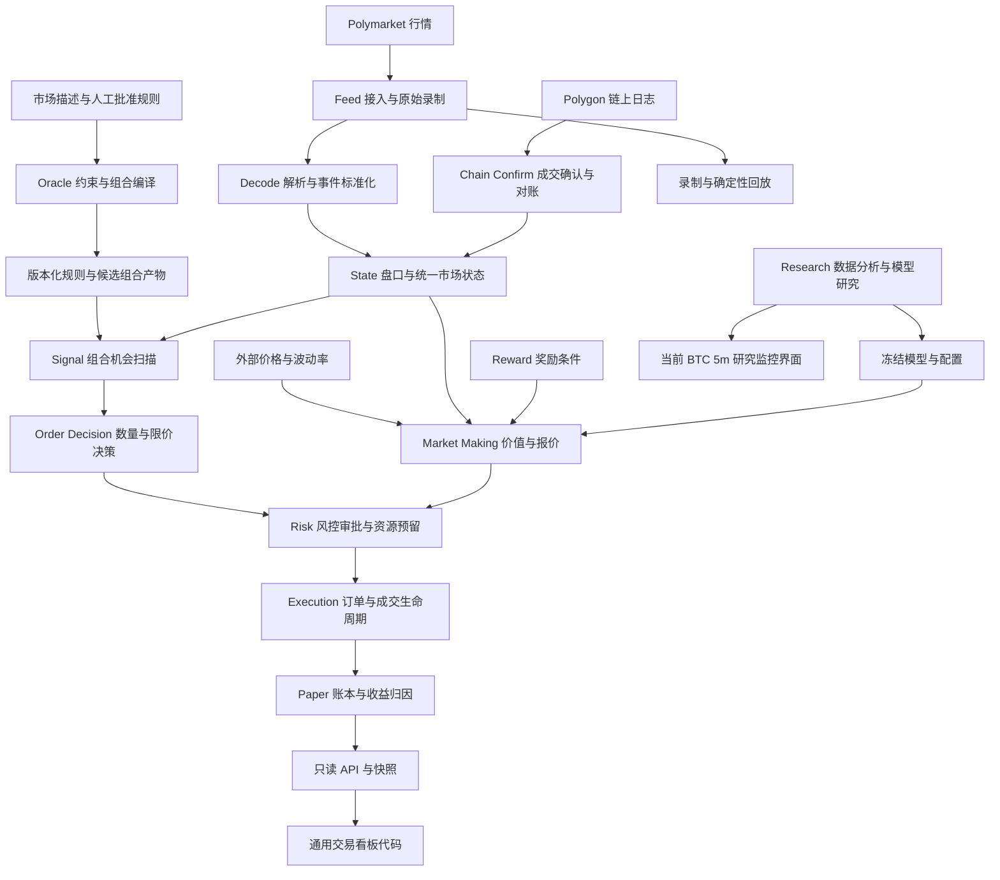

# Polytope 项目结构与功能报告

报告日期：2026-10-31。范围：当前工作区源码、构建定义、配置和项目文档，包括尚未提交的新增与修改文件；基准提交为 `070c12d`。

本报告说明系统结构、各板块职责和实际入口。结论来自静态代码检查，本次未运行交易、联网采集或完整测试；“存在实现”不代表已经完成生产验收。

## 1. 项目定位

Polytope 是一个以 **Polymarket 预测市场为主要对象的交易与研究系统**。核心运行模块采用 C++20，研究分析主要采用 Python，监控界面采用 TypeScript + Vite。

项目有两类主要交易决策：

| 业务方向 | 主要问题 | 对应板块 |
|---|---|---|
| 组合套利 | 多个合约之间存在什么结算约束？组合购买成本是否低于保守收益？ | `oracle/`、`engine/signal/`、`engine/order_decision/` |
| 做市与外部价值驱动报价 | 合约合理价格是多少？如何结合库存、延迟、到期和奖励持续报价？ | `engine/strategy/market_making/`、`engine/reward/` |

两者共享行情状态、风控、执行、回放与记账能力。研究系统负责采集数据、检验假设和产生模型或配置，再通过明确接口交给运行模块。

## 2. 系统关系图

以下为逻辑关系，不表示所有模块都由同一个进程默认启动。



## 3. 顶层目录总览

| 目录或文件 | 功能与作用 | 当前形态 |
|---|---|---|
| `engine/` | 行情、状态、策略、风险、执行和纸面记账的运行代码 | C++ 核心；部分基础设施仍是骨架 |
| `oracle/` | 将市场结算规则编译为约束、可行状态和候选组合 | 独立离线模块，有工具和测试 |
| `replay/` | 策略历史事件回放 | BTC 15m 回放已有实现，其他若干子目录预留 |
| `research/` | 数据采集、定价研究、交易规则审计、回测与图表 | 多组 Python 研究脚本及研究产物 |
| `apps/paper_backend/` | 只读 HTTP API、SSE 与快照服务 | C++ 后端；独立可执行程序 |
| `frontend/dashboard/` | 展示策略结果和运行指标 | 当前入口为 BTC 5m 策略监控；保留通用看板组件 |
| `config/` | 行情、市场、风险、运行、链上确认及产品策略配置 | YAML 与 JSON；是否加载由具体入口决定 |
| `tools/` | 工作流运行器、检查器、回放器和性能测量工具 | 很多完整流程实际在这里组装 |
| `scripts/` | 针对 SOL、宏观策略等场景的启动与复分析脚本 | 带有具体实验条件的操作脚本 |
| `tests/` | 单元、集成、回放、模糊、性能和研究脚本测试 | 含固定输入样本 `fixtures/` |
| `docs/` | 模块设计、接口约定、验证记录与研究说明 | 本报告及各专题文档 |
| `runs/`、`research/runs/` | 保存不同实验的输入、结果、审计和报告 | 运行产物，不是统一数据库 |
| `logs/` | 行情及运行日志 | 用于排查与回放 |
| `build/` | CMake 构建缓存、二进制及测试产物 | 本地生成内容 |
| `secp256k1/` | 椭圆曲线密码学库源码 | 与签名研究有关；目录存在不等于所有交易目标都依赖它 |
| `.local/` | 本地辅助文件 | 不属于交易业务模块 |
| `CMakeLists.txt` | 注册 C++ 模块、运行工具、测试和构建选项 | 项目构建入口 |
| `README.md` | 项目概览和主要文档索引 | 快速导航 |

## 4. 核心运行模块

### 4.1 Feed：外部行情接入

位置：[`engine/feed/`](../engine/feed/)。

**作用：把外部 WebSocket 数据变成可记录、可检查、可重复播放的原始输入。**

| 子板块 | 主要功能 |
|---|---|
| `source_runtime/` | WebSocket 连接、心跳、连接关闭处理和重连决策 |
| `raw_ingest/` | `RawPacket` 封装；二进制日志读写；长度、版本、CRC 校验 |
| `integrity/` | 数据陈旧检测、一致性检查和恢复控制 |
| `output/` | 事件与健康状态发布、原始日志回放 |
| `decode/`、`state/` | 保留适配和早期实现；独立 Decode、State 模块也已存在 |

主要入口是 `RealtimeFeedEngine`。原始日志使同一批输入能够离线复现，支持后续状态与决策审计。

### 4.2 Decode：协议解析与统一事件

位置：[`engine/decode/`](../engine/decode/)。

**作用：隔离交易所消息格式，让下游模块消费统一事件。**

流程为 `DecodeInputView → codec → JSON → venue parser → normalizer → publisher`。

- `core/`：解析流水线、工作单元、配置及结果。
- `json/`：JSON 分类、字段读取和视图。
- `parser/polymarket/`：盘口快照、价格变化、成交、状态和市场生命周期消息解析。
- `normalize/`：统一价格、数量、时间和方向表示。
- `public/`：对外接口与 `NormalizedEvent` 等共享契约。
- `publish/`、`metrics/`、`replay/`：事件输出、计量与解析结果回放比较。

**实现边界：**`codecs/` 中 Gzip、Lz4、Zstd 的 `.cpp` 当前为空文件，不能据文件名宣称压缩解码已经完整支持。

### 4.3 State：统一市场状态

位置：[`engine/state/`](../engine/state/)。

**作用：把离散事件累积成策略可读取的盘口、结算和数据质量状态。**

| 子板块 | 功能与作用 |
|---|---|
| `book/` | 更新限价订单簿；深度前缀计算支持快速成交成本查询 |
| `core/` | 市场与资产索引、事件适配和过滤、统一状态仓库、全局 bitmask |
| `chain/` | 链上确认成交和结算状态写入 |
| `quality/` | 盘口质量、数据准入及对账状态 |
| `shard/` | 将资产路由到对应的订单簿分片 |
| `snapshot/` | 发布带版本的市场快照，供下游读取 |
| `view/` | 对外提供深度视图，减少下游重复构造数据 |
| `hash/` | 缓存与计算状态哈希，用于确定性比较 |

重要输出包括 `MarketStateView`、`MarketDepthView` 和快照。策略既需要价格，也需要知道价格是否新鲜、盘口是否可用，以及市场是否已经关闭或结算。

### 4.4 Chain Confirm：链上成交确认与对账

位置：[`engine/chain_confirm/`](../engine/chain_confirm/)。

**作用：将行情侧的成交线索与 Polygon 链上的确认记录关联起来。**

包含 WebSocket 日志接入、HTTP 补拉、Ethereum 日志及 `OrderFilled` 解码、待确认线索缓存、确认成交存储和 `FillReconciler` 对账。结果可进入 State 的链上与质量状态。

这与行情盘口分工不同：盘口描述当前可见流动性，链上记录提供已发生交易的确认依据。

### 4.5 Signal：组合套利机会发现

位置：[`engine/signal/`](../engine/signal/)。

**作用：结合 Oracle 的候选组合与当前市场状态，筛出有理论优势的交易机会。**

处理链路：读取产物与快照 → 扫描相关组合 → 检查深度与状态 → 计算费用、滑点及延迟缓冲 → 过滤与排序 → 生成 `OpportunityIntent`。

- `reader/`：加载 Oracle 产物与市场快照，检查一致性和陈旧状态。
- `scan/`：注册组合、跟踪变更资产、扫描受影响候选。
- `pricing/`、`edge/`：买卖方向、VWAP 预检、费用和净优势计算。
- `rank/`：候选筛选与排序。
- `publish/`：意图构造、去重、限流及审计输出。

`OpportunityIntent` 表示发现机会，后续仍需完成数量决策和风险审批。

### 4.6 Order Decision：数量与限价决策

位置：[`engine/order_decision/`](../engine/order_decision/)。

**作用：决定一个机会应交易多少，以及每条腿的价格保护范围。**

输入包含机会意图、候选组合、各腿深度、风险政策和当前时间；输出 `OrderDecision`。

- `math/`：成本曲线、优势曲线、前缀 VWAP 与离散优化。
- `sizing/`：枚举候选数量、建立成本曲线、选择组合规模。
- `limits/`：构造限价与价格保护。
- `core/`：通用实现、固定形状优化实现与结果缓存。

它连接“机会看起来有利”和“实际可按什么规模执行”，避免仅看最优价就确定下单量。

### 4.7 Market Making：价值评估与持续报价

位置：[`engine/strategy/market_making/`](../engine/strategy/market_making/)。

**作用：根据合理价值、库存和市场条件，生成报价与撤单意图。**

| 子板块 | 功能与作用 |
|---|---|
| `fair/` | 市场隐含价值、外部价格与波动率、数字期权和触碰模型、可交易价值构建 |
| `canonical/` | 将 YES/NO 的价格和敞口映射到共同坐标，支持一致的库存判断 |
| `inventory/` | 动态目标库存计算 |
| `quote/` | 价差、库存偏移、报价数量、价格边界及奖励约束 |
| `refresh/` | 判断保留旧单、撤单重报和 TTL 到期 |
| `state/` | 当前报价簿和报价状态机 |
| `risk/` | 组合触碰风险管理 |
| `research/` | 报价日志、外部 fair 偏差记录和 markout 归因 |
| `core/`、`public/` | 组织报价流程，输出 `QuoteIntent` 与 `CancelQuoteIntent` |

**产品化策略：**

- `products/up_down_5m/`：5 分钟涨跌合约专用 fair 与报价控制。结合距离结算时间、参考价格新鲜度、方向、动态库存上限和撤单窗口进行控制。
- `products/btc15m_lead_lag/`：BTC 15 分钟 Lead–lag 策略。使用冻结模型生成四通道条件价值，维护 CALM / SHIFT / SHOCK / HALT / WAIT 状态，支持连续报价与冲击入场候选。

BTC 15m 默认未提供真实模型时停单；合成测试模型只用于功能验证。详见 [`btc15m_lead_lag.md`](btc15m_lead_lag.md)。

### 4.8 Reward：流动性奖励条件

位置：[`engine/reward/`](../engine/reward/)。

**作用：把奖励资格与条件接入选市场、报价和收益分析。**

`client/` 定义公开奖励配置与私有账户访问；`normalize/` 统一数据；`store/` 保存奖励市场；`features/` 和 `filter/` 构建特征并筛选。报价可依据最小数量和价差等条件调整，风控再检查对应资格。

奖励收益由 Paper 中单独的 `RewardPnLEngine` 处理。私有账户接口与实际奖励到账仍取决于具体实现、认证和运行数据，不能把奖励估计直接等同于已实现交易利润。

### 4.9 Risk：独立审批与资源预留

位置：[`engine/risk/`](../engine/risk/)。

**作用：确认交易或报价符合约束，并为获批行为预留现金、库存或敞口。**

| 子板块 | 功能与作用 |
|---|---|
| `validate/` | 验证意图格式、来源证据与契约 |
| `guards/` | 熔断、过期、重复、频率、市场状态、快照新鲜度、优势、亏损、敞口、库存和部分成交风险检查 |
| `reprice/` | 用当前深度和成本条件复核 VWAP、手续费、滑点及延迟 |
| `ledger/` | 风险、库存、敞口和预留账本，防止重复使用可用额度 |
| `quote/` | 做市报价风控与到期数字合约专用检查 |
| `publish/`、`metrics/` | 审批结果、审计记录和风险指标 |

组合交易输出 `ApprovedIntent`，报价输出 `ApprovedQuote`。执行结果还需要驱动预留释放与账本更新。

### 4.10 Execution：订单计划与成交生命周期

位置：[`engine/execution/`](../engine/execution/)。

**作用：把获批决策转成订单，并管理提交、确认、部分成交、撤单和失败。**

- `plan/`：执行计划、子订单构造和计划校验。
- `core/`：`ExecutionGateway`、流程组织与计划存储。
- `adapter/`：Paper、Sandbox、Live，以及 Maker 专用适配器和模拟成交模型。
- `state/`、`cancel/`：订单与计划状态机、成交跟踪、部分成交政策和撤单管理。
- `synthetic/`：合成完整套组合的执行逻辑。
- `publish/`、`metrics/`：执行报告和统计。

**当前边界：**代码已存在 Live 买卖、Maker 适配及 Polymarket HTTP 传输；`LiveExecutionConfig.enabled` 默认关闭，并要求注入签名与传输能力。旧文档中“Live 仅为 stub”的描述不足以代表当前源码，也不能据适配器存在判断真实资金链路已验收。

### 4.11 Paper：模拟交易账本、PnL 与读模型

位置：[`engine/paper/`](../engine/paper/)。

**作用：把执行事件转换成可核对的账户、持仓和绩效结果。**

- `ledger/`、`portfolio/`：现金、持仓、成交入账和组合敞口。
- `pnl/`：实现与未实现收益、估值、Maker 收益、奖励与不利选择跟踪。
- `metrics/`：收益率、波动、Sharpe、回撤、成交率及转换率等指标。
- `regime/`：汇总数据、流动性、链上、信号、风险和执行状态。
- `read/`：`DashboardReadStore`、快照环与只读模型发布。
- `core/`、`public/`：纸面交易流程和对外账户、成交、快照契约。

Paper 执行适配器负责“模拟如何成交”，Paper 账本负责“成交后如何记账和评价”。

### 4.12 Decision Fastpath：受约束的决策加速

位置：[`engine/decision_fastpath/`](../engine/decision_fastpath/)。

**作用：对固定形状组合减少通用流程开销，并与通用路径比对。**

包含固定买入组合内核、启用条件检查和差异验证。配置提供 Disabled、ShadowCompare、VerifiedPaper、PaperAuthoritative 模式；默认关闭。出现不匹配可禁用快速路径并要求回退。

它复用机会、风险和订单计划契约，是特定场景的优化实现；具体加速收益需要以相应性能工具实测。

### 4.13 Runtime、Memory、Metrics、Common：基础设施

| 位置 | 预期或实际作用 | 实现边界 |
|---|---|---|
| `engine/runtime/` | 运行编排、线程、CPU 亲和性和退出管理 | 检查到的 `.cpp` 为命名空间骨架，不能视为完整调度系统 |
| `engine/memory/` | 环形缓冲、固定对象池、内存对齐等组件 | 有头文件实现；`SlabAllocator.cpp` 当前为骨架 |
| `engine/metrics/` | 通用指标、计数与延迟直方图规划 | 多个 `.cpp` 为骨架；实际指标还分布于各业务模块 |
| `engine/common/` | 公共类型、时间、错误码和固定点/VWAP/风险数学 | 供多个模块共享的基础契约与计算 |

## 5. Oracle：离线规则与组合编译

位置：[`oracle/`](../oracle/)。这里的 Oracle 主要指**结算逻辑与可行状态模型**；做市模块中的 `SpotOracle` 则是外部价格接口，两者职责不同。

处理链路：

```text
市场描述 → 规则草稿 → 人工批准 Rulebook → 约束编译
        → 连通分量划分 → 枚举/语义可行状态查询
        → Payoff 与候选组合 → 带 Manifest/Checksum 的产物
```

| 子板块 | 功能与作用 |
|---|---|
| `ingestion/` | 加载固定样本或 Gamma 市场元数据，构造市场集合 |
| `llm/` | Stub 与可选 OpenRouter 规则草稿提取；默认无需 LLM |
| `rules/` | RuleDraft、人工编辑批准、规则校验、Rulebook 与审计 |
| `compiler/` | 布尔约束、约束图、连通分量划分与编译 |
| `enumerate/` | 小规模枚举，以及 ExactlyOne / AtMostOne 等语义查询 |
| `payoff/` | 构造不同结算状态下的收益向量与矩阵 |
| `bundles/` | 生成并校验候选组合及其保守结算收益 |
| `artifact/` | 导出、载入、版本与校验和管理 |
| `public/`、`tools/` | 对外类型及采集、提取、工作流验证入口 |

LLM 输出需经人工批准才能进入编译；运行时读取冻结产物，不在交易决策中临时调用 LLM 或求解器。`artifact_exporter/`、`bundle_generator/`、`constraint_compiler/` 等旧规划目录只有 `.gitkeep`，实际实现应以上表为准。

## 6. 回放与研究

### 6.1 Replay：有两类回放需求

1. **行情/状态确定性回放**：主要实现分布在 `engine/feed/output/ReplayRunner`、`engine/decode/replay/` 与 `tools/replay_raw_log.cpp`，检验相同输入能否产生相同事件和状态。
2. **策略成交回放**：`replay/market_making/LeadLagReplay` 模拟 BTC 15m 报价、显示队列、提交/撤单/通知延迟、资源预留、markout 和结算。

顶层 `replay/recorder/`、`player/`、`deterministic_runner/`、`report_generator/` 当前仅为预留目录。不能因为这些目录存在就判断有独立完整实现。

策略回放的公共成交与队列模型是反事实近似，无法还原完整自有订单 FIFO 或自身市场冲击。可复现性与真实可成交性需要分别判断。

### 6.2 Research：数据与策略假设验证

位置：[`research/`](../research/)。

| 研究板块 | 代表文件 | 功能与作用 |
|---|---|---|
| 市场筛选 | `polymarket_event_research.py`、`crypto_market_selector.py` | 筛选事件、加密市场和适合研究/做市的对象 |
| 外部 fair 研究 | `fair_value_pipeline.py`、`poly_btc_above_fair_research.py` | 比较外部理论价值与预测市场报价 |
| 外部数据采集 | `ws_data_pipeline.py` | 记录公共市场消息、来源时间和接收时间；部分私有源为占位接口 |
| L2 优势发现 | `edge_discovery/` | 市场集合构建、盘口抓取、二元盘口标准化、质量过滤、波动率与候选标签 |
| BTC 5m 数据研究 | `btc5m_full_market_capture.py`、`btc5m_oracle_lag_study.py`、`btc5m_taker_edge_research.py` | 完整合约采集、参考价格延迟与主动成交机会研究 |
| BTC 5m 版本审计 | `analyze_sigma65_*.py`、`finalize_partial_btc5m_capture.py`、`watch_btc5m_partial_audit.py` | 比较规则版本、交易明细、部分采集窗口与成本压力 |
| PMXT BTC 15m 回测 | `pmxt_btc15m_backtest.py` | 历史数据覆盖检查、适配、训练与回放比较 |
| 冲击与成交条件诊断 | `pmxt_shock_*.py`、`pmxt_fill_conditional.py`、`build_pmxt_fill_observer.py` | 冲击入场、延迟压力、成交条件和标签诊断 |
| 研究审计与绘图 | `pmxt_replay_audit.py`、`report_pmxt_replay_audit.py`、`plot_pmxt_*.py` | 复核回放假设并生成报告和图表 |

`notebooks/`、`optimizer/`、`experiments/`、`validation/` 当前为预留目录，主要工作在直接可运行的脚本中。

解释研究结果时应同时阅读最新审计说明。例如 `pmxt_shock_fixed_tests.md` 顶部已将使用过的四五月窗口标记为 development，旧目录中的 confirmation 名称不能作为独立确认依据；详见 [`pmxt_reentry_audit.md`](pmxt_reentry_audit.md)。

## 7. 后端与前端：两条展示路径

### 7.1 通用纸面交易看板链路

`Paper/DashboardSnapshot → paper_backend → GET API / SSE → 通用看板组件`。

`apps/paper_backend/` 提供健康、快照、成交、PnL、绩效、状态和延迟接口，并拒绝写入方法。独立 `main.cpp` 从 dashboard 文件读取数据提供服务；库代码还提供基于 `DashboardReadStore` 的路由模型。

**部分 API 尚为占位：**`/api/v1/markets`、`/api/v1/intents` 和 `/api/v1/risk-decisions` 当前返回空数组，不能把路由存在当作明细数据已接通。

`frontend/dashboard/src/pages/` 保留九个页面定义：

| 页面 | 功能 |
|---|---|
| Overview | 总体账户与流程状态 |
| Markets | 市场信息展示 |
| Signals | 机会与信号展示 |
| Risk | 风控审批展示 |
| Execution | 订单执行展示 |
| Market Maker | 做市报价与库存展示 |
| PnL | 收益与账户表现 |
| Regime | 数据和运行状态分类 |
| Latency | 各阶段延迟 |

另有 `api/`、`state/`、`components/`、`charts/`，分别负责数据契约与读取、状态管理、通用 UI 和图表。

### 7.2 当前默认界面：BTC 5m Strategy Monitor

当前 `src/main.ts` 直接渲染 BTC 5m 研究监控，**没有使用上面的九页路由作为默认界面**。

- 每 10 秒读取 `/api/btc5m/current`。
- 展示采集进度、策略版本 PnL、V2.2C 成本压力、UP/DOWN 分组、交易明细及小时收益。
- 接口在 `vite.config.ts` 的开发/预览服务器插件中实现，读取本地 `research/runs/` 的 CSV、审计 JSON、结算和元数据文件。
- 数据目录可通过 `BTC5M_RUN_DIR` 指定；缺省路径指向一个具体历史研究目录。

所以当前界面主要呈现研究产物。单独把 `dist/` 放到静态服务器还需要另行提供 `/api/btc5m/current`，因为该接口依赖 Node/Vite 服务端插件。

## 8. 实际运行入口

| 入口或构建目标 | 用途与边界 |
|---|---|
| `trading_engine` / `engine/main.cpp` | 当前直接构造 `RealtimeFeedEngine` 并启动行情；包含硬编码资产 ID。不能据目标名称推断已自动串联完整策略 |
| `fetch_market_universe`、`extract_oracle_rules`、`verify_oracle_workflow` | 市场集合、规则提取和离线产物构建 |
| `verify_signal_workflow`、`verify_order_decision_workflow`、`verify_risk_workflow`、`verify_execution_workflow` | 分阶段检查机会、数量、风控和执行契约 |
| `run_worldcup_feed_to_execution` | 将行情、状态、组合机会、决策、风控、Paper 执行和快照等组装为工作流 |
| `run_market_maker_dashboard_live` | 实时行情驱动的做市观察与指标输出；源码标识为 `read_only_live_market_maker`，其中 live 指行情场景 |
| `run_btc15m_lead_lag_replay` | 冻结模型下的 BTC 15m 延迟回放 |
| `run_market_making_loopback_replay` | 做市链路的本地回环与回放检查 |
| `paper_backend` | 只读快照 HTTP/SSE 服务 |
| 前端 `npm run dev` / `npm run preview` | 当前 BTC 5m 研究监控及其本地读取接口 |
| `scripts/run_*.sh` | 特定实验场景启动；应以脚本实际参数与调用目标判断运行行为 |

`config/runtime.yaml` 虽描述线程、模式和退出参数，但默认 `main.cpp` 未体现完整配置驱动的多阶段启动。配置目录与实际装配入口需要一起阅读。

## 9. 测试、验证与工具

| 板块 | 负责验证什么 |
|---|---|
| `tests/unit/` | 各模块的契约、数学、状态转移、风控规则、报价与账本行为 |
| `tests/integration/` | Feed→Decode→State、Signal→Risk、Oracle 产物往返、执行与 Paper 等交接 |
| `tests/replay/` | 解析事件序列与重复回放的确定性 |
| `tests/fuzz/` | 解析器对异常输入的处理 |
| `tests/performance/` | JSON 和 Decode 等环节的性能测量 |
| `tests/research/` | PMXT 适配、冲击诊断、成交条件和回放审计逻辑 |
| `tests/fixtures/` | 固定原始行情、规则、快照、策略模型及预期输入 |
| `tools/verify_*`、`inspect_*`、`validate_*` | 工作流验证、数据检查和错误定位 |
| `tools/bench_*`、`probe_*`、`profile_*` | 行情解析、状态、决策、执行计划和签名延迟测量 |

C++ 由 CMake/CTest 组织；前端 `npm run build` 执行 TypeScript 检查和 Vite 打包。当前测试与工具的存在说明仓库具备验证入口，本报告未复跑，因此不报告通过率、当前延迟或收益数字。

## 10. 阅读与维护重点

1. **先找运行入口，再看模块。** 许多工作流由 `tools/` 组装，默认 `main.cpp` 的覆盖范围较小。
2. **区分两条策略线。** 组合套利依赖规则与保守结算收益；做市依赖 fair、库存和订单维护；两者进入各自的风控与执行契约。
3. **区分模型 Oracle 与价格 Oracle。** `oracle/` 处理结算逻辑，`SpotOracle` 提供外部参考价格。
4. **区分已实现、兼容层和预留目录。** `feed/decode`、多处同名 State/Signal/Risk 文件需要结合命名空间、头文件路径和 CMake 判断，不能仅凭名称判定主实现。
5. **以当前源码和最新审计为准。** 旧模块文档、历史实验路径名称与当前行为可能存在差异，尤其是 Live 执行、前端入口和研究窗口分类。
6. **保持可追溯交接。** 原始日志、标准化事件、版本化快照、Oracle 校验和、冻结模型哈希、审批与成交记录共同支撑结果复核。

## 11. 进一步阅读

- 项目入口：[`README.md`](../README.md)
- 行情与解析：[`engine/feed/README.md`](../engine/feed/README.md)、[`engine/decode/README.md`](../engine/decode/README.md)、[`decode_contract.md`](decode_contract.md)
- 市场状态：[`engine/state/README.md`](../engine/state/README.md)、[`market_state_workflow_v1.md`](market_state_workflow_v1.md)
- 规则与组合：[`oracle/README.md`](../oracle/README.md)、[`oracle_layer.md`](oracle_layer.md)
- 决策与风险：[`signal_engine.md`](signal_engine.md)、[`risk_engine.md`](risk_engine.md)
- 做市与执行：[`market_making.md`](market_making.md)、[`execution_gateway.md`](execution_gateway.md)
- 纸面交易与展示：[`paper_trading_framework.md`](paper_trading_framework.md)
- 产品与研究：[`btc15m_lead_lag.md`](btc15m_lead_lag.md)、[`research/README.md`](../research/README.md)、[`pmxt_btc15m_backtest.md`](pmxt_btc15m_backtest.md)、[`pmxt_reentry_audit.md`](pmxt_reentry_audit.md)
