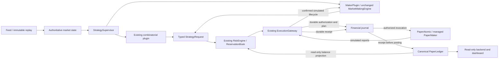

# Unified maker OMS V0.2.1

Scope: native C++20 PAPER/SHADOW/REPLAY, never LIVE. Actual results are in `runs/runtime_v0_2_1_20261106/final_report.md`; this document describes implementation, not production certification.

## Before and after

Legacy maker tools call MarketMakingEngine → QuoteRiskEvaluator → PaperMakerExecutionAdapter/ActivePaperQuoteBook and maintain runner-local PaperLedger. They remain isolated research/regression programs, not production owners of the unified account. Their algorithms and artifacts were retained unchanged.

The central path is now Session → immutable venue-qualified state views → StrategySupervisor → StrategyPlugin::on_immutable_frame → existing CombinatorialPlugin / MakerPlugin → discriminated StrategyRequest → existing RiskEngine/ReservationBook → existing ExecutionGateway → PaperAtomic / stateless managed PaperMakerExecutionAdapter simulation → durable receipt → existing PaperTradingEngine/PaperLedger → derived telemetry.

MakerPlugin delegates fair, inventory, size, spread, refresh and quote calculations to the existing MarketMakingEngine. It owns desired quote state only. It has no adapter, ledger or reservation reference. OMS-confirmed fills/terminal events reset desired state as legacy maker-runner feedback does. Actual outstanding orders stay in ExecutionGateway regardless of desired changes.

## Ownership

| Authority | Owner |
|---|---|
| Books | Existing sequence-aware store through VenueMarketFacade; recorded-v1 store only in its legacy profile |
| Desired quotes | MarketMakingEngine inside MakerPlugin |
| Actual maker orders / stable client identity | ExecutionGateway::maker_orders_ |
| Shared reservations | Existing RiskEngine and ReservationBook |
| Cash and positions | Existing PaperLedger / PositionLedger |
| Simulated own receipt identity | Gateway receipt registry plus canonical ledger economic fingerprint |
| PnL / attribution / operations | Derived from canonical postings and current marks |

The managed adapter evaluates immutable OMS projections and never populates its legacy ActivePaperQuoteBook. There is no second mutable order owner on this path. Existing legacy adapter APIs remain for research compatibility.

## Durability and lifecycle

MAKER_RISK_RESERVED → MAKER_ORDER_PREPARED (full identity/parameters/authorization) → MAKER_SUBMIT_STARTED → MAKER_ADAPTER_INVOKED → scheduled simulated ACK / OPEN / partial FILL / CANCEL_PENDING / terminal evidence. All maker economic events force raw-input durability and financial fsync. Receipt persistence precedes ledger changes. Quotes are independently outstanding; public trades are only evidence for a scenario fill, never own exchange receipts.

Unknown submission or cancel acknowledgement retains resources and freezes new risk. A crash before submit has no phantom order. Possible submission restores RECOVERY_BLOCKED without retry; durable known fills restore once. Complete prefixes replay under frozen executable/config/input/model identities. Torn tails remain untouched and rejected.

SHADOW records authorized would-submit plans and releases paper-only evaluation reservations without calling the adapter. A test-only forced invocation reaches the real gateway hook and is rejected. No live adapter is constructed. Single-wallet Polymarket paper assets are supported; Kalshi remains a data probe, not a second funded trading wallet.

## Completed validation evidence

Final RC3 executable SHA-256: c5f5019185c88e69e46b9e7430e3440d8494f4a2610582f8a40145ef2ffa9833. Its fresh source rebuild matched byte-for-byte. Full regression: 1,034 passed, 1 known existing failed, 5 disabled. All 53 new native-executable maker scenarios passed, including cancel rejection before first ACK freezing the whole portfolio. Ten final runs recovered with identical decision/account digests and no extra fill postings. Earlier candidates remain retained. Readiness remains PARTIALLY_VERIFIED; see the final A-J report.
